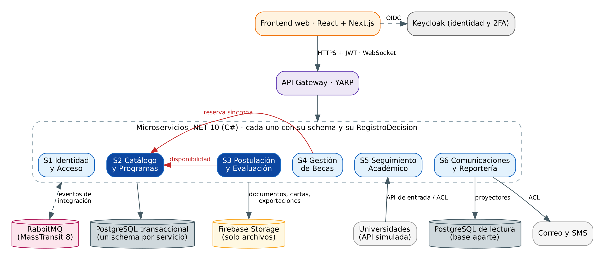

# Arquitectura de ASCENSO

> Versión vigente: **Borrador v0.1** (4-nov-2026), pendiente de revisión del equipo y del profesor. Documento original: [`ASCENSO_Propuesta_Arquitectura_v0.1.pdf`](ASCENSO_Propuesta_Arquitectura_v0.1.pdf). Correcciones previstas para la v0.2: [`../cambios/cambios_DDD_v3.3_y_ADR_v0.2.md`](../cambios/cambios_DDD_v3.3_y_ADR_v0.2.md).

| Documento | Contenido |
|---|---|
| [Decisiones (ADR-01 a ADR-24)](adr/README.md) | Un archivo por decisión |
| [Cambios respecto del borrador anterior](cambios-borrador-anterior.md) | Sección 4 del documento |
| [Cambios que requiere el DDD](cambios-requeridos-ddd.md) | Sección 5 del documento |
| [Pendientes y preguntas para el profesor](pendientes-y-preguntas.md) | Sección 6 del documento |
| [Hoja de revisión](hoja-de-revision.md) | Sección 7: aprobación de cada ADR |

## ¿Está completa la definición?

Con las tres decisiones cerradas por el equipo (servicios separados para Programas y Becas, persistencia solo en PostgreSQL y Firebase, y una propuesta para las máquinas de estado), este documento cubre todos los parámetros necesarios para definir la arquitectura: estilo y partición, estructura interna, datos, seguridad, trazabilidad, mensajería, procesos programados, tiempo real, concurrencia, integración, migración, calidad y versiones. Lo que queda abierto (sección 6) son reglas de negocio que el cliente aún no responde y dos pruebas técnicas; ninguno cambia la forma de la arquitectura, solo detalles dentro de un servicio.

## 1. Resumen ejecutivo

ASCENSO se construye como un conjunto de **seis microservicios en .NET 10**, alineados con los Bounded Contexts del DDD v3.2, detrás de un **API Gateway (YARP)** y consumidos por un frontend en **React + Next.js**. Cada servicio sigue **Clean Architecture con DDD** (cuatro capas), guarda sus datos en su propio schema de **PostgreSQL** con EF Core y deja los archivos en **Firebase Storage**. Los servicios se comunican sobre todo por **eventos de integración** (MassTransit 8 sobre RabbitMQ, con Outbox), y solo por llamadas síncronas donde una regla de negocio necesita respuesta inmediata, como reservar presupuesto antes de emitir una oferta.

Los ciclos de vida de la Postulación y de la Beca se controlan con **máquinas de estado explícitas**. Toda decisión queda en un **RegistroDecision inmutable** escrito en la misma transacción que el cambio. La identidad y la verificación en dos pasos se delegan a **Keycloak**; el código de un solo uso (OTP) es un servicio propio. Los reportes y el panel leen una **base de lectura separada** en PostgreSQL que solo escriben los proyectores de eventos.

### Tabla de decisiones

| ADR | Decisión | Estado |
|---|---|---|
| [ADR-01](adr/ADR-01-estilo-arquitectonico.md) | Estilo arquitectónico | Obligatoria |
| [ADR-02](adr/ADR-02-particion-en-seis-microservicios-y-api-gateway.md) | Partición en seis microservicios y API Gateway | Propuesta |
| [ADR-03](adr/ADR-03-programas-y-becas-separados-reserva-sincrona-con.md) | Programas y Becas separados: reserva síncrona con compensación | Decidida / Propuesta |
| [ADR-04](adr/ADR-04-estructura-interna-de-cada-servicio-clean-architecture-ddd.md) | Estructura interna de cada servicio (Clean Architecture + DDD) | Propuesta |
| [ADR-05](adr/ADR-05-persistencia-transaccional-postgresql-ef-core.md) | Persistencia transaccional: PostgreSQL + EF Core | Obligatoria / Propuesta |
| [ADR-06](adr/ADR-06-archivos-firebase-storage-solo-para-binarios.md) | Archivos: Firebase Storage solo para binarios | Obligatoria |
| [ADR-07](adr/ADR-07-cqrs-base-de-lectura-en-postgresql-alimentada-por-eventos.md) | CQRS: base de lectura en PostgreSQL, alimentada por eventos | Decidida / Propuesta |
| [ADR-08](adr/ADR-08-maquinas-de-estado-stateless-en-beca-y-postulacion.md) | Máquinas de estado: Stateless en Beca y Postulación | Propuesta |
| [ADR-09](adr/ADR-09-identidad-y-verificacion-en-dos-pasos-keycloak.md) | Identidad y verificación en dos pasos: Keycloak | Propuesta / Pendiente |
| [ADR-10](adr/ADR-10-codigo-de-un-solo-uso-otp-para-operaciones-sensibles.md) | Código de un solo uso (OTP) para operaciones sensibles | Propuesta |
| [ADR-11](adr/ADR-11-autorizacion-fina-por-recurso-y-por-datos.md) | Autorización fina por recurso y por datos | Propuesta |
| [ADR-12](adr/ADR-12-trazabilidad-registrodecision-inmutable.md) | Trazabilidad: RegistroDecision inmutable | Obligatoria / Propuesta |
| [ADR-13](adr/ADR-13-eventos-y-mensajeria-masstransit-8-rabbitmq-con-outbox.md) | Eventos y mensajería: MassTransit 8 + RabbitMQ con Outbox | Propuesta |
| [ADR-14](adr/ADR-14-tareas-programadas-hangfire.md) | Tareas programadas: Hangfire | Propuesta |
| [ADR-15](adr/ADR-15-tiempo-real-signalr-como-unico-canal-de-push.md) | Tiempo real: SignalR como único canal de push | Propuesta |
| [ADR-16](adr/ADR-16-concurrencia-optimista-en-todas-las-raices-de-agregado.md) | Concurrencia optimista en todas las raíces de agregado | Propuesta |
| [ADR-17](adr/ADR-17-reloj-unico-y-fechas-limite-en-utc-4.md) | Reloj único y fechas límite en UTC-4 | Propuesta |
| [ADR-18](adr/ADR-18-proteccion-de-datos-personales.md) | Protección de datos personales | Propuesta |
| [ADR-19](adr/ADR-19-integracion-con-universidades-capa-anticorrupcion.md) | Integración con universidades (capa anticorrupción) | Propuesta |
| [ADR-20](adr/ADR-20-notificaciones-por-canal-correo-y-sms.md) | Notificaciones por canal (correo y SMS) | Propuesta |
| [ADR-21](adr/ADR-21-migracion-de-datos-historicos-etl.md) | Migración de datos históricos (ETL) | Obligatoria / Propuesta |
| [ADR-22](adr/ADR-22-indices-de-base-de-datos.md) | Índices de base de datos | Propuesta |
| [ADR-23](adr/ADR-23-calidad-y-gobierno-openspec-pruebas-y-ci.md) | Calidad y gobierno: OpenSpec, pruebas y CI | Obligatoria / Propuesta |
| [ADR-24](adr/ADR-24-versiones-y-licencias.md) | Versiones y licencias | Propuesta |

## 2. Vista general de la arquitectura

El diagrama muestra los contenedores del sistema. Las flechas rojas son las únicas llamadas síncronas entre servicios; el resto de la comunicación entre servicios es por eventos. Los dos servicios en azul oscuro contienen los subdominios Core del DDD (Programas y Fondos; Evaluación y Selección).

*Figura 1. Vista de contenedores (todo se levanta con docker-compose; Firebase se usa con su emulador en desarrollo).*

### Principios que ordenan todas las decisiones

- **El negocio manda:** las reglas viven en el dominio; los handlers solo orquestan (lámina 46 de la Clase 8).
- **Una transacción, un agregado**; lo demás, con eventos (lámina 34). La única excepción es la aceptación de una oferta (D-3 del DDD).
- **Cada servicio es dueño de sus datos:** nadie lee ni escribe el schema de otro servicio.
- **Nunca se supera el presupuesto:** lo que reduce el disponible se verifica de forma síncrona; lo que lo aumenta llega por eventos (D-1).
- **Nada se edita en silencio:** toda decisión deja registro inmutable con quién, cuándo y por qué (RF-35).
- **Las fallas son seguras:** si un servicio crítico no responde, la operación se rechaza en lugar de quedar a medias.

## 3.1 Estructura: estilo, servicios, capas y datos
