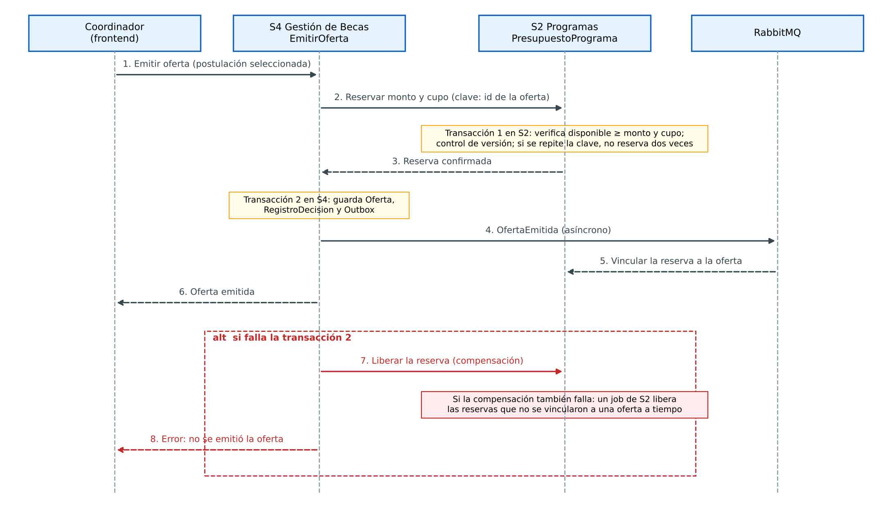

# ADR-03 · Programas y Becas separados: reserva síncrona con compensación

> Fuente: *Propuesta de Arquitectura de Software (ADR) · Borrador v0.1*, 4-nov-2026. Documento original en [`../ASCENSO_Propuesta_Arquitectura_v0.1.pdf`](../ASCENSO_Propuesta_Arquitectura_v0.1.pdf). Índice de decisiones en [`README.md`](README.md).

**Estado:** Decidida / Propuesta

## Contexto

El equipo decidió separar Programas y Fondos (S2) de Gestión de Becas (S4). En el DDD son un Partnership: Becas reserva en PresupuestoPrograma y Fondos reacciona a los eventos de Becas. La regla 8 prohíbe superar el presupuesto, y el Anexo A de HU-12.1 pide un único servicio transaccional que verifique y libere, consumido por varias áreas.

## Decisión (protocolo D-1 entre servicios)

- **Lo que reduce el disponible** (reservar una oferta o una renovación) se pide a S2 de forma síncrona, **antes** de cambiar el agregado en S4. La solicitud lleva como clave el identificador de la oferta o de la solicitud de renovación: si se repite, S2 no reserva dos veces.
- **Lo que aumenta el disponible o solo lo reclasifica** (confirmar el otorgamiento; liberar por rechazo, expiración o revocación; registrar un pago) llega a S2 por eventos.
- **Compensación:** si S4 no logra guardar después de reservar, pide a S2 liberar la reserva.
- **Red de seguridad:** S2 vincula la reserva cuando recibe OfertaEmitida, y un proceso programado libera las reservas que no se vinculan dentro de un plazo.
- **Falla segura:** si S2 no responde, la oferta no se emite.

## Flujo

*Figura 2. Emisión de una oferta entre S4 y S2, con compensación.*

## Consecuencias

- Tras una revocación, la liberación de presupuesto y cupo llega unos segundos después, por evento. Mientras tanto el disponible se ve menor de lo real, nunca mayor: es seguro. Esto cambia el Anexo A de HU-22.1 y HU-22.2, como ya señalaba el DDD v3.2 (sección 20.2).
- Queda por fijar el plazo de vinculación de una reserva (sección 6).

## Fuentes

DDD v3.2, D-1, sección 3.1 y flujos 16.4a y 16.4d; regla transversal 8; Anexo A de HU-12.1, HU-12.2 y HU-15.1.
