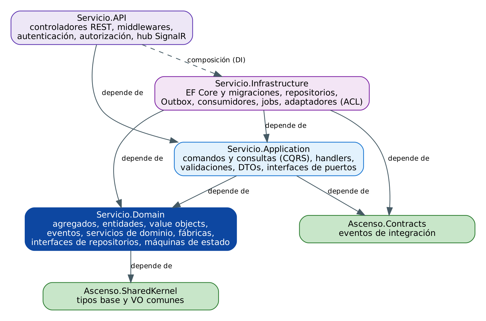

# ADR-04 · Estructura interna de cada servicio (Clean Architecture + DDD)

> Fuente: *Propuesta de Arquitectura de Software (ADR) · Borrador v0.1*, 4-nov-2026. Documento original en [`../ASCENSO_Propuesta_Arquitectura_v0.1.pdf`](../ASCENSO_Propuesta_Arquitectura_v0.1.pdf). Índice de decisiones en [`README.md`](README.md).

**Estado:** Propuesta

## Contexto

Cinco personas y sus asistentes de IA deben crear cada pieza en el mismo lugar. El dominio no puede depender de la base de datos (lámina 42, DIP).

## Decisión

*Figura 3. Proyectos de un servicio y su dirección de dependencias.*

- **Domain:** agregados, entidades, value objects, eventos de dominio, servicios de dominio, fábricas, interfaces de repositorios y máquinas de estado. No conoce EF Core, MassTransit, ASP.NET Core ni Firebase.
- **Application:** un comando o una consulta por operación, trazable a su HU (reemplaza «un caso de uso por HU», porque varias HU tienen más de una operación, como la HU-27.1). Los handlers cargan, invocan, guardan y publican, sin reglas de negocio. La validación de forma de los datos se hace con FluentValidation; las reglas de negocio quedan en el dominio. Un mediador en proceso (MediatR) despacha comandos, consultas y eventos de dominio, con comportamientos comunes de validación, transacción y registro.
- **Infrastructure:** EF Core y sus migraciones, repositorios (uno por raíz de agregado, D-12), Outbox, consumidores de mensajes, procesos programados y adaptadores externos (capas anticorrupción).
- **API:** controladores REST, autenticación, autorización y configuración.
- **Ascenso.SharedKernel:** tipos base y value objects comunes (sección 5 del DDD). Es el Shared Kernel del Context Map: cualquier cambio se acuerda entre todos.
- **Ascenso.Contracts:** eventos de integración entre servicios (el Published Language), versionados.
- **Pruebas:** un proyecto de pruebas unitarias para Domain y Application y uno de integración por servicio (ADR-23).

## Alternativas descartadas

- Arquitectura clásica en tres capas: la lógica de negocio terminaría dependiendo de la capa de datos.

## Fuentes

DDD v3.2, D-11 y D-12; Clase 8, láminas 39 y 42 a 46; clase del 28-sep (capas y SRP).
