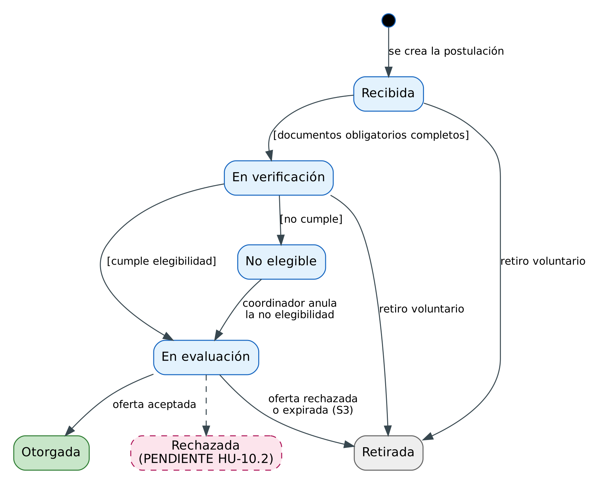
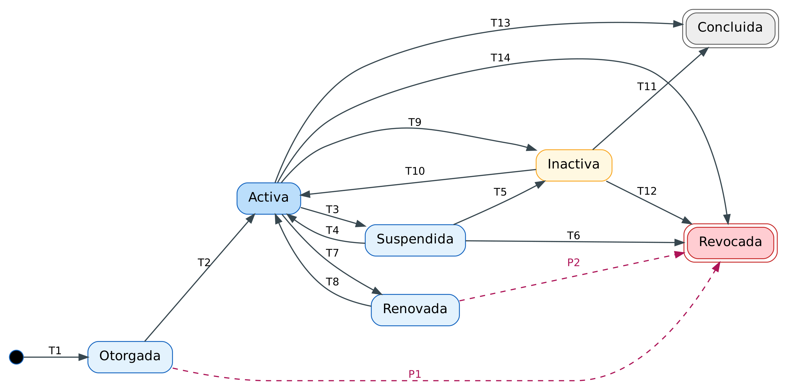

# ADR-08 · Máquinas de estado: Stateless en Beca y Postulación

> Fuente: *Propuesta de Arquitectura de Software (ADR) · Borrador v0.1*, 4-nov-2026. Documento original en [`../ASCENSO_Propuesta_Arquitectura_v0.1.pdf`](../ASCENSO_Propuesta_Arquitectura_v0.1.pdf). Índice de decisiones en [`README.md`](README.md).

**Estado:** Propuesta

## Contexto

Es obligatorio usar máquinas de estado. En la clase del 21-sep el profesor pidió controlar las transiciones permitidas con una máquina y no con «if/else»; en la del 28-sep, integrar una librería si aplica; en la del 15-oct, que para cambios de estado transaccionales basta modelar la máquina en código, sin colas. El DDD 16.3 reserva el patrón State para Beca y Postulación y usa un enum en el resto. Las HU fijan las transiciones con sus condiciones.

## Opciones evaluadas

| Criterio | Stateless en el agregado | Patrón State escrito a mano | Enum con tabla validada | Saga de MassTransit |
|---|---|---|---|---|
| Máquina explícita (obligatoria) | Sí | Sí | Sí | Sí |
| Condiciones en las transiciones (por ejemplo, «documentos completos») | Declarativas | En cada clase de estado | Como «if» dentro de los métodos | Declarativas |
| Evita lógica condicional dispersa (clase del 21-sep) | Sí | Sí | Parcialmente | Sí |
| Persistencia con EF Core | Simple: se guarda el estado enumerado | Hay que reconstruir el objeto de estado | Simple | Tablas y persistencia propias |
| Esfuerzo para Beca (7 estados, unas 15 operaciones) | Bajo | Alto: muchas clases repetitivas | Bajo | Alto |
| Diagrama exportable para documentar | Sí | No | No | Parcial |
| Coherencia con DDD 16.3 y la clase del 15-oct | Alta | Alta | Media | Baja: es para procesos entre servicios |

## Decisión

- **Postulación y Beca** usan la librería **Stateless** dentro del agregado. El estado se guarda como un valor enumerado; la máquina se reconstruye en memoria al cargar el agregado y no se persiste. La configuración del grafo vive en una pieza propia del dominio (SRP), y cada transición registra su evento de dominio.
- **Oferta, Desembolso, Pago, Consulta, PeriodoAcademico, DocumentoCargado,** **AsignacionEvaluador, Evaluacion, SolicitudRenovacion, SolicitudPausa y Usuario** usan un enum con tabla de transiciones validada en el agregado (DDD 16.3: más sería sobreingeniería).

## Alternativas descartadas

- Saga de MassTransit: orquesta procesos distribuidos entre servicios, no el ciclo de vida de una entidad, y agrega broker y persistencia donde basta la memoria (eliminada del borrador anterior).
- Patrón State escrito a mano: válido, pero cerca de siete clases por máquina con métodos repetidos. Queda como alternativa si el profesor prefiere ver el patrón escrito; el cambio afecta solo a dos agregados.

## Transiciones de la Postulación

*Figura 4. Postulación. La lista de espera es una marca dentro de «En evaluación», no un estado (S2). «Retirada» guarda su motivo (voluntario, oferta rechazada u oferta expirada).*

## Transiciones de la Beca

*Figura 5. Beca. Doble borde: estados finales. Las transiciones se detallan en la tabla siguiente.*

| Id | Desde | Hacia | Disparador y condición | Fuente |
|---|---|---|---|---|
| T1 | (inicio) | Otorgada | Se acepta la oferta; la beca nace con su primer tramo. | HU-16.1, C1 |
| T2 | Otorgada | Activa | Se firma el compromiso o, si el programa no lo exige, al aceptarse la oferta. | S10, HU-17.2 |
| T3 | Activa | Suspendida | Suspensión con motivo y fecha de revisión (o indefinida), o pausa aprobada. | S5, HU-21.1, HU-27.1 |
| T4 | Suspendida | Activa | Reanudación, o reactivación tras una pausa con el estatus académico verificado. | HU-21.2, HU-27.2 |
| T5 | Suspendida | Inactiva | La pausa vence sin que la beca se reactive (proceso programado). | C3, R18b |
| T6 | Suspendida | Revocada | Revocación con motivo y OTP. | HU-22.1 |
| T7 | Activa | Renovada | Renovación aprobada (con el presupuesto ya reservado). | HU-26.2 |
| T8 | Renovada | Activa | Inicio del nuevo periodo (al marcarse el periodo actual). | S4, HU-38.2 |
| T9 | Activa | Inactiva | Renovación rechazada o no solicitada a tiempo. | C3, R18a, HU-26.2 |
| T10 | Inactiva | Activa | El becario sube los datos que faltan y el coordinador decide. | R28 |
| T11 | Inactiva | Concluida | El becario sube los datos que faltan y el coordinador decide. | R28 |
| T12 | Inactiva | Revocada | Revocación con motivo y OTP. | R29 |
| T13 | Activa | Concluida | Fin de la beca. | HU Plan B, tabla de estados |
| T14 | Activa | Revocada | Incumplimiento grave (incluye incumplir una condición de permanencia), con OTP. | R19, HU-22.1, HU-25.2 |
| P1 | Otorgada | Revocada | Pendiente: no confirmada por el cliente. | HU-22.1; DDD 20.2 |
| P2 | Renovada | Revocada | Pendiente: no confirmada por el cliente. | HU-22.1; DDD 20.2 |

Cuentan como activas para la regla de no doble beneficio: Otorgada, Activa, Suspendida y Renovada (S6). Una beca Inactiva no recibe dinero en el periodo siguiente, pero conserva su cupo y su presupuesto (R27).

## Consecuencias

- El dominio depende de una librería externa. Se acepta explícitamente porque es lógica pura en memoria, sin acceso a datos ni a la red.
- Cada transición se prueba de forma individual, y el grafo exportado se incorpora a la documentación de OpenSpec.
- Corrige el borrador anterior: faltaban el estado Inactiva y sus cinco transiciones (C3), Renovada a Activa y Suspendida a Revocada; No elegible sale de «En verificación», no de «En evaluación»; Retirada tiene tres orígenes.

## Fuentes

HU Plan B, tabla de estados, C3, S2 a S6, R18, R19, R27 a R29; DDD v3.2, secciones 15.1, 15.2 y 16.3; clases del 21-sep, 28-sep y 15-oct.
