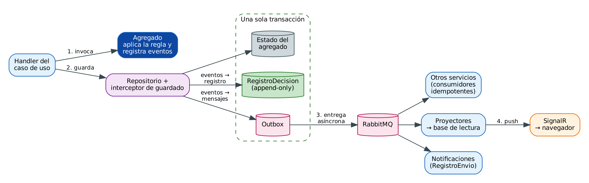

# ADR-12 · Trazabilidad: RegistroDecision inmutable

> Fuente: *Propuesta de Arquitectura de Software (ADR) · Borrador v0.1*, 4-nov-2026. Documento original en [`../ASCENSO_Propuesta_Arquitectura_v0.1.pdf`](../ASCENSO_Propuesta_Arquitectura_v0.1.pdf). Índice de decisiones en [`README.md`](README.md).

**Estado:** Obligatoria / Propuesta

## Contexto

La lámina obligatoria pide una arquitectura «enfocada en auditoría». La RF-35 y la HU-35.1 exigen registrar quién, cuándo y por qué de cada decisión, sin edición ni borrado, y de forma atómica con el cambio de estado. El DDD v3.2 (D-6) define RegistroDecision como la forma persistida de los eventos de dominio.

## Decisión

*Figura 6. Un cambio de estado: el agregado registra eventos y, al guardar, el estado, el registro y el Outbox se escriben en una sola transacción.*

- **La fuente son los eventos de dominio** que registra el agregado, con su actor y su justificación. Al guardar, un interceptor de EF Core convierte esos eventos en filas de RegistroDecision y del Outbox, dentro de la misma transacción.
- **Campos:** sujeto (tipo e identificador), tipo de decisión, actor (usuario y rol, o «sistema», o «migración»), justificación, estado anterior y nuevo, datos del evento, fecha en el reloj único (ADR-17), servicio de origen e identificador de correlación. Se diseñan pensando en la exportación de HU-36.1.
- **Inmutabilidad real:** el usuario de base de datos de la aplicación solo puede insertar y consultar en esa tabla.
- **Cobertura:** todas las transiciones de Postulación, Beca, Oferta, Desembolso y Pago; las decisiones de evaluación (excepción, caso límite, conflicto); el presupuesto y los aportes; los reportes académicos y las evaluaciones de cumplimiento; y los cambios de periodo.
- La línea de tiempo (HU-28.1) y la consulta del registro (HU-35.2) se leen desde la base de lectura (ADR-07).
- **Aparte:** la bitácora de quién consulta los datos de pago (HU-20.3). Es auditoría de lectura, no una decisión.

## Corrige el borrador anterior

- El nombre «AuditTrail» se reemplaza por RegistroDecision, que es el término del lenguaje ubicuo (el glosario dice «no usar log»).
- Comparar el estado anterior y el nuevo de EF Core no captura la justificación ni distingue al sistema como actor; por eso la fuente son los eventos de dominio.

## Fuentes

RF-35; Anexo A de HU-15.2, HU-20.3, HU-28.1, HU-35.1 y HU-36.1; DDD v3.2, D-6 y glosario.
