# ASCENSO — Arquitectura de Software v1.3

**Versión 1.3 · Correcciones de la revisión del 20 de noviembre de 2026 · 20 de noviembre de 2026**  
**Proyecto:** Plataforma de becas y ayudas estudiantiles de la Fundación ASCENSO  
**Asignatura:** Desarrollo de Software · Ingeniería Informática · UCAB · Prof. Bismarck Ponce  
**Etapa:** arquitectura **diseñada**, aún **sin código implementado**.  
**Carácter documental:** documento interno de referencia del equipo; la aprobación institucional o del profesor no se presume.

> **Regla de precedencia:** Historias de Usuario Plan B final (decisiones C1–C5, R1–R30, Anexos A/B) → `DDD_V3.2.md` (modelo de negocio adoptado) → lámina «Decisiones Arquitectónicas» del profesor (tecnologías obligatorias) → Clase 09 — Arquitectura → acuerdos arquitectónicos documentados aquí → borrador interno v0.1. Ninguna decisión arquitectónica cambia los hechos del dominio por sí sola.

## Control de versiones

| Versión | Fecha | Alcance |
|---|---|---|
| v0.1 | 04-nov-2026 | Borrador interno de 24 ADR y partición S1–S6; material de evaluación, no adoptado íntegramente. |
| A1.0 | 15-nov-2026 | Vistas arquitectónicas y contratos candidatos; se conservaban dos modelos de despliegue alternativos. |
| **v1.0** | **15-nov-2026** | **Configuración de referencia única:** seis servicios ASP.NET Core, Clean Architecture, PostgreSQL transaccional, MongoDB para CQRS conforme a DDD D-14, Firebase Storage, contratos/puertos y políticas operativas definidas. Se registran las aprobaciones ajenas que siguen abiertas. |
| **v1.1** | **18-nov-2026** | **Revisión de 33 hallazgos originales.** APIs públicas/privadas separadas, ofertas idempotentes, OTP único, MongoDB ratificado, migración con compromisos, mapas UML y adenda de integración DDD. |
| **v1.2** | **19-nov-2026** | **Seguimiento de 9 hallazgos parciales/abiertos y 8 nuevos**: contratos HU-20.2, matrices regeneradas, diagramas y fuentes empaquetadas. La imagen primaria de la lámina obligatoria no está accesible en los archivos del chat; se distingue la revisión secundaria de la fuente original. |
| **v1.3** | **20-nov-2026** | **Correcciones de la revisión de la v1.2** (6 puntos a medias y 8 nuevos): respuesta del desafío OTP, comando de consecuencias, resultado y campos del lote universitario, RF-18 y HU-18.1 en S4, secuencias renderizadas con Mermaid y enlaces regenerados, eventos catalogados y lámina obligatoria incluida en las fuentes. Detalle en §21. |

## Índice

1. Alcance, criterios arquitectónicos y decisiones cerradas
2. Tres niveles de ejecución y cuatro capas lógicas
3. Partición S1–S6 y propiedad de los 12 Bounded Contexts
4. UML de componentes, interfaces y referencias compilables
5. Puertos, adaptadores, repositorios y casos de uso
6. Flujo síncrono, eventos de integración y consistencia distribuida
7. CQRS, bases de datos y datos sensibles
8. Seguridad, identidad, 2FA, OTP y autorización
9. Reglas temporales, trabajos, tiempo real y notificaciones
10. Protocolos críticos y pruebas de concurrencia
11. Integraciones académicas, Firebase y migración histórica
12. Estructura del repositorio y estándares de integración
13. Decisiones arquitectónicas ADR-01 a ADR-24
14. Contratos de API, eventos, almacenamiento y permisos
15. Trazabilidad funcional, calidad, CI y despliegue
16. Supuestos de negocio no resueltos y validaciones externas
17. Definición de terminado y guía de implementación
18. Fuentes y diccionario de diagramas
19. Registro de cierre v1.1
20. Adenda de coherencia v1.2
21. Adenda de coherencia v1.3

---

## 1. Alcance y decisiones rectoras

### 1.1 Qué define este documento

La arquitectura fija **unidades de despliegue**, **componentes**, **contratos entre ellos**, **dirección de dependencias de código**, **propiedad de los datos**, **mecanismos de consistencia**, **seguridad**, **operaciones asíncronas**, **calidad verificable** y **secuencia de construcción**. No reescribe las 73 historias ni las 43 entidades del DDD. El modelo de dominio es la definición vigente de conceptos y reglas.

La Clase 09 (láminas 7–9) enseña cuatro responsabilidades lógicas —Presentación, Aplicación, Dominio e Infraestructura— y distingue expresamente capas (*layers*) de niveles físicos (*tiers*). Las láminas 26–29 y 33 enseñan la dependencia hacia el interior; las 31 y 39 piden pruebas y un ejemplo de caso de uso completo. El documento se construye sobre ese criterio y no sobre una cantidad arbitraria de clases.

### 1.2 Configuración adoptada y corregida (revisión v1.1)

| Decisión | Elección precisa | Fundamento | Condición |
|---|---|---|---|
| Topología backend | **6 microservicios .NET** con datos propios, YARP y contratos versionados | Lámina «Decisiones Arquitectónicas» (obligatoria): microservicios conectados por APIs. La distribución S1–S6 es propuesta del equipo | Lámina incluida en `06_FUENTES/Arquitectura_Obligatoria.jpeg` |
| Frontend | **React + Next.js** (Node.js para servidor/renderizado UI) | Lámina «Decisiones Arquitectónicas» (obligatoria) | Versión concreta al comenzar implementación |
| Interior de cada servicio | Clean Architecture + DDD, cuatro proyectos principales | Clase 09, láminas 7–9, 26–29 y 33 | Regla de dependencias obligatoria en CI |
| Escritura | **PostgreSQL + EF Core**, schema y credencial por servicio | Lámina «Decisiones Arquitectónicas» (obligatoria) y DDD D-12 | Sin lectura de schemas ajenos |
| Lectura CQRS | **MongoDB** (decisión del equipo 16-nov-2026) | DDD D-14, acuerdo recogido en resumen de hallazgos | Decisión cerrada para diseño; PostgreSQL autoritativo permanece obligatorio |
| Archivos | Firebase Storage de la Fundación mediante adaptador | PRD, restricción del cliente | Binarios; referencias privadas en datos |
| Identidad | Keycloak OIDC + S1; 2FA vía correo/SMS | Elección arquitectónica del borrador | Integración de correo/SMS requiere prueba técnica y alternativa segura |
| Mensajería | MassTransit 8 + RabbitMQ, Outbox e Inbox | Eventos DDD D-6 y fronteras S1–S6 | Versiones exactas sujetas a licencia/compatibilidad verificada |
| Tareas | Hangfire por servicio, invoca comandos idempotentes | Procesos temporales R18 y HU | Separado de reglas de dominio |
| Tiempo real | SignalR en S6 con reconexión por consulta de verdad | RNF tiempo real, HU-32.2 y HU-40.1 | No se usa para consistencia ni para almacenar |
| Estados | Stateless para Beca y Postulación; enums/guardas para estados menores | DDD §15–16; razonamiento v0.1 | Confirmar con profesor si espera patrón State escrito a mano |

**Decisión de diseño vs. exigencia:** adoptar aquí una elección no demuestra que el profesor haya aprobado esa tecnología. La lámina «Decisiones Arquitectónicas» del profesor, incluida en `06_FUENTES/Arquitectura_Obligatoria.jpeg`, fija como obligatorios: arquitectura escalable en capas de microservicios conectados por APIs, Firebase con PostgreSQL + Entity Framework Core, React + Next.js, .NET Core (C#), máquina de estados, enfoque de auditoría e ingeniería de datos y migración (ETL). Como opcionales nombra Keycloak, Active Directory o LDAP para identidad, MassTransit + RabbitMQ para mensajería, Hangfire para tareas programadas, un posible data warehouse para los reportes y el uso de índices. OpenSpec no figura en la lámina: proviene de la clase del 14-sep-2026. Las decisiones de tecnología se alinean con esa lámina sin atribuirle aspectos que no contiene. Esta versión sí define **una sola configuración de implementación**, en vez de presentar monolito y microservicios como dos arquitecturas activas simultáneamente.

### 1.3 Límites innegociables

- Una transacción cambia un agregado, salvo la excepción **D-3** (`Oferta` + `BeneficiosPersona`) en una transacción local de S4, prevista por DDD.
- `PresupuestoPrograma` en S2 decide presupuesto y cupos, no el panel ni un cache.
- Referencias entre agregados **por ID**; periodos con `CodigoPeriodo`; nunca ORM directo en Domain.
- La regla de doble beneficio C2 vive en `BeneficiosPersona`; `Beca.Inactiva` conserva cupo/presupuesto según C3 y no cuenta como activa para doble beneficio S6.
- `RegistroDecision` es historial inmutable y **no** un agregado independiente. Estado + auditoría + Outbox deben confirmarse juntos (D-6).
- No declarar una acción financiera exitosa si el comando no confirmó su transacción autoritativa.

## 2. Tres niveles, cuatro capas y sus límites

### 2.1 Vista de niveles físicos

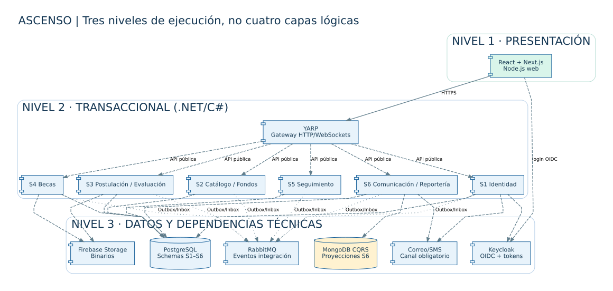

El navegador usa HTTPS contra YARP, que enruta a S1–S6 y permite WebSockets para SignalR. Los servicios usan PostgreSQL para su escritura, MongoDB para proyecciones en S6, Firebase para documentos y RabbitMQ para eventos. **Node.js no es la capa transaccional**: ejecuta el frontend Next.js y herramientas de desarrollo; las reglas permanecen en .NET/C#.

La denominación «tres capas» de los apuntes puede usarse en esta **vista de tres niveles**: presentación web → backend transaccional → persistencia. No debe usarse para afirmar que Clean tiene solo tres capas lógicas.

### 2.2 Capas lógicas Clean de cada servicio

| Capa/proyecto | Responsable | Contiene | No conoce |
|---|---|---|---|
| `*.Api` | Adaptador HTTP de entrada | Controllers mínimos, autenticación HTTP, binding/DTO, `ProblemDetails`, DI, endpoints OpenAPI | Reglas financieras ni SQL embebido |
| `*.Application` | Casos de uso | Comandos, consultas, handlers, validación de forma, políticas transaccionales, puertos de salida, DTO | SDK de Firebase, SMTP, `DbContext` concreto |
| `*.Domain` | Modelo DDD | 25 raíces en sus contextos, entidades, VO, invariantes, servicios del dominio, fábricas, eventos, interfaces de repositorio | ASP.NET, EF Core, RabbitMQ, MongoDB, Firebase, detalles de red |
| `*.Infrastructure` | Implementaciones técnicas | EF Core, mappings, Outbox, Inbox, MongoDB/lecturas, integración con Keycloak/Firebase/universidades, canales, jobs | Nuevas reglas de negocio no definidas en el dominio |

**Referencias de compilación:** `Api → Application`, `Api → Infrastructure` solo en la raíz de composición (`Program.cs`), `Infrastructure → Application, Domain`, `Application → Domain`, `Domain → SharedKernel`. `Contracts` contiene eventos externos y DTO publicados. `Domain` no depende de las otras capas ni de frameworks. El flujo de ejecución puede salir de Application hacia Infrastructure por un puerto; la referencia del código **sigue apuntando al interior**, tal como enseña la lámina 26.

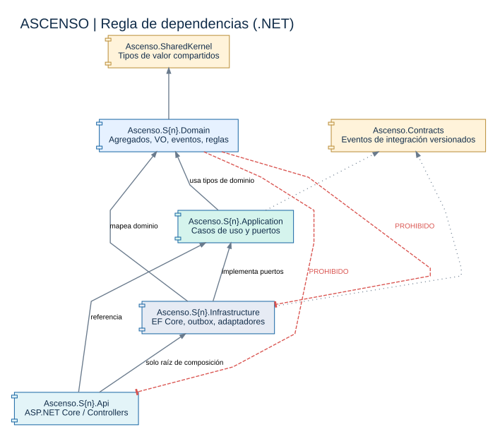

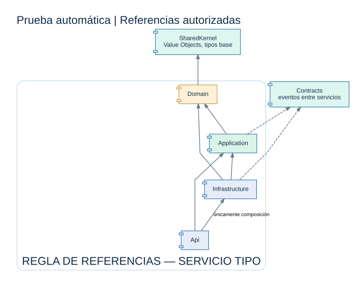

### 2.3 Criterios SOLID aplicados con proporcionalidad

Aplicamos el **Principio de Responsabilidad Única (SRP)** separando reglas de dominio de orquestación y adaptadores. El **Principio de Inversión de Dependencias (DIP)** motiva contratos en fronteras de persistencia y proveedores, **no** una interfaz por cada clase. El **Principio Abierto/Cerrado (OCP)** es útil en canales de notificación o fuentes universitarias, porque existen variantes reales; no es argumento para crear fábricas donde basta un constructor. El **Principio de Sustitución de Liskov (LSP)** y el **Principio de Segregación de Interfaces (ISP)** se evaluarán sobre jerarquías/puertos concretos; no se inventan violaciones por cumplir una lista.

## 3. Partición de los Bounded Contexts y propietarios

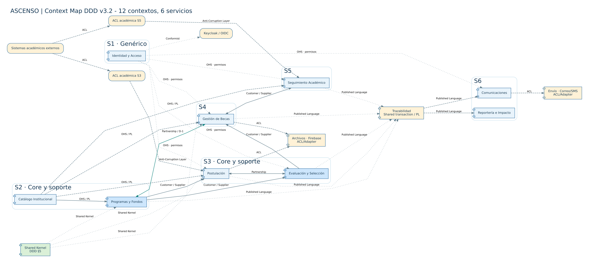

| Servicio | Contextos del DDD v3.2 | Raíces asignadas | Operaciones principales | Datos autoritativos |
|---|---|---|---|---|
| **S1 Identidad** | Identidad y Acceso | `Usuario`, `TipoUsuario`, `ClienteApiUniversidad` | Registro, roles, 2FA, OTP, clientes universidad | Identidades, configuración, desafíos y permisos |
| **S2 Catálogo y Fondos** | Catálogo Institucional; Programas y Fondos | `CalendarioAcademico`, `UniversidadAliada`, `Programa`, `Donante`, `PresupuestoPrograma` | Universidades y periodos, programas y rúbricas, aportes, reservas | Calendario, programas, **saldo/cupo único** |
| **S3 Postulación y Evaluación** | Postulación; Evaluación y Selección | `CicloPostulacion`, `Postulante`, `Postulacion`, `Comite`, `Evaluacion`, `ConflictoInteres` | Inscripción, elegibilidad, documentos, asignación, rúbrica aplicada, consolidación, lista de espera | Postulaciones y evaluaciones |
| **S4 Becas** | Gestión de Becas | `Oferta`, `Beca`, `BeneficiosPersona`, `DatosPago`, `VentanaRenovacion` | Oferta, aceptación, tramos, desembolsos, pagos, pausa, renovación, revocación | Beneficios por persona y ciclo de beca |
| **S5 Seguimiento** | Seguimiento Académico | `ReporteAcademico`, `PlazoReporte`, `EvaluacionCumplimiento` | Ingreso manual/API de reportes, evaluaciones de permanencia | Estado académico acreditado |
| **S6 Comunicaciones y Reportería** | Comunicaciones; Reportería e Impacto | `Consulta`, `RegistroEnvio`, `ConsentimientoDonante` | Mensajería, avisos, reportes, indicadores, modelos de lectura | Consultas y consentimientos; **no** presupuesto |

Los tres contextos adicionales —**Trazabilidad, Archivos, Envío de mensajes**— se implementan como capacidades transversales: el registro inmutable se escribe en la transacción de cada servicio; los archivos usan el puerto Firebase; los canales de correo/SMS usan adaptadores de S1/S6. No se despliegan microservicios independientes solo para aparentar DDD.

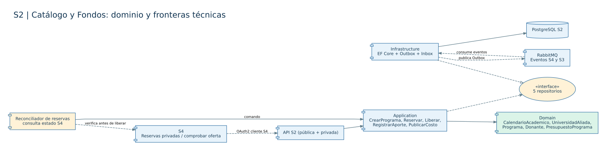

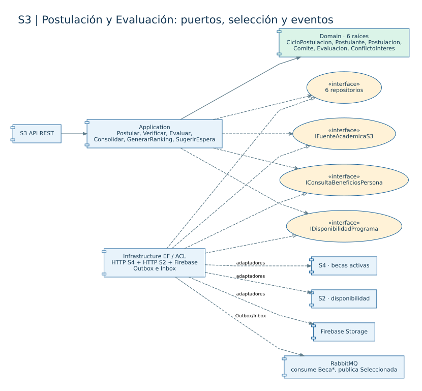

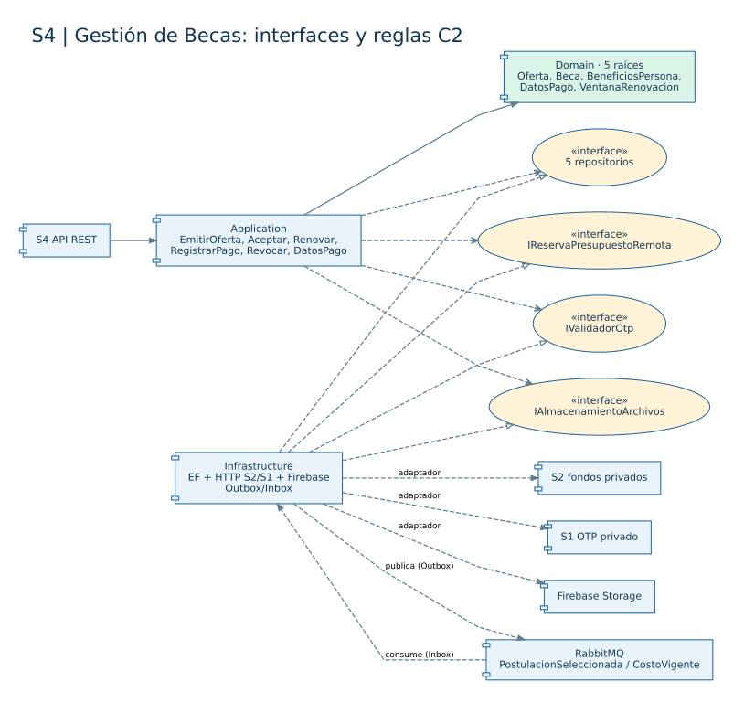

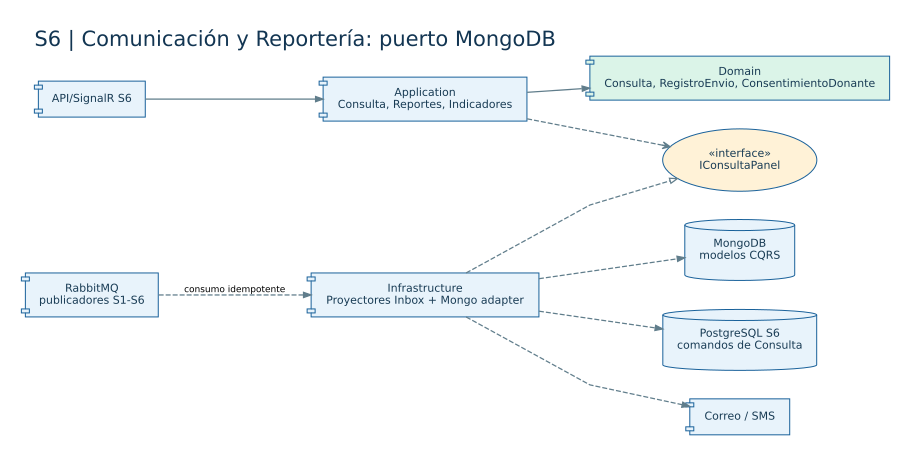

### 3.1 Dependencias interservicios permitidas

**Llamadas HTTP síncronas privadas (OAuth2 client_credentials, no expuestas por YARP):** `S4 → S2` reserva/liberación con clave idempotente por postulación y ciclo; `S3 → S2` consulta de disponibilidad al generar ranking/seleccionar; `S4 → S1` validación y consumo de OTP cuando corresponde; y `S3 → S4` consulta autoritativa para HU-01.2 antes de aceptar una postulación. Esta última evita que una réplica atrasada de becas habilite postulaciones indebidas. El resto de eventos puede ser eventual y se transporta por Outbox/Inbox. Los tokens de usuarios finales no pueden invocar rutas privadas. Consulte `03_CONTRATOS/openapi-interno.yaml`.

**Eventos publicados:** `S2 → S3/S4/S6` catálogo, fondos y periodos; `S3 → S4/S6` `PostulacionSeleccionada.v1` y hechos de evaluación; `S4 → S2/S3/S5/S6` ofertas, becas, pagos, cambios; `S5 → S4/S6` resultados académicos; eventos relevantes de todos los productores a las proyecciones S6. Cada consumidor ve solo datos mínimos publicados, no tablas ajenas.

### 3.2 Datos y eventos necesarios para garantizar las reglas

1. `PostulacionSeleccionada.v1` sale de S3 tras decisión validada y S4 lo consume; `Postulacion` mantiene una oferta pendiente por ciclo, además de que S4 impone unicidad `(postulacionId, cicloId)` y S2 reserva con esa misma clave. No basta con `ofertaId` aleatorio.
2. `CostoMatriculaVigente.v1` sale de S2 con universidad, periodo, monto, vigencia y versión. S4 replica ese valor y **no** confirma un segundo beneficio sin costo aplicable y vigente (C2).
3. S3 mantiene una proyección de estados de beca por eventos S4, pero para HU-01.2 invoca a S4 por su puerto `IConsultaBeneficiosPersona` antes de admitir la postulación. Si la consulta autoritativa falla, rechaza/pospone la operación (fail closed).
4. La propuesta de siguiente candidato en lista de espera se decide **en S3** y se publica para que S6 la notifique. S6 no ejecuta reglas de selección.
5. El ranking se calcula en **S3** a pedido con datos locales transaccionales, y disponibilidad de cupos de S2. S6 solo expone proyecciones de seguimiento de ese resultado.

**Regla:** prohibidas consultas SQL directas al esquema de otro servicio, incluso estando en el mismo servidor PostgreSQL. Prohibido hacer depender una transacción de que S6 esté en línea.

## 4. UML de componentes y contratos

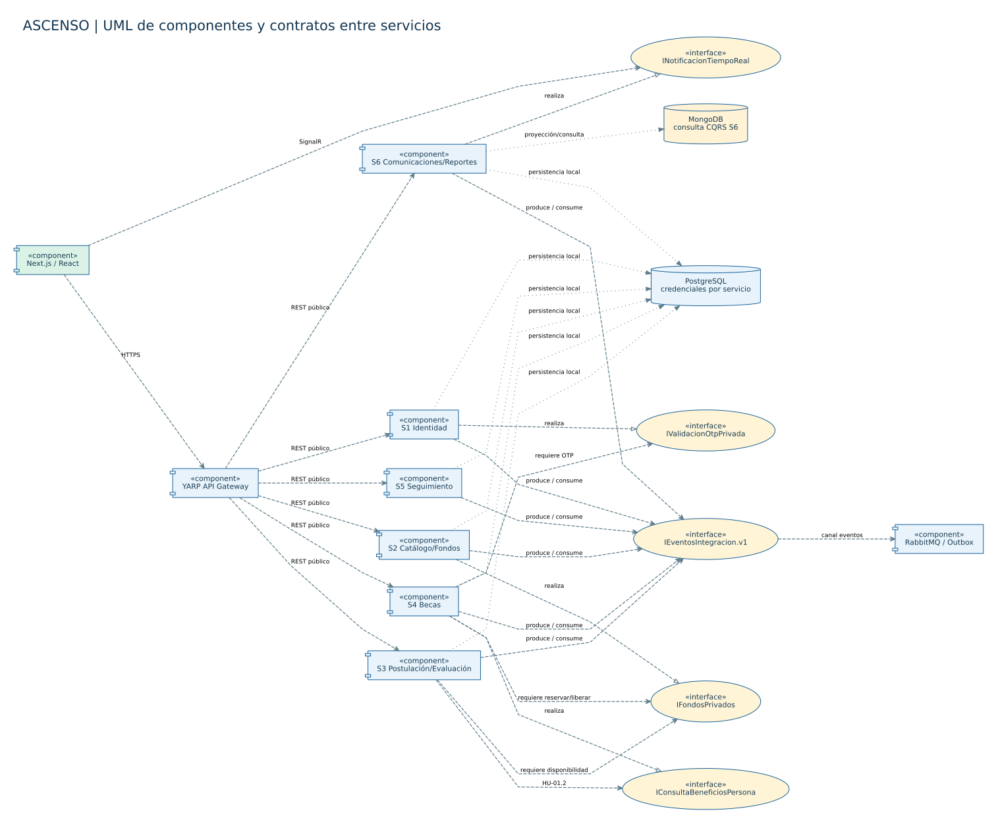

En esta vista los elementos `«component»` son unidades de software, los `«interface»` son contratos lógicos y las líneas discontinuas indican **dependencias**. Los servicios se modelan como componentes y la capa de ejecución externa se separa del dominio. No se mezclan clases del DDD con componentes como si fueran equivalentes.

### 4.1 Reglas de dibujo para el UML final

- Componente: rectángulo con símbolo de componente UML y nombre de S1–S6, gateway, frontend o adaptador.
- Contrato provisto: círculo (*lollipop*) en el borde proveedor; contrato requerido: semicírculo (*socket*) en consumidor, unidos por conector de ensamblaje cuando se use esa vista; si se usa una representación simplificada, dependencia discontinua **desde consumidor hacia contrato** con su nombre explícito.
- Implementación: línea discontinua con triángulo vacío apuntando hacia la interfaz implementada (realización).
- Agrupación: marcos de despliegue o paquetes solo cuando ayudan a explicar la frontera; un Bounded Context **no** equivale a un proceso ni a una clase.
- Dependencias: mostrar únicamente las importantes, con contrato/protocolo y dirección. No dibujar cada llamada de dominio como una nueva interfaz.

**Vistas separadas** por legibilidad: mapa general, dependencias de proyectos, puertos/adaptadores, descomposición de S2/S3/S4/S6 y diagrama de integración. Todas están en `02_DIAGRAMAS`; diagramas de secuencia complementan el UML de componentes, sin reemplazarlo.

## 5. Puertos, adaptadores y caso de uso completo

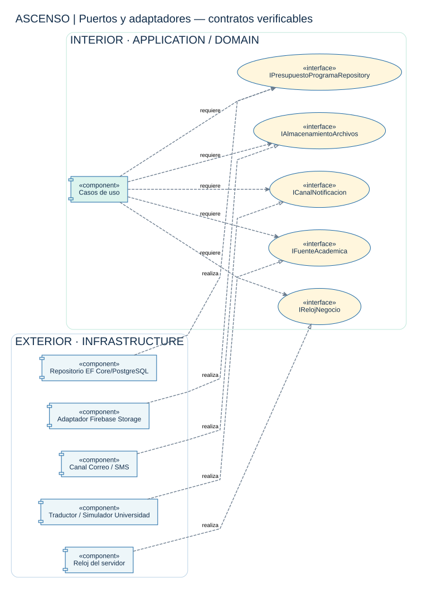

| Puerto | Definido en | Adaptador | Propósito verificable |
|---|---|---|---|
| `IPresupuestoProgramaRepository` | `S2.Domain` | `PresupuestoProgramaRepositoryEf` | Rehidratar/guardar el agregado financiero con control de versión |
| `IAlmacenamientoArchivos` | `S3/S4.Application` o contrato compartido | `FirebaseStorageAdapter` | Guardar/obtener binarios sin contaminar el dominio |
| `ICanalNotificacion` | `S6.Application` | `CorreoAdapter`, `SmsAdapter` | Envíos por canal configurado, idempotentes |
| `IFuenteAcademicaS3` / `IFuenteAcademicaS5` | `S3.Application` y `S5.Application` | Adaptadores API/manual/simulados por servicio | S3 certifica promedio; S5 recibe/acredita reporte; no hay dependencia de S3 a S5 |
| `IRelojNegocio` o `TimeProvider` | `Application` | Reloj del servidor/falso de pruebas | Tiempo confiable; lógica de fechas en VO DDD |
| `IConsultaPanel` / interfaces de lectura | `S6.Application` | `MongoConsultaPanel` | Retornar DTO de lectura sin revelar documentos MongoDB |
| `IValidadorOtp` | `S4.Application` | Cliente HTTP de S1 | Validar/desafiar operación sensible por usuario+recurso |

**Puertos adicionales de la corrección:** `S3.Application` define `IConsultaBeneficiosPersona` (adaptador HTTP privado S4), `IDisponibilidadPrograma` (adaptador S2) e `IFuenteAcademicaS3` (adaptadores académicos de validación de promedio); `S5.Application` tiene su `IFuenteAcademicaS5` para reportes. Las interfaces son fronteras reales, no decoraciones de cada clase.

Los repositorios de los **25 agregados** se modelan según DDD §18.1: contrato en Domain, implementación en Infrastructure; nunca se expone `IQueryable` a Application. **No se crean 25 microservicios**, solo 25 repositorios con un agregado por raíz.

### 5.1 Caso representativo: `EmitirOferta`

1. `S4.Api` recibe `EmitirOfertaRequest` y transforma HTTP a comando. Autenticación y autorización del coordinador **por programa** ocurren antes del cambio.
2. `EmitirOfertaHandler` verifica por información recibida del evento de selección que la postulación está habilitada, y verifica que la decisión siga siendo válida (consulta autoritativa a la fuente requerida). No calcula saldo.
3. Handler, mediante `IReservaPresupuestoRemota`, envía a S2 **solo** `operationId`, `postulacionId`, `programaId`, `cicloId` y periodo autorizado. **S2 determina importe, moneda y cupo con `Programa.MontoPorPeriodo` (C1)** y las reglas de periodo del DDD; el frontend no fija monto ni `PlanReserva`.
4. `PresupuestoPrograma` verifica la clave única de reserva por `(postulacionId, cicloId)`, cupo/programa/ciclo y disponible, acepta una cantidad igual al disponible y realiza commit con su versión. La idempotencia impide duplicar la reserva.
5. Con `reservaId`, `OfertaFactory` construye `Oferta` aplicando las invariantes. Se guarda `Oferta + RegistroDecision + Outbox` en una transacción local S4.
6. Si S4 falla, solicita liberación compensatoria idempotente a S2. Si cae la red, la conciliación verifica la existencia real de la oferta **antes** de liberar la reserva.
7. Al confirmar, `OfertaEmitida.v1` llega a S2 (vincular reserva), S3 (marcar oferta en postulación) y S6 (notificar y proyectar). El éxito del comando se basa en el commit local y la reserva autoritativa, **no** en que todos los eventos se consumieran ya.

**Pruebas del caso:** cupo agotado, exactamente disponible, reserva duplicada, S2 caído, S4 falla tras reservar, reserva huérfana, retraso de `OfertaEmitida`, dos ofertas simultáneas con la misma postulación/ciclo, replay de eventos, JWT de usuario sobre API privada y acceso desde coordinador de otro programa.

## 6. Comunicación y consistencia distribuida

### 6.1 Qué es síncrono y qué es asíncrono

- **Síncrono = decisión inmediata**: reserva de S2, consulta de disponibilidad para seleccionar, operación OTP cuando el riesgo exige autorización previa. Tiempo de espera acotado; errores explícitos `409` o `503`; jamás fallback a datos atrasados.
- **Asíncrono = consecuencia posterior**: notificaciones, proyecciones, liberaciones normales, cambio de periodo en otras becas, auditoría de lectura materializada, recordatorios y actualizaciones de pantalla.
- **Evento interno** es registrado por el agregado, nunca reemplaza sus reglas; **evento de integración** es un contrato mínimo publicable, versionado y compatible.

### 6.2 Outbox/Inbox y trazabilidad

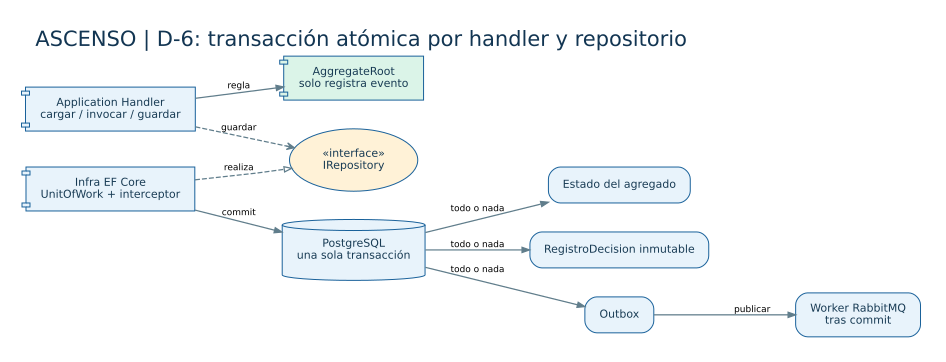

La transacción local almacena agregado + filas de `RegistroDecision` + mensajes de Outbox. Tras el commit, un publicador entrega a RabbitMQ. La entrega es **al menos una vez**, por lo que el consumidor registra `(consumerName, eventId)` con restricción de unicidad **en la misma transacción que sus efectos**. En error: reintento con espera, errores visibles y cola de reproceso supervisada. Sin una política de idempotencia, no se aprueba una integración financiera.

Un evento de dominio **no tiene por qué publicarse íntegro a otros servicios**. El módulo traduce a un `IntegrationEvent` con `eventId`, `schemaVersion`, `occurredAtUtc`, `aggregateId`, `correlationId`, `producer`, payload mínimo y, si corresponde, `tenant/scope`. Los eventos con PII se minimizan o anonimizan para S6; nunca viajan credenciales, OTP o cuentas completas.

### 6.3 Reservas con compensación: seguridad frente a fallos

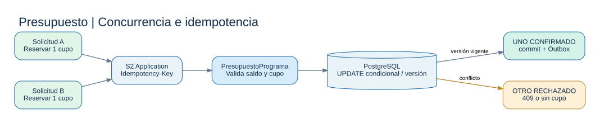

La operación que **reduce** el disponible se ejecuta primero en S2 (D-1). La liberación tras revocación o rechazo llega por evento y puede tardar: mientras tanto el sistema será conservador, con un disponible menor, nunca mayor al real. Los reintentos usan la misma clave de operación. El reconciliador **no** borra reservas solo por tiempo: exige verificar que no exista una oferta confirmada con evento retrasado. Esta precisión evita una doble adjudicación.

El contrato entre servicios debe declarar explícitamente `operationId`, `idempotencyKey`, `resourceId`, `reservaId`, `codigoPeriodo`, estado y error de negocio. La lectura de saldo de MongoDB es exclusivamente informativa. La carrera pago versus revocación se serializa mediante versión de `Beca`.

## 7. Datos, CQRS y propiedad

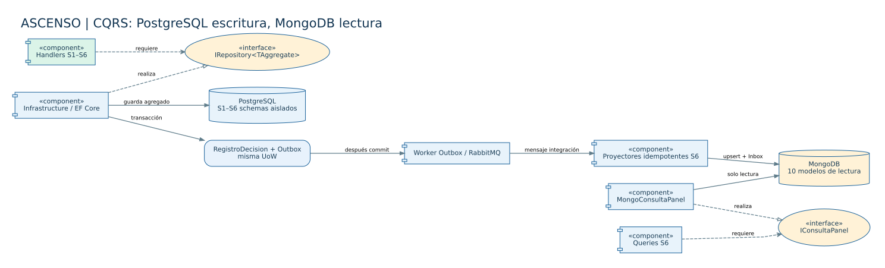

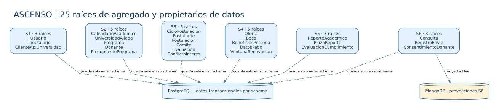

### 7.1 PostgreSQL transaccional

Un servidor de desarrollo puede alojar una base con esquemas `s1_identidad`, `s2_catalogo_fondos`, `s3_postulacion_evaluacion`, `s4_becas`, `s5_seguimiento` y `s6_comunicaciones`; cada uno tiene su propio `DbContext`, usuario de runtime y usuario de migraciones. El runtime no tiene `SELECT/UPDATE` en otros esquemas. Cada servicio realiza sus propias migraciones. Al escalar se pueden separar servidores sin cambiar los contratos.

**Concurrencia:** cada raíz de agregado tiene `Version` según DDD Shared Kernel; la persistencia valida token/versión y lanza conflicto si otro cambio ya confirmó. En S2 los cupos y montos se validan bajo operación serializable suficiente para garantizar el invariante; una versión optimista sin atomicidad de la operación y revalidación de invariantes no basta.

### 7.2 MongoDB — lectura CQRS

**Se selecciona MongoDB como motor NoSQL de D-14** para materializar las 10 proyecciones del modelo: `postulaciones_postulante`, `ranking_ciclo`, `presupuesto_programa`, `historial_becas`, `linea_tiempo_beca`, `estado_financiero`, `impacto_donante`, `consolidado_institucional`, `indicadores`, `registro_decisiones`. Los productores preservan sus datos transaccionales en PostgreSQL; los proyectores S6 realizan operaciones idempotentes y registran eventos procesados. Los lectores retornan DTO con `actualizadoEnUtc` para identificar consistencia eventual.

**Excepción funcional importante:** las reglas de cupo, presupuesto y doble beneficio no pueden decidirse leyendo esas colecciones. Ranking y panel se pueden presentar desde MongoDB, pero seleccionar/otorgar exige revalidar el estado transaccional de S2/S3/S4. El documento v0.1 planteaba PostgreSQL de lectura; queda **descartado en esta línea base** por contradecir la versión adoptada D-14, salvo solicitud formal de cambio de DDD.

### 7.3 Firebase Storage

Firebase guarda documentos de postulación, cartas de oferta, compromisos firmados y comprobantes/exportaciones cuando aplique. PostgreSQL solo guarda `ReferenciaArchivo` privada. La autorización a un archivo se realiza en backend antes de generar acceso temporal; ni React ni un evento externo llevan rutas administrativas o links públicos persistentes. Un archivo subido no equivale a documento verificado; las reglas están en `Postulacion`/`Beca`.

## 8. Seguridad integral

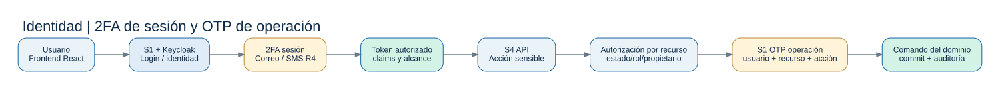

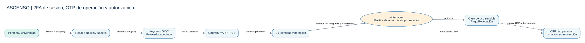

### 8.1 Autenticación y segundo factor

S1 delega identidad OIDC a Keycloak. Postulantes pueden registrarse según HU y los usuarios internos son provisionados según permisos. Tipos con obligación de 2FA incluyen actores internos de decisión/finanzas, evaluadores externos y enlaces académicos según R3. R4 establece **correo o SMS a elección**, 15 minutos, 3 intentos fallidos y bloqueo de 1 hora. **El TOTP de una app autenticadora no sustituye por sí solo este requisito**. Se debe validar mediante prueba técnica el flujo OIDC con segundo factor por correo/SMS antes de usarlo para roles privilegiados; de fallar la extensión, el control equivalente debe bloquear la emisión/aceptación del token hasta validar factor mediante S1. No se declara esa integración ya probada.

### 8.2 OTP de operación

Un OTP para confirmar un desembolso o revocar beca se vincula a `usuarioId + operacion + recursoId + challengeId`, vence, admite un solo uso y queda protegido por consumo atómico. El **handler de S4** comprueba primero identidad derivada del token, permisos, alcance y estado del agregado; únicamente entonces invoca `IValidadorOtp` a S1 en ruta privada. La API no consume OTP antes del handler y el cliente no puede invocar directamente `/internal/v1/otp/validar-y-consumir`. El consumo no autoriza por sí mismo una operación. La longitud de 6 dígitos es una elección de implementación y no un dato confirmado de R4. Si la transacción de negocio falla después de consumir el OTP, no se reutiliza el código: el usuario repite desafío, pero el `operationId` previene resultados duplicados si una respuesta se perdió.

**Protocolo OTP único (B3):** S4 API transmite `challengeId` y código al handler; el handler verifica actor (del token), alcance, recurso y estado; solo entonces invoca `IValidadorOtp` mediante un cliente OAuth2 privado S1. S1 consume el código de forma atómica y de un solo uso, S4 aplica `Beca`/`DatosPago` y guarda auditoría y Outbox. Los cambios de pago, su resolución, cambios de datos bancarios, revocación y consecuencia revocatoria HU-25.2 usan el mismo flujo. Si falla commit, el OTP sigue consumido y se inicia un desafío nuevo; `operationId` evita duplicaciones tras cortes de red.

### 8.3 Autorización por recurso, masking y datos personales

Keycloak suministra autenticación/rol general, S1 administra permisos configurables; cada servicio decide acceso al **recurso real**: coordinador a su programa, enlace a su universidad, evaluador a evaluaciones vigentes sin conflicto, estudiante a sus datos; puntuaciones ajenas se ocultan antes del cierre. Los campos bancarios se cifran en reposo y se devuelven enmascarados desde API. Registrar consulta a datos de pago es auditoría de lectura diferente de `RegistroDecision`. Consentimiento y datos de donantes se aplican antes de proyectar información anonimizada. Los secretos no se suben a Git.

## 9. Temporalidad, trabajos y notificaciones

El **correo electrónico es canal mínimo obligatorio**, no mero sustituto de una conexión fuera de línea. SignalR complementa la comunicación en vivo; SMS es canal configurable. S6 usa `RegistroEnvio` para deduplicación, mientras S1 envía OTP de manera inmediata por el canal seleccionado.

**Nueve trabajos declarados**: expirar ofertas S4; resolver becas no renovadas S4; vencer pausas S4; avisar revisión de suspensiones S4→S6; terminar lista de espera S3; recordatorios de plazos S6 (RF-30); avisos a comité S6 (RF-31); detectar reporte académico tardío S5; reconciliar reservas sin vínculo S2 (sin liberar solo por vencimiento). Todos invocan handlers y registran actor sistema.


- `VentanaFechas` y `FechaLimite` del DDD encapsulan R20: **UTC-4**, día límite completo hasta las 23:59. El tiempo se obtiene de un reloj de servidor inyectado; es preferible almacenar instantes UTC y aplicar una zona fija de negocio en validación; **no** convertir UTC-4 por reglas DST del navegador.
- Hangfire dispara casos de uso idempotentes y paginados: expirar ofertas, resolver becas sin renovación → Inactiva, vencer pausas → Inactiva, avisos de revisión, fin de listas de espera, reportes académicos tardíos, recordatorios, liberación de reservas huérfanas bajo verificación.
- SignalR envía **avisos de cambio**, no decisiones de negocio: mensajería de consultas, panel e hitos. Tras reconectar, React vuelve a consultar la fuente vigente para evitar estado obsoleto.
- S6 distribuye correo y SMS a partir de eventos del negocio. `RegistroEnvio` evita duplicados `(persona, hito, anticipación)`; envíos en lote tienen cuotas/reintentos. El OTP urgente de S1 usa canal directo independiente de avisos masivos.

## 10. Escenarios críticos de consistencia

| Escenario | Autoridad | Reacción segura | Prueba obligatoria |
|---|---|---|---|
| Dos ofertas disputan último cupo | `PresupuestoPrograma` S2 | Solo una confirma reserva, la otra recibe conflicto/cupo insuficiente | Prueba paralela con barrera |
| Dos ofertas aceptadas por la misma persona | `BeneficiosPersona` S4 | D-3 serializa por persona, rechaza acumulación incompatible | Concurrencia + cobertura C2 |
| Pago y revocación simultáneos | `Beca` S4 | Control de versión y transición válida | Carrera y reintento con carga fresca |
| Oferta expira cuando se acepta | `Oferta` S4 | Solo una transición confirma | Cierre 23:59 UTC-4 |
| S4 cae después de reservar | S2 + reserva idempotente | Compensar con conciliación de oferta real | Corte entre reserva y commit |
| Evento se consume dos veces | Inbox del consumidor | Efecto único pese a dos entregas | Duplicado evento con mismo `eventId` |
| Proyección se retrasa | Servicio propietario | Decisión transaccional no lee MongoDB | Test de lag simulado |
| OTP se consume dos veces | S1 OTP | Segundo intento bloqueado | Carrera de consumo |
| Universidad envía lote repetido | S5 reporte | Inserción idempotente por universidad/lote/periodo | Lote repetido o parcial |
| Firebase no responde | Adaptador S3/S4 | No marcar documento/carta completado si no hay referencia confirmada | Falla de proveedor |

## 11. Integración universitaria, documentos y ETL

La regla C5 permite fuente API o manual según convenio; `IFuenteAcademica` traduce datos de cada universidad a `PromedioCertificado`/`ReporteAcademico`. S5 recibe lotes por API con cliente propio y autorización por universidad, valida origen, registra resultado y procesa idempotentemente. Cada reporte del lote lleva promedio, materias aprobadas, materias reprobadas y estado de matrícula, y la universidad consulta después el resultado fila por fila (registrado o rechazado, con su motivo), como pide HU-24.3. S3 solo consume datos certificados según la ruta de negocio; no queda acoplado al formato propio del proveedor. Se incluyen adaptadores simulados para pruebas.

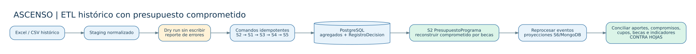

La migración de las hojas históricas se realiza con staging, normalización, *dry run* y comandos idempotentes por propietario; se carga S2 catálogo/fondos, S1 identidades, S3 postulaciones, S4 becas/pagos y S5 reportes. **Después de incorporar becas históricas se reconstruyen en S2 todos los compromisos y cupos ocupados**; luego se reprocesan eventos/proyecciones de S6 en MongoDB, se concilian compromisos, disponible, conteos de becarios y reportes frente a las planillas, y solo entonces se habilita la plataforma. **No** se insertan tablas directamente en otros esquemas, no se salta `BeneficiosPersona`/`PresupuestoPrograma`, y la auditoría registra actor `migracion`. La reconciliación compara programas, fondos y becas efectivas con el origen. Hasta recibir el formato real de planillas, no puede certificarse el mapeo ETL.

## 12. Organización de código, módulos y gobierno

```text
ascenso/
├── frontend/                      # React + Next.js (Node.js)
├── gateway/                       # YARP; configuración/rutas, sin reglas DDD
├── services/
│   ├── Ascenso.S1.Identidad/
│   ├── Ascenso.S2.CatalogoFondos/
│   ├── Ascenso.S3.PostulacionEvaluacion/
│   ├── Ascenso.S4.Becas/
│   ├── Ascenso.S5.SeguimientoAcademico/
│   └── Ascenso.S6.ComunicacionesReporteria/
│       └── ... en cada servicio:
│           ├── *.Api/
│           ├── *.Application/
│           ├── *.Domain/
│           ├── *.Infrastructure/
│           └── tests/{Unit,Integration,Architecture}/
├── building-blocks/
│   ├── Ascenso.SharedKernel/       # VO, IDs tipados, tipos base DDD
│   └── Ascenso.Contracts/          # eventos de integración públicos, DTO, versionados
├── contracts/                     # OpenAPI, esquemas de eventos, matriz de permisos
├── deploy/                        # docker-compose, health checks, config sin secretos
├── openspec/                      # OBLIGATORIO: especificaciones, proposals y changes
└── docs/{architecture,adr,diagrams}/
```

Los nombres S1–S6 son identificadores de arquitectura; las clases usan nombres **del glosario ubicuo** (`Programa`, `PresupuestoPrograma`, `TramoBeca`, `RegistroDecision`, `BeneficiosPersona`). Para evitar 24 proyectos independientes creados vacíos, se construye un **vertical slice de un servicio completo** primero: Domain+Application+Infra+Api+tests con un flujo real; luego se replica el patrón por límite de servicio. La frontera distribuida S1/S2/S3/S4 debe existir conforme al mapa; no diseñar un «SharedKernel» gigante que contenga reglas de cada contexto.

Cada cambio público se revisa por contrato, dueño y consumidores. Versionar los ADR. Un flujo de CI verificará dependencias, contratos, tests, secret scanning, migraciones y compatibilidad. No mezclar políticas de despliegue con reglas del dominio.

## 13. Decisiones arquitectónicas — registro definitivo de diseño

**Convención:** `Adoptada (diseño)` significa la selección de esta línea base; **no** supone firma del profesor. `Condicionada` exige una prueba o fuente externa antes de implementarse, sin que ello impida documentar la arquitectura. Cada ADR tiene motivación y consecuencia, no solo nombre de tecnología.

| ADR | Decisión adoptada | Razón / fuente | Consecuencia y verificación | Estado de aprobación externa |
|---|---|---|---|---|
| **01** | Microservicios .NET conectados por APIs; seis unidades S1–S6 | Consigna obligatoria comunicada en revisión A2; DDD contextos | Aislamiento de datos, Gateway y eventos con consistencia eventual | **Exigencia informada; 6 servicios decididos por equipo** |
| **02** | S1–S6 distribuidos como §3 | Conserva Partnership y límites DDD | Un propietario por agregado; comunicación privada documentada | **Adoptada como partición del equipo** |
| **03** | Reservar primero en S2 y después emitir en S4; compensar con idempotencia | DDD D-1, regla 8, HU-12.1/15.1 | Consistencia distribuida segura; ensayo de red caída | Adoptada (diseño), reglas monetarias pendientes cliente |
| **04** | Cuatro capas Clean + puertos/adaptadores | Clase 09, diap. 7–9, 14–18, 26–39 | Prueba de referencias, Domain no usa infraestructura | Adoptada (diseño) |
| **05** | PostgreSQL/EF Core escritura, schemas aislados | DDD D-12/D-14, notas de clase | DbContext por S, migraciones y roles separados | Adoptada (diseño) |
| **06** | Firebase Storage para documentos; `ReferenciaArchivo` privada | PRD, DDD §3b | Adaptador, autorización de descarga, emulator en desarrollo | Obligación del cliente; emulator a validar |
| **07** | MongoDB NoSQL CQRS, 10 proyecciones | DDD D-14; descarta cambio no aprobado de v0.1 | S6 proyecta eventos idempotentes; reglas financieras no lo leen | Selección de diseño; restricción de motores a verificar |
| **08** | Stateless en Beca/Postulación; resto transición enum controlada | DDD §15–16, v0.1 | Test de todas las transiciones; no guardar grafo en DB | Aceptación del profesor por confirmar |
| **09** | Keycloak OIDC, 2FA correo/SMS controlado por S1 | DDD D-8, R3/R4; v0.1 | PoC obligatorio antes de tokens privilegiados | **Condicionada a PoC** |
| **10** | OTP de operación en S1, vinculado a recurso/acción y consumo único | R4–R6, HU-20.1, 22.1 | Test replay/caducidad/concurrencia; no confundir con 2FA | Adoptada (diseño) |
| **11** | Permisos por rol, recurso, alcance y estado en cada servicio | HU-37.1, confidencialidad | Política central + filtros backend + masking | Adoptada (diseño) |
| **12** | Auditoría `RegistroDecision` y Outbox en commit local | DDD D-6, RF-35 | Insert-only, correlación y test rollback atómico | Adoptada (diseño) |
| **13** | MassTransit 8 + RabbitMQ, Inbox/Outbox | DDD eventos, varias fronteras | Contratos versionados, reintentos, DLQ; validar licencia | Adoptada (diseño), pin al implementar |
| **14** | Hangfire por servicio para procesos temporales | R18, HU-15.2/26.2 | Jobs idempotentes y paginados que invocan comandos | Adoptada (diseño) |
| **15** | SignalR S6 para cambios web, fuera de línea correo/SMS | RNF, HU-32.2/40.1 | Reconexión→consultar estado; no motor de persistencia | Adoptada (diseño) |
| **16** | Concurrencia optimista en las 25 raíces; disciplina S2/D-3 | DDD `Version`, RNF consistencia | Tests de último cupo, aceptación paralela, pago/revocación | Adoptada (diseño) |
| **17** | Reloj inyectado, fechas negocio UTC-4 | R20, DDD D-7 | Test 23:59; jobs en zona fija | Adoptada (diseño) |
| **18** | Cifrado/masking/anonimización, secretos aislados | RNF de privacidad y HU-20.3/33.1 | Bitácora acceso sensible y control de consentimiento | Adoptada (diseño), gestión de llaves pendiente |
| **19** | API académica y ACL: manual/API/simulada | C5, DDD §3b | Contratos por universidad + validación de lote | Adoptada (diseño), precedencia de fuentes pendiente |
| **20** | S6 avisos negocio; S1 OTP directo; canal extensible | HU-29/30, R4 | `RegistroEnvio` idempotente y límites de envío | Adoptada (diseño), proveedor externo pendiente |
| **21** | ETL histórico por servicio, staging, simulación, reconciliación | PRD historial existente | No saltar invariantes ni auditoría | Adoptada (diseño), planillas no recibidas |
| **22** | Índices por consulta; S aislados y proyecciones específicas | RNF y HU-09.2/34.1 | Migraciones, `EXPLAIN`, verificación de carga | Adoptada (diseño) |
| **23** | GitHub CI, 90% de cobertura como política, **OpenSpec obligatorio** | Revisión A2 cita clase 14-sep y Clase 09 pide test de arquitectura | No iniciar implementación sin OpenSpec; cobertura se mide, no presume | **OpenSpec obligatorio comunicado, calidad adoptada** |
| **24** | .NET 10 LTS candidato, paquetes exactos con lock/central versions | v0.1 (fecha 04-nov), necesidad de reproducibilidad | Validar licencias/versiones efectivas al crear solución; no `latest` | **Condicionada a comprobación vigente** |

**No se autoriza convertir «propuesta v0.1» en «exigencia del profesor» mediante un cambio de etiqueta.** El estado de aprobación tiene sentido académico y debe registrarse con fecha, responsable y evidencia documental.

## 14. Contratos para iniciar la implementación

Los **40 RF, 73 historias de usuario, 25 raíces y 34 eventos** están desarrollados sin omisiones en [`ANEXOS_TECNICOS.md`](ANEXOS_TECNICOS.md), en vez de reiterar sin necesidad las 4.485 líneas del DDD.

La carpeta `03_CONTRATOS` acompaña este documento con `openapi.yaml` (solo público), `openapi-interno.yaml` (únicamente servicios y OAuth2 cliente), `EVENTOS_E_INTERFACES.md`, `MATRIZ_PUERTOS.md` y `SEGURIDAD_INTERSERVICIOS_V1.1.md`. Estos contratos **no** contienen clases EF, no filtran entidades del DDD a HTTP y usan DTOs estables.

Los endpoints públicos incluyen solicitud de desafío OTP (que devuelve el identificador del desafío y su vencimiento), postulación y evaluación de S3, ofertas, becas y pagos de S4, reportes universitarios de S5, panel y consultas de S6; `ProblemDetails` con correlación y códigos `400/401/403/404/409/422/503`. **Son contratos arquitectónicos base**: los endpoints restantes de las 73 HU se añaden por operación durante OpenSpec, sin rediseñar fronteras ni cambiar semánticas.

Los eventos son contratos de integración entre servicios (`PostulacionSeleccionada.v1`, `CostoMatriculaVigente.v1`, `OfertaEmitida.v1`, `OfertaAceptada.v1`, `OfertaExpirada.v1`, `BecaRevocada.v1`, `PagoConfirmado.v1`, `PeriodoMarcadoActual.v1`, etc.). La tabla de mapeo de los 34 eventos **de dominio** del DDD hacia eventos **de integración** identifica cuáles salen del servicio y cuáles solo son internos. **No** se publican todos solo por existir.

## 15. Trazabilidad, calidad y despliegue

### 15.1 Matrices y requisitos

`04_MATRICES/MATRIZ_73_HU_ARQUITECTURA.csv` complementa el mapeo de historias del Plan B, mientras `04_MATRICES/MATRIZ_40_RF_ARQUITECTURA.csv` asigna propietario arquitectónico a cada RF y colaboradores. `REGISTRO_24_ADR.csv` explica decisiones y aprobaciones; `CATALOGO_SERVICIOS.csv` y `CATALOGO_EVENTOS_INTEGRACION.csv` orientan reparto del equipo. El modelo DDD v3.2 sigue siendo fuente de entidades/estados; la implementación debe referenciar los RF y HU en sus pruebas sin copiar diagramas antiguos.

### 15.2 Calidad y pruebas (diseñadas, no ejecutadas)

- **Dominio puro:** pruebas unitarias de D-1/D-3/C1/C2/C3/R20, transiciones de Beca/Postulacion y políticas de dominio.
- **Application:** prueba del handler con repositorios, reloj y proveedores simulados; no requiere PostgreSQL para verificar las reglas.
- **Arquitectura:** `Domain` no conoce EF/ASP.NET/Rabbit/Mongo/Firebase; `Application` no referencia `Infrastructure`; `Api` no contiene reglas de negocio; no existe dependencia directa de esquemas ajenos.
- **Integración:** PostgreSQL real en contenedor, prueba commit/rollback de agregado+auditoría+Outbox; RabbitMQ duplicados/reintentos; MongoDB proyección; Keycloak 2FA, Firebase emulator.
- **Contratos:** OpenAPI válida; eventos versionados; comprobación productor-consumidor.
- **Carga:** medir ranking, panel, notificación masiva, concurrencia financiera; no inventar SLA no presentes en las fuentes.
- **Gobierno:** pull request revisado; pruebas en CI; prohibido afirmar cobertura 90% hasta medirla.

### 15.3 Despliegue y observabilidad

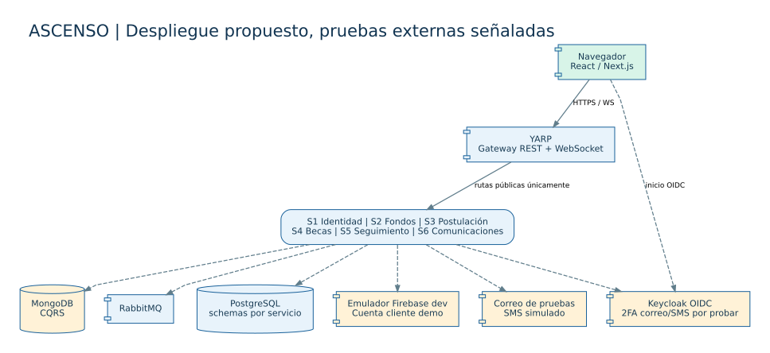

La configuración local arranca con Docker Compose frontend, gateway, S1–S6, PostgreSQL, MongoDB, RabbitMQ, Keycloak, servidor de correo de pruebas y Firebase emulator. **No se incluyen secretos ni credenciales reales**. Salud `live` y `ready` por servicio, logs estructurados con `correlationId`, métricas por handler/cola/Outbox/proyector, alarmas de backlog y fallos de conciliación. El despliegue a producción necesita gestión de certificados, secretos, respaldos y observabilidad acorde a recursos reales; no simular infraestructura productiva inexistente.

## 16. Supuestos aún abiertos que NO deben inventarse

| Asunto | Autoridad | Efecto sobre el diseño | Cómo se trabaja sin inventar respuesta |
|---|---|---|---|
| Periodo o duración que cubre la reserva de oferta | Cliente, HU-15.1 | Regla financiera S2 | Puerto soporta `PlanReserva` con periodos explícitos; sin default arbitrario |
| Momento de fijar monto de renovación | Cliente, HU-12.2 | S2/S4 y C1 | `SolicitudRenovacion` no cambia de regla hasta decisión; frontera ya establecida |
| Transiciones de revocación desde Otorgada/Renovada | Cliente, HU-22.1 | Máquina Beca | Diagramas marcan P1/P2 como no confirmadas; no habilitar en producción |
| ¿Qué hace llegar a Rechazada? | Cliente, HU-10.2 | Máquina Postulación | Guardas dejan la transición pendiente sin fingir definición |
| Prioridad de fuentes académicas | Cliente, HU-24.2 | ACL S5 | Conservar procedencia y rechazar conflicto no resuelto |
| Consentimiento y retiro por donante | Cliente, HU-33.2 | S6 proyección | No revelar persona hasta validación de consentimiento |
| OpenSpec obligatorio y 90% objetivo | OpenSpec: según revisión A2 y clase 14-sep. Cobertura: política del equipo | CI y entrega | Configurar OpenSpec desde inicio; medir cobertura en CI sin afirmar resultado aún |
| Microservicios exigidos | Consigna referida en hallazgo A2 | Despliegue S1–S6 | Aplicado; guardar imagen original cuando se reciba, sin inventar su contenido |
| Proveedor 2FA correo/SMS | PoC S1 | Seguridad efectiva | No emitir acceso privilegiado si no se valida segundo factor |
| MongoDB de consulta | Equipo, acuerdo 16-nov-2026 | DDD D-14 / CQRS | **Decidido**: MongoDB; no reabrir un motor «por definir» |
| Planillas originales y credenciales externas | Fundación | ETL, integraciones | Implementar simuladores y mapeos condicionales; no cargar datos inventados |

Estas cuestiones impiden certificar la **aprobación externa y la implementación completa**, pero no impiden cerrar **la arquitectura de referencia** ni iniciar el esqueleto C# con puertos y límites correctos. La distinción debe aparecer en la defensa y en el control de cambios.

## 17. Definición de terminado y orden de construcción

**Diseño cerrado (esta entrega):** todos los S tienen propietario, capas y contratos, los 40 RF están rastreados, el flujo financiero se documenta con idempotencia, el DDD no se modifica, existe UML de componentes y de dependencias, se define la persistencia y lectura, se explican seguridad, Outbox y pruebas, y cada elección tecnológica está identificada como diseño o exigencia. Esto no equivale a código ejecutado.

**Orden concreto:** (1) preparar monorepo/CI/SharedKernel/Contracts; (2) S2 Catálogo+PresupuestoPrograma + pruebas de concurrencia; (3) S1 identidad con PoC 2FA/OTP; (4) S3 Postulación/Evaluación y S4 Oferta+Beca, probando reserva/aceptación reales; (5) Outbox/RabbitMQ y S6 proyecciones; (6) S5 API académica y seguimiento; (7) notificaciones/schedulers/ETL/observabilidad; (8) pruebas de aceptación integradas. No avanzar con pagos hasta demostrar protección de estados, OTP y presupuesto.

**Prueba del profesor, diapositiva 39:**
1. Un diagrama de proyectos y todas las referencias compilables hacia el dominio (figuras 02, 19).
2. Tres puertos de salida con sus adaptadores (figura 05 y §5).
3. Un caso de uso concreto que separa puertos, aplicación y reglas (EmitirOferta, §5.1 y secuencia 11).
4. Una regla de arquitectura escrita como test (archivo de calidad adjunto).

## 18. Fuentes y catálogo de diagramas

### Fuentes, con precedencia

1. `ASCENSO_Historias_de_Usuario_PlanB_final.pdf` — historias, criterios y decisiones del cliente.
2. `DDD_V3.2.md` — dominios, 25 agregados, entidades, value objects, eventos, reglas D-1 a D-14. **No se reemplaza ni modifica.**
3. `Arquitectura_Obligatoria.jpeg` — lámina «Decisiones Arquitectónicas» del profesor: tecnologías obligatorias y opcionales.
4. `Clase09_ Arquitectura.pptx` — cuatro capas, ports/adapters, Clean, dependencias, pruebas.
5. `ASCENSO_Propuesta_Arquitectura_v0.1 (1).pdf` — 24 ADR y S1–S6 como candidatos; borrador no aprobado.
6. Notas de clase: React/Node, .NET/C#, PostgreSQL, RabbitMQ, Hangfire, SignalR.

### Catálogo de imágenes de arquitectura

Las 20 láminas SVG/PDF de `02_DIAGRAMAS/` cubren: tres niveles, referencias Clean, partición de contextos, UML de componentes, puertos/adaptadores, CQRS, propiedad de datos, seguridad, eventos/notificaciones, prueba de dependencias, S2, S3, S4, S6, despliegue, concurrencia financiera, 2FA/OTP, migración, reglas de compilación y Outbox/auditoría. Las **12 secuencias** están en Mermaid editable e indexadas en `ENLACES_MERMAID_ARQUITECTURA.html`. Cualquier cambio al diagrama debe volver a exportarse y someterse a revisión junto al texto que explica la decisión.

**Cierre documental:** esta versión es la especificación arquitectónica **adoptada para diseño e implementación** del equipo, **no** una constancia de visto bueno del profesor ni de funcionamiento probado. Las decisiones no verificadas están identificadas, no disimuladas. Se podrá abrir un ADR correctivo sin alterar retrospectivamente el DDD v3.2.

---

## 19. Registro de cierre v1.1 (33 hallazgos)

Esta versión corrige la forma documental de los hallazgos **A1–A9, B1–B9 y D1–D15** indicados en el informe del 16-nov-2026. La evidencia por archivo y el método de verificación se encuentran en `08_REVISION_V1.1/MATRIZ_33_CORRECCIONES.csv` y `REPORTE_DE_VERIFICACION.md`. No se consideran resueltas por defecto las preguntas de **negocio** que el propio DDD identifica pendientes del cliente; no son defectos de arquitectura atribuibles a este informe.

- **Estructura conservada:** el documento maestro, 20 figuras principales, 12 secuencias, dos diagramas diagrams.net, contratos, matrices, tres PDF y tablero HTML siguen ocupando las carpetas y funciones originales.
- **Compatibilidad del DDD:** `DDD_V3.2.md` queda intacto. Una adenda con el cambio de despliegue Fondos/Becas se documenta en `06_FUENTES/DDD_V3.3_ADENDA_ARQUITECTONICA_PARA_REVISION.md`; no se afirma que una versión 3.3 haya sido aprobada.
- **Consigna obligatoria:** la revisión A2 comunica microservicios, React/Next.js, .NET/C#, PostgreSQL/EF Core, Firebase, máquinas de estados, auditoría, ETL y OpenSpec obligatorio. Se adopta esa interpretación y se conserva su procedencia secundaria hasta recibir la lámina original.
- **Validación:** los esquemas OpenAPI, las matrices, los archivos Graphviz, la notación de secuencias y los enlaces se someten a comprobación automatizada de artefactos. **No existe código de producto implementado**, por lo que no se atribuye funcionalidad real ni resultados de integración.


## 20. Adenda de coherencia v1.2 — cierre de revisión del 19-nov-2026

La **arquitectura de seis servicios** y el DDD v3.2 permanecen sin alteraciones semánticas. La arquitectura de software sí registra las siguientes correcciones de interoperabilidad:

1. **B3 / N3.** Los contratos públicos distinguen `MarcarPeriodoCommand` (HU-38.2) de `AceptarOfertaCommand` (HU-16.1). HU-20.2 dispone de una operación para marcar fallo/devolución y otra para resolver mediante nuevo pago con OTP `RESOLVER_PAGO`. `APLICAR_CONSECUENCIA_REVOCATORIA` está en `ChallengeRequest` y el flujo sigue autorizado en S4.
2. **N4 / N5.** El número de cuenta llega a S4 exclusivamente por TLS y se cifra al persistir; jamás en log. La consulta privada de beneficios usa `personaId` interno UUID y no cédula en URL.
3. **A8 / B9 / N2.** Los CSV son la única fuente de trazabilidad; RF-04 y HU-04.x usan `IFuenteAcademicaS3`, RF-18 y HU-18.1 comparten S3 como dueño de orquestación (corregido en v1.3: el dueño es S4, ver §21); HU-33.2 pertenece a S6. Los anexos PDF y el Excel se regeneran desde dichos CSV y no contienen copias obsoletas.
4. **N6.** La selección de postulaciones se comunica mediante `Outbox S3 → RabbitMQ → Inbox S4 → Handler S4`. No existe salto directo desde el agregado/servicio S3 al handler S4.
5. **N7.** S5 responde HTTP 202 solamente después de guardar duraderamente el lote y el Outbox; un worker S5 realiza procesamiento y la ACL S5 custodia la equivalencia `(universidadId, codigoEstudiante) → BecaId`, sin exponer claves internas a la universidad.
6. **D4 / D13 / D14.** Context Map incorpora ACL académicas S3/S5 y relación Conformist con Keycloak. Seguridad usa React + Next.js, Keycloak adoptado y ámbitos por programa; la secuencia de caducidad se simplifica para asegurar legibilidad.
7. **A2 / B8 / N1 / N8.** Las fuentes reales del kit se enumeran con inventario verificable. La lámina original de «Decisiones Arquitectónicas» figura en el informe como `Arquitectura_Obligatoria.jpeg`, pero el archivo **no es accesible entre los adjuntos actuales**. Se conserva una **referencia secundaria atribuida** en `06_FUENTES/DECISIONES_ARQUITECTONICAS_LAMINA_OBLIGATORIA_REFERENCIA.md`, sin afirmar que reemplaza la fuente visual del profesor. (Resuelto en v1.3: la imagen ya está en las fuentes, ver §21.)
8. **A9.** La adenda v3.3 que explica S2 y S4 está incluida como *propuesta* en `06_FUENTES/`, sin modificar ni suplantar `DDD_V3.2.md`.

**Alcance de verificación:** contratos OpenAPI, formatos, trazabilidad e integridad de archivos. No existe todavía código de producto implementado, por lo que ninguna prueba documental equivale a verificar microservicios en ejecución.

## 21. Adenda de coherencia v1.3 — correcciones de la revisión del 20-nov-2026

La partición S1–S6 y el DDD v3.2 no cambian. Esta versión cierra los 6 puntos que la revisión de la v1.2 dejó a medias y sus 8 hallazgos nuevos (T1 a T8), más un defecto detectado al corregir (T9). El detalle por archivo está en `10_REVISION_V1.3/REPORTE_DE_CAMBIOS.md`.

1. **A2.** La lámina «Decisiones Arquitectónicas» del profesor está en `06_FUENTES/Arquitectura_Obligatoria.jpeg`, su transcripción se comprobó contra la imagen y encabeza la precedencia tecnológica (§1.2 y §18).
2. **A8 / B9 / T4.** RF-18 y HU-18.1 pertenecen a **S4**: el historial se alimenta de eventos de `Beca` y HU-16.1 lo consulta en cada aceptación de oferta. S6 mantiene la proyección `historial_becas` para las vistas por programa y periodo, y S3 solo consume por `IConsultaBeneficiosPersona` para HU-01.2. HU-33.1 nombra a S6 como dueño del consentimiento.
3. **B3 / T2.** El desafío OTP responde con `ChallengeResponse` (identificador del desafío y vencimiento).
4. **B3 / T3.** `AplicarConsecuenciaCommand` lleva la consecuencia elegida (llamado de atención, suspensión o revocación), el siguiente paso y la fecha de revisión de una suspensión; el OTP solo es obligatorio al revocar.
5. **N7 / T5.** El lote universitario lleva los cuatro datos del reporte y la universidad consulta el resultado fila por fila en una ruta nueva de S5.
6. **N6 / T1 / T9.** La secuencia 11 vuelve a compilar. Las 12 vistas de `VISTAS_SECUENCIAS_SVG` se generan ahora con Mermaid a partir de los `.mmd`, y los 24 enlaces a Mermaid Live se regeneraron con el formato de estado que el editor espera (los de la v1.2 llevaban el código sin ese envoltorio).
7. **T6.** En `DIAGRAMA_COMPONENTES.drawio`, S4 depende de `IFondosPrivados` e `IValidacionOtpPrivada`; ya no aparece realizándolas.
8. **T7.** `CostoMatriculaVigente`, `SugerenciaListaEspera` y `LoteAcademicoRecibido` están en el catálogo de eventos de integración.
9. **T8.** El contrato público retira `ReservaResponse` y da ruta a `RegistrarConsultaCommand` (HU-32.1); la guía de lectura corrige su título.

**Supuestos tomados en esta versión, a confirmar por el equipo:** el dueño de RF-18 y HU-18.1 (S4, con S6 como alternativa) y el catálogo de `EstadoMatricula`, del que el DDD v3.2 solo define `INSCRITO`.

**Alcance de verificación:** igual que en v1.2, es documental. No hay código de producto implementado y la apertura de los enlaces en Mermaid Live no se pudo comprobar desde el entorno de generación.
