# ASCENSO — Modelo de Dominio (DDD)

**Versión 3.2** · 4 de noviembre de 2026

**Fuente principal:** *ASCENSO — Historias de Usuario, Plan B · Versión final* (14-oct-2026), con las decisiones del cliente C1–C5, las respuestas R1–R30, los supuestos S1–S12, el Anexo A (reglas técnicas) y el Anexo B (preguntas abiertas). **Cuando este modelo y las HU difieran, mandan las HU.**

**Referencia de notación y de DDD (fuente principal de los diagramas):** láminas del Prof. Bismarck Ponce: *Clase 4 — UML* (diagramas de clases y de secuencia) y *Clase 8 — Domain-Driven Design*. Se siguen sus once ideas, la regla de agregados de la lámina 34 (diseñar chico, otros agregados por Id, una transacción un agregado, lo demás con eventos) y el anti-patrón de modelo anémico de la lámina 44.

**Fuentes secundarias:** PRD ASCENSO (17-sep-2026) y `DDD_V1.md`.

---

## Control de versiones

| Versión | Fecha | Descripción |
|---|---|---|
| 1.0 | — | Modelo inicial: diagramas de clases por área y máquinas de estado (`DDD_V1.md`). |
| 1.1 | 04-nov-2026 | Corrección del encabezado del diagrama de estados de la Oferta. |
| 2.0 | 04-nov-2026 | Alineación completa con las HU Plan B final. Se agregan Bounded Contexts, Context Map, invariantes, eventos de dominio, servicios de dominio, flujos de consistencia y la tabla de pendientes con la numeración del Anexo B. |
| 2.1 | 04-nov-2026 | Índice del documento. La sección 14 pasa a llamarse "Estados de las entidades", con un resumen de todos los estados y siete diagramas nuevos: periodo académico, documento cargado, asignación de evaluador, evaluación, solicitud de renovación, solicitud de pausa y usuario. |
| 2.2 | 04-nov-2026 | Alineación con la lámina de DDD del profesor: una transacción, un agregado; fábricas; repositorios; Event Storming; agregados sin comportamiento; `Dinero` con los nombres de la lámina; subdominios Core revisados con la pregunta guía. Ver el registro de cambios de la 2.2. |
| 2.3 | 04-nov-2026 | Raíces de agregado explícitas: estereotipo `<<AggregateRoot>>`, catálogo de los 25 agregados con su raíz, contenido y regla que protege (6.1) y diagramas de límites de consistencia por contexto (6.2). |
| 2.4 | 04-nov-2026 | Entidades explícitas: atributo `id` en cada entidad de los diagramas, sección 6.3 con la clasificación entidad / objeto de valor razonada y los casos que dependen del contexto. `Compromiso` pasa a objeto de valor. |
| 2.5 | 04-nov-2026 | CQRS con dos bases de datos: una transaccional (escritura, repositorios) y una de consulta (lectura, modelos de lectura). Arquitectura de escritura y lectura, regla de qué base lee cada cosa y catálogo de modelos de lectura (sección 18). |
| 3.0 | 04-nov-2026 | Todos los diagramas reconstruidos con la notación de las láminas del profesor: diagramas de clases UML (Clase 4) con las siete piezas de DDD juntas (Clase 8, lámina 45), colores por tipo, tipos base de la lámina 39, métodos en PascalCase, estados disparados por métodos y secuencias con instancias `:Clase`. Se eliminan los diagramas de flujo salvo el Event Storming. |
| 3.1 | 04-nov-2026 | Sección 6.2 con las 43 entidades y los 33 value objects en diagramas UML por contexto; sección 6.3 con los totales del modelo; el diagrama de `Beca` incluye sus 14 eventos (faltaban 8). |
| **3.2** | **04-nov-2026** | Cada diagrama tiene un título propio: el índice HTML ya no repite nombres (antes los diagramas 08 a 12 se llamaban igual). |

---

## Contenido

1. Glosario (lenguaje ubicuo)
2. Subdominios y Bounded Contexts
3. Context Map
4. **Event Storming**: línea de tiempo del negocio
5. Shared Kernel y tipos base: `Entidad`, `RaizDeAgregado`, `IEventoDeDominio`, `IManejador` y objetos de valor comunes
6. **Vista general, agregados y entidades**: raíces, contenido de cada agregado, las 43 entidades y los 33 value objects, y los totales del modelo
7. Catálogo Institucional
8. Programas y Fondos
9. Postulación: 9a ciclo y postulante, 9b la postulación
10. Evaluación y Selección
11. Gestión de Becas
12. Seguimiento Académico
13. Identidad y Acceso
14. Trazabilidad, Comunicaciones y Reportería
15. **Estados de las entidades** (Postulación, Beca, Oferta, Desembolso, Pago, Consulta, Periodo, Documento, Asignación, Evaluación, Solicitudes y Usuario)
16. Invariantes, eventos, servicios y flujos de consistencia
17. **Fábricas**
18. **Repositorios y bases de datos (CQRS)**: base transaccional y base de consulta
19. Decisiones de diseño
20. Pendientes

---

## Registro de cambios respecto a la versión 1.x

Cada cambio corrige una inconsistencia con las HU o cubre una regla de las HU que el modelo no tenía donde vivir.

| # | Elemento en V1 | Cambio en V2 | Fuente en las HU |
|---|---|---|---|
| 1 | `SaldoPrograma` | Se renombra **`PresupuestoPrograma`** (término de las HU) y pasa a ser el **único guardián** de presupuesto, cupo del programa **y cupo de cada ciclo**. Es el "agregado Programa (presupuesto/cupo)" que nombra el Anexo A. | Regla transversal 8, R10, R11, R27, HU-12.1, HU-12.2, HU-15.1, Anexo A HU-12.1 y HU-22.2 |
| 2 | `CicloPostulacion.cupoNuevos` se controlaba por separado | El ciclo define el límite; el conteo de cupos nuevos ocupados vive en `PresupuestoPrograma` (`CupoCiclo`) para verificarse en la misma transacción que el presupuesto. | HU-12.1, HU-15.1 |
| 3 | `Beca.montoPorPeriodo` único y `Beca` ligada a un solo periodo | Se agrega la entidad **`TramoBeca`** (periodo, monto aprobado, origen). La beca dura varios periodos y el monto de cada renovación se asigna por estudiante. | C1, S4, HU-19.1, HU-20.1, HU-26.1, HU-26.2 |
| 4 | `Desembolso` con `Fallido/Devuelto → Confirmado` y `resolucion: string` mutable | Se separa el **desembolso programado** (calendario) de cada **`Pago`** registrado. Una marca de fallido o devuelto no se reescribe; la resolución es un **nuevo pago**. | HU-19.1, HU-20.1, HU-20.2, Anexo A HU-20.2 |
| 5 | `Programa.bloquearRubrica()` sin disparador | El bloqueo lo dispara la **apertura del periodo de evaluación** del ciclo, que ejecuta Dirección. Al abrirse, el ciclo guarda la **`RubricaAplicada`** (copia inmutable) contra la que se puntúa. | R16, HU-07.2, Anexo A HU-07.2 y HU-08.1 |
| 6 | `CicloPostulacion.aceptaPostulacion(u: UniversidadAliada, ahora)` | Se reemplaza por el servicio de dominio **`PoliticaVentanaPostulacion`**: una sola regla para la ventana común y el cierre por universidad. | HU-02.2 y su Anexo A, C4 |
| 7 | `CriterioElegibilidad {tipo, valor}` | Se agrega **`operador`**. | HU-02.1, HU-04.1 |
| 8 | `PerfilAcademico.promedio: Promedio` | Pasa a **`PromedioCertificado`**: valor, vía (API o registro manual), origen y fecha. El promedio es un dato externo que entrega la universidad. | HU-04.1, R13, C5 |
| 9 | `ViaDatosAcademicos {API, MANUAL, NINGUNA}` | Queda **`{API, MANUAL}`**: el convenio registra una de las dos vías. | HU-14.1 |
| 10 | `Postulacion` sin control de ofertas | Se agrega `ofertaPendiente` y la invariante **una sola oferta pendiente por postulación**. | HU-15.1 |
| 11 | `Postulacion.excepcionUnEvaluador: bool` | Pasa a **`ExcepcionAutorizada`** (quién, cuándo, justificación). | HU-06.2 |
| 12 | Sin reemplazo de evaluador | `AsignacionEvaluador` gana estado y reemplazo; se agrega `reemplazarEvaluador()`. | R17, HU-06.2, HU-39.1 |
| 13 | Sin decisión de caso límite | Se agrega `Postulacion.resolverCasoLimite()` y la marca de selección. | HU-09.2, HU-10.1 |
| 14 | `ListaEspera` sin fin automático | `terminarListaEspera()` al llegar la fecha de inicio de inscripciones de la universidad. | C4, R18d, HU-10.2 |
| 15 | `Retirada` sin distinguir causa | Se agrega **`MotivoRetiro`** (voluntario, oferta rechazada, oferta expirada), porque S3 usa el mismo estado para tres hechos y RF-05 exige reportería del retiro. | S3, HU-05.1, HU-16.2 |
| 16 | `Comite` con dos asociaciones a `Usuario` | Los miembros son **`MiembroComite`** (usuario y si tiene la jefatura). | HU-06.1, S12 |
| 17 | `Programa` sin asociación con donantes | Se agrega el conjunto de donantes del programa: **un donante se asocia una sola vez**. | HU-11.2 |
| 18 | `CondicionesPermanencia.condicionesRenovacion` | Se renombra **`descripcionRenovacion`**: es texto descriptivo. | HU-11.2 |
| 19 | `Donante.registrarAporte(prog: Programa, p: PeriodoAcademico, …)` | Recibe identificadores y publica **`AporteRegistrado`**, que suma al presupuesto. | S8, HU-13.2 |
| 20 | `PeriodoAcademico` (entidad interna) referenciado desde todo el modelo | Las referencias externas usan el VO **`CodigoPeriodo`** (por ejemplo "2026-2"). | HU-38.1, Anexo A HU-38.1 |
| 21 | Sin lugar para la regla de no doble beneficio | Se agrega el agregado **`BeneficiosPersona`** y el servicio **`VerificadorDobleBeneficio`**. | C2, S6, HU-01.2, HU-16.1 |
| 22 | `RegistroEventos` (solo Postulación o Beca, actor obligatorio, 13 tipos) | Pasa a **`RegistroDecision`**: sujeto genérico, actor que puede ser el sistema y catálogo de tipos ampliado. | HU-04.1, HU-09.1, HU-28.1, HU-35.1, HU-35.2, HU-39.1 |
| 23 | `CuentaAcceso.iniciarSesion(clave)` dentro de `Postulante` | Se elimina. La cuenta del postulante es un **`Usuario` con tipo Postulante**; las credenciales, el 2FA y el OTP pertenecen a Identidad y Acceso. | HU-01.1, HU-37.1, HU-37.2 |
| 24 | `Usuario` sin alcance | Se agregan programas asignados, universidad del enlace y estado; se agrega **`ClienteApiUniversidad`**. | HU-02.1, HU-24.2, HU-24.3, HU-37.1 |
| 25 | `Suspension.fechaRevision` obligatoria | Puede quedar **nula, que significa indefinida**. | HU-21.1 |
| 26 | `Beca` sin métodos para Inactiva ni cambio de periodo | Se agregan `vencerPausa()`, `salirDeInactiva()`, `rechazarRenovacion()` e `iniciarNuevoPeriodo()`. | C3, R28, HU-26.2, HU-27.2, HU-38.2 |
| 27 | Sin registro de envíos | Se agrega **`RegistroEnvio`** (persona, hito, canal y resultado) para no duplicar notificaciones ni recordatorios. | HU-29.1, HU-30.1 |
| 28 | Sin regla horaria | `VentanaFechas` y `FechaLimite` encapsulan **UTC-4 con el día límite incluido hasta las 23:59**. | R20 |
| 29 | `PENDIENTE (pregunta N)` con numeración propia | Se usa la numeración del **Anexo B** de las HU (ver sección 20). | Anexo B |
| 30 | Sin límites ni relaciones entre módulos | Se agregan **Bounded Contexts** y **Context Map**. | Áreas 1–7 de las HU; Anexo A |

### Cambios de la versión 3.1: modelo completo

| # | Elemento en V3.0 | Cambio en V3.1 | Fuente |
|---|---|---|---|
| 53 | La sección 6.2 solo mostraba el ejemplo `Pago` frente a `Dinero` | Cinco diagramas UML con las 43 entidades (25 raíces y 18 internas) y los 33 value objects, por contexto y por agregado. | Láminas 23, 25, 27 y 28 |
| 54 | Sin totales | Sección 6.3 con los totales del modelo y el desglose por contexto. | — |
| 55 | El diagrama de `Beca` dibujaba 6 de sus 14 eventos | Se agregan `CompromisoFirmado`, `BecaReanudada`, `BecaRenovada`, `BecaConcluida`, `RenovacionAprobada`, `RenovacionRechazada`, `PagoFallido` y `PagoDevuelto`: los diagramas y la tabla 16.2 tienen los mismos 34 eventos. | Lámina 45; tabla 16.2 |

### Cambios de la versión 3.0: notación de las láminas del profesor

| # | Elemento en V2.5 | Cambio en V3.0 | Fuente |
|---|---|---|---|
| 45 | Subdominios, Context Map, límites de agregado, entidad vs VO y arquitectura CQRS dibujados como diagramas de flujo | Todos pasan a diagramas de clases UML. Los límites de agregado se ven como paquetes dentro del diagrama de cada contexto; la antigua sección 6.2 de diagramas de flujo se elimina. | Clase 4 (UML), láminas 3 a 7 |
| 46 | Raíz, entidad y VO solo se distinguían por el texto del estereotipo | Estereotipos «Raíz de agregado», «Entidad», «Value Object», «Enumeración», «Evento de dominio», «Servicio de dominio», «Fábrica» e «interface», cada uno con un color fijo y una leyenda. | Clase 8, láminas 23, 25 y 45 |
| 47 | Cada diagrama de contexto mostraba solo el modelo | Cada contexto reúne las siete piezas: raíces, entidades, VO, eventos, servicios, fábricas y repositorios, más las raíces de otros agregados que referencia por Id. | Clase 8, lámina 45 |
| 48 | Sin tipos base | `Entidad`, `RaizDeAgregado` (con `Version`), `IEventoDeDominio` e `IManejador` en el Shared Kernel. | Clase 8, láminas 23, 31 y 39 |
| 49 | Métodos en camelCase; VO con atributos privados | Métodos en PascalCase como el código de la lámina; los VO exponen propiedades públicas de solo lectura y su constructor, porque se validan al nacer. | Clase 8, láminas 23 y 25 |
| 50 | Context Map con etiquetas largas | U y D en los extremos de cada relación y el patrón en el centro; capas anticorrupción dibujadas como interfaz más traductor. | Clase 8, láminas 16 y 18 |
| 51 | Estados con transiciones en prosa | Cada transición indica el método que la dispara y su condición entre corchetes. | Clase 4; patrón State de las HU |
| 52 | Secuencias con participantes genéricos | Instancias `:Clase`, llamadas como métodos y retornos punteados; el handler carga, llama, guarda y publica. La aceptación y sus reacciones pasan a diagramas propios. | Clase 4, láminas 8 y 10; Clase 8, lámina 46 |

### Cambios de la versión 2.2: alineación con la lámina de DDD del profesor

| # | Elemento en V2.1 | Cambio en V2.2 | Fuente |
|---|---|---|---|
| 31 | La emisión de oferta, la aceptación y la revocación guardaban dos agregados en una transacción, y `RegistroDecision` era otro agregado más | Emisión, revocación y renovación: **una transacción, un agregado**; lo demás llega por eventos. Aceptación: el servicio de dominio **`ServicioAceptacionOferta`** toca dos agregados, igual que `ServicioDeTransferencia`. `RegistroDecision` deja de ser agregado: es la forma persistida de los eventos y se guarda con el agregado que los registra. | Láminas 34, 36 y 39; HU-15.1 (permite compensar); el Anexo A declara sus reglas técnicas como propuestas a confirmar |
| 32 | `VerificadorDobleBeneficio` | Se elimina: la regla C2 vive en la raíz `BeneficiosPersona`. | Lámina 31 ("la regla vive en la raíz"); C2 |
| 33 | Sin fábricas | Se agregan `PostulacionFactory`, `OfertaFactory` y `BecaFactory` (sección 17). | Láminas 40 y 41 |
| 34 | Sin repositorios | Un repositorio por raíz de agregado, con la interfaz en el dominio (sección 18). | Láminas 42 y 43 |
| 35 | Sin Event Storming | Línea de tiempo de eventos con las dudas marcadas (sección 4). | Lámina 19 |
| 36 | `ReporteAcademico`, `PlazoReporte`, `ConflictoInteres`, `TipoUsuario`, `ClienteApiUniversidad`, `RegistroEnvio` y `ConsentimientoDonante` sin comportamiento | Se agregan sus métodos de negocio; por ejemplo, el reporte calcula si llegó tarde. | Lámina 44 |
| 37 | `Dinero {monto, moneda}` | `Dinero {cantidad, moneda}` con `sumar` y `restar`; valida al nacer cantidad no negativa y moneda de 3 letras. | Láminas 24 y 25 |
| 38 | Tres subdominios Core | Core: Evaluación y Selección, y Programas y Fondos. Gestión de Becas pasa a Soporte, según la pregunta guía. | Láminas 7, 8 y 47 |
| 39 | `Oferta` sin periodo | Se agrega `periodo`, del que nace el primer tramo de la beca. | HU-16.1, C1 |
| 40 | Solicitud de renovación reservaba presupuesto por evento | La reserva se hace primero y sola en `PresupuestoPrograma`; después cambia la beca. | Lámina 34; HU-12.2 |
| 44 | Los modelos de lectura no decían dónde viven | **Dos bases de datos**: transaccional relacional para comandos y repositorios; de consulta NoSQL para los modelos de lectura, alimentada por eventos (D-14). | Clase del 21-09 (CQRS); Anexo A HU-23.1, HU-34.1, HU-40.1 |
| 43 | Entidades sin identidad visible ni clasificación razonada; `Compromiso` como entidad | Atributo `id` en cada entidad (salvo identidad natural: `PeriodoAcademico` por código y `TramoBeca` por periodo); sección 6.3; `Compromiso` pasa a VO. | Láminas 22, 23, 25, 27 y 28 |
| 42 | Raíces marcadas solo como `<<Agregado>>` y sin vista de los límites | Estereotipo `<<AggregateRoot>>`; tabla de agregados con raíz, entidades internas, objetos de valor y regla que protege; diagramas de límites (sección 6). | Láminas 30, 32, 34 y 49 |
| 41 | "Caminos separados" sin explicar | Se documenta por qué no aplica a ningún par de contextos. | Lámina 17 |

---

## Convenciones de este documento

### Notación UML de los diagramas

Todos los diagramas de clases siguen la notación de la lámina de UML del profesor (Clase 4) y las piezas de la lámina de DDD (Clase 8):

- **Tres compartimentos:** nombre con su estereotipo, atributos y métodos. `-` es privado y `+` es público. Los métodos se escriben como `+ Suspender(motivo: Justificacion) : void`, en PascalCase como el código de la lámina.
- **Entidades:** exponen `+Id` (la identidad que no cambia, lámina 23) y guardan su estado en atributos privados (`-estado`); el estado solo cambia por sus métodos, nunca por setters públicos (lámina 44).
- **Value Objects:** exponen propiedades públicas de solo lectura (son `record` inmutables) y su constructor, porque se validan al nacer (lámina 25).
- **Relaciones:** composición ◆ (el rombo relleno del lado del todo) solo dentro de un agregado; asociación → hacia sus enumeraciones; herencia ▷ e implementación de interfaz ▷ punteada; dependencia punteada con su verbo: «registra» (evento), «crea» (fábrica), «guarda» (repositorio), «usa» (servicio).
- **Referencias entre agregados:** solo por Id (lámina 34). La raíz del otro agregado aparece en gris y la flecha punteada lleva el nombre del atributo, por ejemplo `programaId`.
- **Límite del agregado:** cada agregado es un paquete `Agregado_…`; adentro está su raíz, la única puerta de entrada (lámina 30).
- **Diagramas de estado:** cada transición lleva el método que la dispara y, entre corchetes, su condición.
- **Diagramas de secuencia:** instancias `:Clase`, flecha sólida para la llamada y punteada para el retorno (Clase 4, lámina 8).

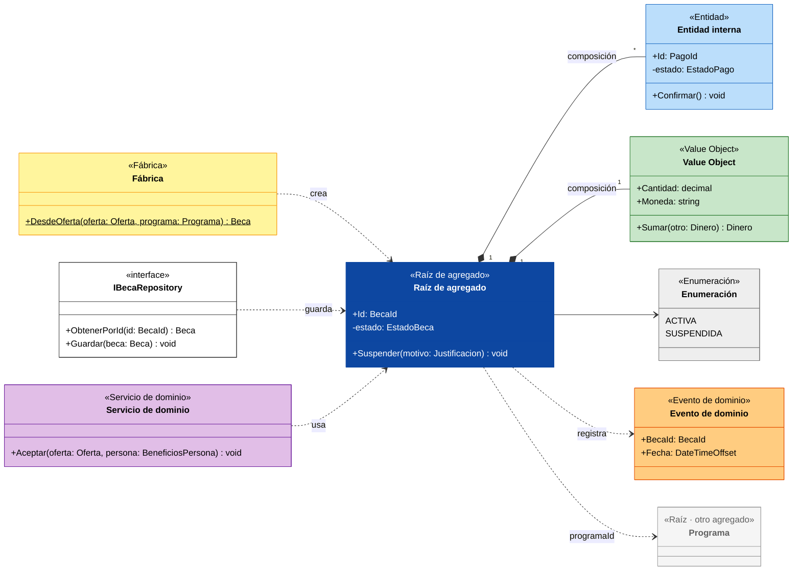

### Otras convenciones

- **Fechas de negocio:** se evalúan en UTC-4 y el día límite se incluye hasta las 23:59 (R20).
- **Pendientes:** `PENDIENTE (Anexo B: n)` usa la numeración del Anexo B de las HU, o la HU donde está la pregunta.
- **Decisiones de diseño:** se citan como `D-n` (sección 19). Son propuestas del equipo y deben validarse con el profesor.

---

## 1. Glosario (lenguaje ubicuo)

| Término de negocio | Definición (según las HU) | En el modelo | Contexto | No usar |
|---|---|---|---|---|
| Postulante | Persona que aplica a un programa; se identifica por su cédula (R1). | `Postulante` | Postulación | "usuario", "estudiante" |
| Becario/a | Postulante con una beca. Es el mismo `Postulante`, con al menos una `Beca`. | `Postulante` + `Beca` | Gestión de Becas | "beneficiario" |
| Programa de beca | Iniciativa con presupuesto, criterios, cupo y monto fijo por periodo (C1). | `Programa` | Programas y Fondos | "fondo" en el código |
| Presupuesto del programa | Suma de los aportes (S8). Disponible = aportes − otorgado − ofertas pendientes − renovaciones pendientes (regla 8). | `PresupuestoPrograma` | Programas y Fondos | "saldo" |
| Cupo del programa | Total de becarios que sostiene el programa (R10). | `Programa.cupoBecarios` | Programas y Fondos | — |
| Cupo del ciclo | Becarios nuevos que admite un ciclo (R10). | `CicloPostulacion.cupoNuevos` | Postulación | — |
| Ciclo de postulación | Periodo en el que un programa recibe postulaciones, con ventana, criterios, documentos y cupo. | `CicloPostulacion` | Postulación | — |
| Convocatoria | Un ciclo de postulación **publicado**. Es un estado del ciclo, no otra entidad. | `CicloPostulacion.publicado` | Postulación | Clase `Convocatoria` |
| Periodo académico | Periodo institucional identificado por un código único, por ejemplo "2026-2". Dirección lo abre, lo cierra y lo marca como actual. | `PeriodoAcademico`, `CodigoPeriodo` | Catálogo Institucional | — |
| Periodo de becas | El periodo académico común a todas las universidades, dentro del cual cada universidad tiene su propia fecha de inicio de inscripciones (C4). | `CodigoPeriodo` + `InicioInscripciones` | Catálogo Institucional | — |
| Periodo de evaluación | Momento en que Dirección abre la evaluación de un ciclo. Bloquea la rúbrica (R16). | `CicloPostulacion.AbrirEvaluacion()` | Postulación / Evaluación | — |
| Periodo de revisión | Lapso en que los evaluadores puntúan; a su cierre se revelan las puntuaciones (S9). | `CicloPostulacion.cierreRevision` | Evaluación | — |
| Inicio de inscripciones | Fecha de cada universidad por periodo. Cierra sus disponibilidades y termina su lista de espera (C4, R18d). | `InicioInscripciones` | Catálogo Institucional | — |
| Rúbrica | Criterios con peso y rango que suman 100 %. | `Rubrica`, `RubricaAplicada` | Programas y Fondos / Evaluación | — |
| Comité evaluador | Grupo que puntúa las postulaciones de un programa; uno de sus miembros puede tener la jefatura (S12). | `Comite`, `MiembroComite` | Evaluación | — |
| Evaluador | Miembro del comité asignado a una postulación. | `AsignacionEvaluador`, `Evaluacion` | Evaluación | "usuario" |
| Lista de espera | Marca sobre una postulación elegible no otorgada; no es un estado (S2). | `ListaEspera` | Evaluación | Estado `EnEspera` |
| Oferta | Propuesta formal de beca con monto, duración, condiciones y fecha límite. | `Oferta` | Gestión de Becas | "carta" para la entidad |
| Carta de otorgamiento | Documento de la oferta, guardado en Firebase. | `Oferta.carta` | Gestión de Becas | — |
| Compromiso | Obligaciones que algunos programas exigen firmar; es distinto de las condiciones de permanencia (HU-17.1). | `CompromisoRequerido`, `Compromiso` | Gestión de Becas | — |
| Tramo de beca | Monto aprobado de una beca para un periodo concreto (C1). | `TramoBeca` | Gestión de Becas | — |
| Desembolso | Pago **programado** en el calendario del becario (RF-19). | `Desembolso` | Gestión de Becas | — |
| Pago | Registro de un desembolso **efectivamente realizado**: fecha, monto, método, destinatario. Se confirma con OTP (RF-20). | `Pago` | Gestión de Becas | — |
| Suspensión | Pausa del beneficio con motivo y fecha de revisión, o indefinida. | `Suspension` (tipo SUSPENSION) | Gestión de Becas | — |
| Pausa | Suspensión solicitada por el becario (licencia médica o retiro temporal); la beca queda Suspendida (S5). | `Suspension` (tipo PAUSA) | Gestión de Becas | Estado `Pausada` |
| Inactiva | Beca no renovada o con pausa vencida. No es final y mantiene su cupo y presupuesto (C3, R27). | `EstadoBeca.INACTIVA` | Gestión de Becas | — |
| Revocación | Cancelación definitiva de una beca; libera presupuesto y cupo. | `Beca.Revocar()` | Gestión de Becas | "anulación" |
| Renovación | Solicitud de un becario para continuar el siguiente periodo, dentro de una ventana. | `SolicitudRenovacion`, `VentanaRenovacion` | Gestión de Becas | — |
| Estatus académico | Rendimiento del becario: promedio, materias aprobadas y reprobadas, estado de matrícula. | `ReporteAcademico` | Seguimiento Académico | — |
| Registro de decisiones | Historial inmutable de quién, cuándo y por qué de cada decisión o acción relevante. | `RegistroDecision` | Trazabilidad | "log", "evento" |
| No doble beneficio | Tres reglas simultáneas sobre las becas activas de una persona (C2, S6). | `BeneficiosPersona` | Gestión de Becas | — |
| Beca activa (para doble beneficio) | Beca en estado Otorgada, Activa, Suspendida o Renovada. Inactiva no cuenta (S6). | `EstadoBeca.CuentaComoActiva()` | Gestión de Becas | — |
| Enlace de universidad | Contacto de la universidad que certifica matrícula y rendimiento; usa 2FA (R3). | `Usuario` con tipo Enlace | Identidad y Acceso | — |

---

## 2. Subdominios y Bounded Contexts

Los contextos salen de las siete áreas de las HU. Cada término del glosario tiene un solo significado dentro de su contexto. La clasificación usa la pregunta guía de la lámina 7: **si esta pieza fuera igual a la de la competencia, ¿la Fundación perdería algo?** La clasificación depende de la estrategia, no de la tecnología (lámina 8), y debe validarse.

| Contexto | ¿Perdería algo la Fundación si fuera igual a la de otros? | Tipo |
|---|---|---|
| Evaluación y Selección | Sí. Evaluar por mérito en días y con cada decisión justificada es el objetivo 1 del PRD y lo que sostiene la confianza de los donantes. | **Core** |
| Programas y Fondos | Sí. Ver el presupuesto en tiempo real y crecer de 12 a más de 25 programas sin crecer el equipo son los objetivos 2 y 5. | **Core** |
| Gestión de Becas | No. La oferta, el calendario y los pagos son administración necesaria, como el cálculo de intereses en el banco de la lámina 8. Tiene reglas ricas (estados, no doble beneficio), por eso se modela con DDD, pero el mejor esfuerzo va al Core (lámina 47). | Soporte |
| Postulación, Seguimiento Académico, Catálogo Institucional | No: son necesarios para operar. | Soporte |
| Trazabilidad, Reportería e Impacto, Comunicaciones | No: cumplen exigencias del PRD sin diferenciar. | Soporte |
| Identidad y Acceso, Archivos, Envío de mensajes | Lo resuelve cualquiera: se usa un producto ya hecho. | Genérico |

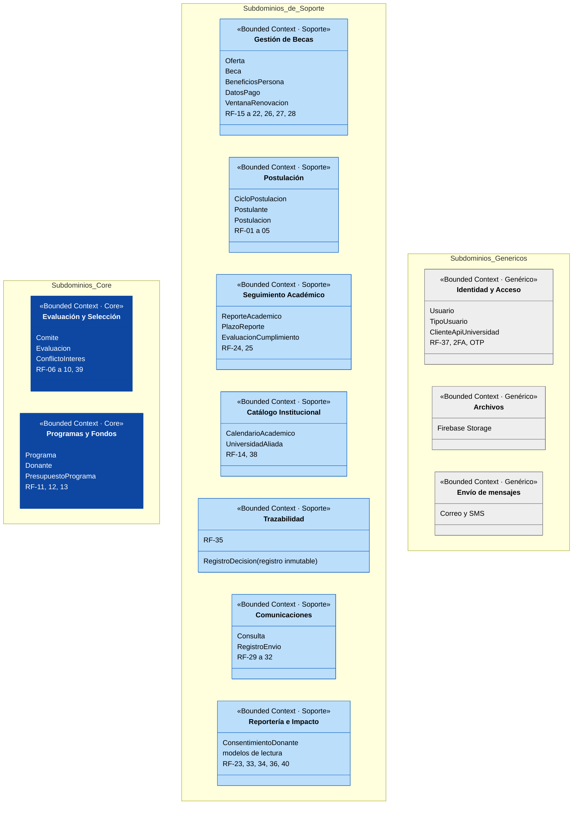

### 2.1 Responsabilidad de cada contexto

| Contexto | Tipo | Responsabilidad | Agregados |
|---|---|---|---|
| Programas y Fondos | Core | Configurar programas, registrar donantes y aportes, y **garantizar que nada supere el presupuesto ni el cupo**. | `Programa`, `Donante`, `PresupuestoPrograma` |
| Evaluación y Selección | Core | Comités, puntuación, conflictos de interés, consolidación, ranking, casos límite y lista de espera. | `Comite`, `Evaluacion`, `ConflictoInteres` (y la parte de evaluación de `Postulacion`, ver Partnership en 3) |
| Gestión de Becas | Soporte | Oferta, ciclo de vida de la beca, calendario de desembolsos y pagos, renovación, pausa, suspensión, revocación y no doble beneficio. | `Oferta`, `Beca`, `DatosPago`, `BeneficiosPersona`, `VentanaRenovacion` |
| Postulación | Soporte | Ciclos y convocatorias, perfil del postulante, documentos, verificación de elegibilidad y retiro. | `CicloPostulacion`, `Postulante`, `Postulacion` |
| Seguimiento Académico | Soporte | Recibir el estatus académico por tres vías y evaluar el cumplimiento de la permanencia. | `ReporteAcademico`, `PlazoReporte`, `EvaluacionCumplimiento` |
| Catálogo Institucional | Soporte | Periodos académicos, universidades aliadas, convenios, carreras, costo de matrícula e inicio de inscripciones. | `CalendarioAcademico`, `UniversidadAliada` |
| Trazabilidad | Soporte | Registro inmutable de decisiones y acciones relevantes. | `RegistroDecision` (registro inmutable, no es agregado) |
| Reportería e Impacto | Soporte | Reportes a donantes y a Dirección, estado financiero, panel. Casi todo es lectura (CQRS). | `ConsentimientoDonante` + modelos de lectura |
| Comunicaciones | Soporte | Consultas de postulantes y becarios, notificaciones y recordatorios sin duplicados. | `Consulta`, `RegistroEnvio` |
| Identidad y Acceso | Genérico | Cuentas, tipos de usuario y permisos, 2FA de sesión y OTP por operación. Se apoya en un proveedor externo. | `Usuario`, `TipoUsuario`, `ClienteApiUniversidad` |
| Archivos | Genérico | Guardar documentos y cartas en la cuenta de Firebase de la Fundación. | — |
| Envío de mensajes | Genérico | Entregar correos y SMS. | — |

### 2.2 Reparto sugerido del equipo por contexto

La asignación por contexto evita que dos personas compitan por los mismos conceptos, como pidió el profesor en la clase del 21-09. Cada persona queda con 8 RF, dentro del rango de 6 a 8 del PRD.

| Integrante | Contextos | RF |
|---|---|---|
| 1 | Catálogo Institucional, Programas y Fondos, Identidad y Acceso, Trazabilidad, panel | 11, 12, 13, 14, 35, 37, 38, 40 |
| 2 | Postulación y notificaciones a postulantes | 01, 02, 03, 04, 05, 29, 30, 32 |
| 3 | Evaluación y Selección, aviso al comité, reporte de impacto | 06, 07, 08, 09, 10, 31, 33, 39 |
| 4 | Gestión de Becas: oferta, aceptación, compromiso, calendario y pagos | 15, 16, 17, 18, 19, 20, 23, 34 |
| 5 | Gestión de Becas: suspensión, revocación, renovación, pausa; Seguimiento Académico | 21, 22, 24, 25, 26, 27, 28, 36 |

---

## 3. Context Map

Upstream (U) provee el modelo; downstream (D) lo consume. Todos los contextos internos comparten el **Shared Kernel** de la sección 5. Como en la lámina 16, **U** (upstream) es quien influye y **D** (downstream) quien se adapta; las etiquetas U y D van en los extremos de cada relación y el patrón, en el centro. Se presenta en dos vistas; la sección 3.1 explica cada relación.

### 3a. Contextos del sistema

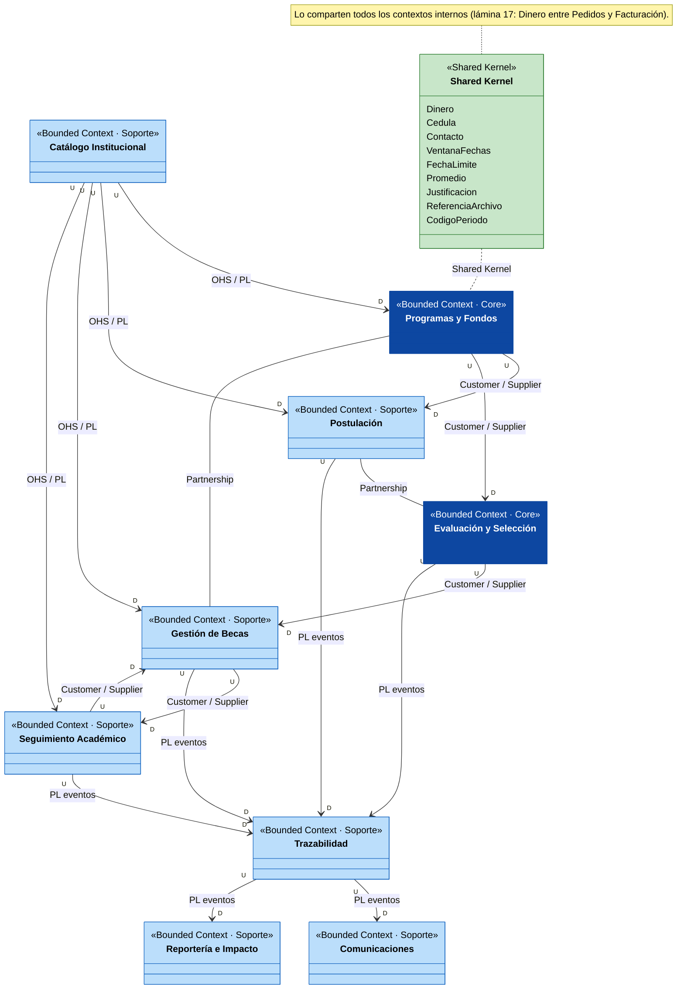

### 3b. Integraciones externas y capas anticorrupción

Cada sistema externo entra por una **capa anticorrupción**: una interfaz del dominio y un traductor que la implementa, como `TraductorPasarela` en la lámina 18.

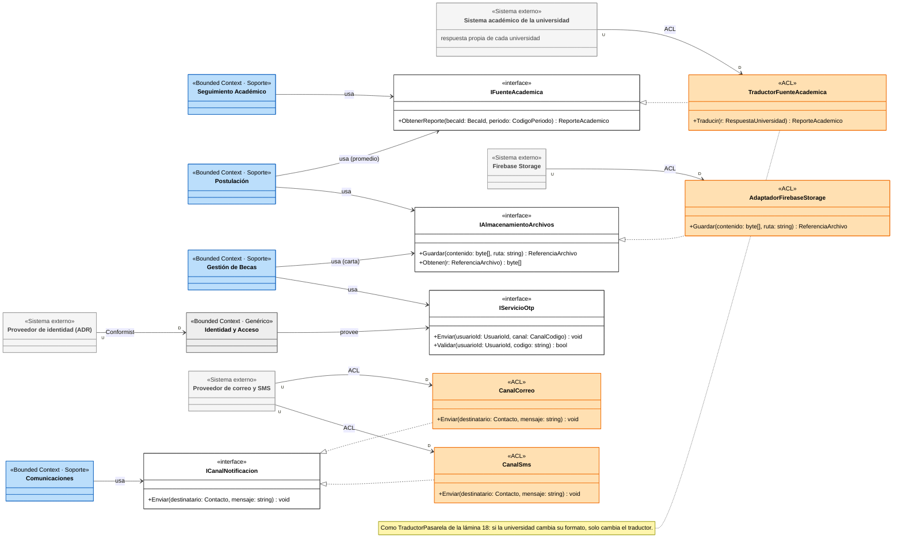

### 3.1 Relaciones del Context Map

| Relación | Patrón | Por qué |
|---|---|---|
| Catálogo → Postulación, Fondos, Becas, Seguimiento | **Open Host Service / Published Language** | Todos leen periodos, universidades, costo de matrícula vigente e inicio de inscripciones con el mismo contrato (`CodigoPeriodo`, `UniversidadId`). El Anexo A de HU-14.1 y HU-14.3 pide fijar ese contrato antes de que otras áreas lo consuman. |
| Todos los contextos internos | **Shared Kernel** | `Dinero`, `Cedula`, `Contacto`, `VentanaFechas`, `FechaLimite` (con la regla R20), `Promedio`, `Justificacion`, `ReferenciaArchivo`, `CodigoPeriodo` y los identificadores. Un cambio en el kernel se acuerda entre todos. |
| Fondos → Postulación | **Customer / Supplier** | La verificación de elegibilidad aplica la restricción de universidades y carreras del programa (HU-04.1). |
| Fondos → Evaluación | **Customer / Supplier** | Evaluación consume la rúbrica, el método de consolidación y el umbral de diferencia que define el programa (HU-07.1, HU-09.1). |
| Postulación ↔ Evaluación | **Partnership** | Las asignaciones, la excepción, la consolidación y la lista de espera viven en `Postulacion`, porque HU-06.2 exige validar el mínimo de dos evaluadores en la misma transacción. Los dos contextos evolucionan juntos. |
| Evaluación → Becas | **Customer / Supplier** | Una postulación seleccionada dentro del cupo (HU-09.2) o por caso límite (HU-10.1) habilita emitir la oferta. |
| Becas ↔ Fondos | **Partnership** | Becas reserva primero en `PresupuestoPrograma` y después cambia su propio estado; Fondos reacciona a los eventos de Becas para confirmar o liberar. Ningún flujo guarda los dos agregados a la vez (D-1). Los dos contextos evolucionan juntos y viven como módulos de la misma aplicación: un Bounded Context no es un microservicio (lámina 15). |
| Seguimiento ↔ Becas | **Customer / Supplier** en ambos sentidos | Becas provee las becas a seguir; Seguimiento publica el resultado de cumplimiento, que activa la consecuencia sobre la beca (HU-25.2). |
| Sistemas académicos → Seguimiento y Postulación | **Anti-Corruption Layer** | El formato de cada universidad se traduce a `ReporteAcademico` y `PromedioCertificado` detrás de `IFuenteAcademica`, con implementaciones API, registro manual y simulada (C5, HU-24.3). |
| Firebase Storage → Postulación y Becas | **ACL / Adapter** | Restricción del cliente: misma cuenta de Firebase. El dominio solo conoce `ReferenciaArchivo`. |
| Proveedor de identidad → Identidad y Acceso | **Conformist** | Se adopta el modelo del proveedor (tokens, roles, 2FA). El proveedor queda por decidir: Keycloak, recomendado en clase, o Firebase Authentication, sugerido en el Anexo A de HU-20.1. |
| Identidad y Acceso → contextos de negocio | **Open Host Service** | Los contextos reciben un usuario autenticado con sus tipos, programas asignados y universidad (si es enlace). Ningún contexto de negocio maneja credenciales. |
| Contextos de negocio → Trazabilidad | **Published Language** (eventos de dominio) | Cada cambio de estado se registra en la misma transacción mediante Outbox (HU-35.1). |
| Trazabilidad → Comunicaciones y Reportería | **Published Language** | Las notificaciones se disparan por suscripción a los eventos, no por llamadas desde cada HU (Anexo A HU-29.1); la línea de tiempo y el panel se alimentan igual (HU-28.1, HU-40.1). |
| Proveedor de correo y SMS → Comunicaciones | **ACL / Adapter** | Detrás de una interfaz de canal extensible (Anexo A HU-29.1). |
| — | **Caminos separados** (no se usa) | Todos los contextos participan del ciclo de vida de la beca; ninguno es independiente del resto, como el blog del banco en la lámina 17. |
---

## 4. Event Storming: línea de tiempo del negocio

Es el único diagrama que no es UML, porque reproduce las notas adhesivas de la lámina 19. Aplica sus cuatro pasos: (1) eventos del negocio en pasado, (2) ordenados en el tiempo, (3) dudas y desacuerdos marcados, (4) agrupados en contextos. Cada grupo es un Bounded Context de la sección 2, y cada nota naranja es un evento de dominio de la sección 16.2. Las notas rosadas son las dudas abiertas con el cliente.

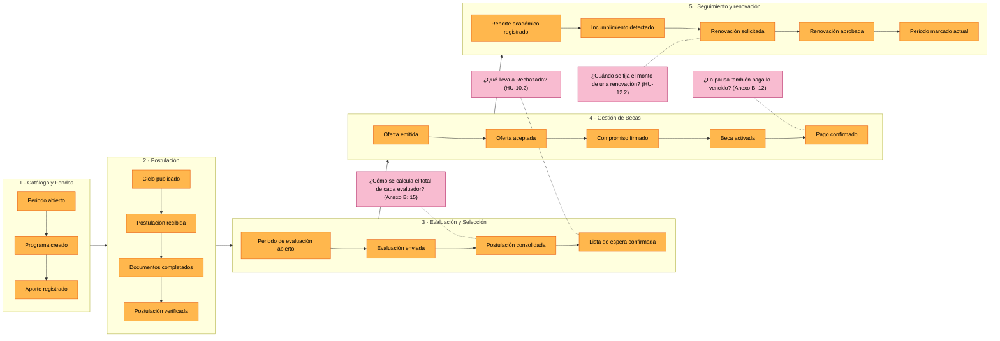

Los caminos alternativos (oferta rechazada o expirada, beca suspendida, revocada o inactivada, cupo liberado) están en la tabla de eventos (16.2) y en las máquinas de estado (sección 15).

---

## 5. Shared Kernel y tipos base

```mermaid
classDiagram
  direction TB
  class Entidad~TId~ {
    <<abstract>>
    +Id: TId
    +EventosPendientes: List~IEventoDeDominio~
    #Registrar(evento: IEventoDeDominio) void
    +Equals(otro: object) bool
  }
  class RaizDeAgregado~TId~ {
    <<abstract>>
    +Version: int
  }
  class IEventoDeDominio {
    <<interface>>
    +Fecha: DateTimeOffset
  }
  class IManejador~TEvento~ {
    <<interface>>
    +Manejar(evento: TEvento) void
  }
  class Dinero {
    <<Value Object>>
    +Cantidad: decimal
    +Moneda: string
    +Dinero(cantidad: decimal, moneda: string)
    +Sumar(otro: Dinero) Dinero
    +Restar(otro: Dinero) Dinero
    +EsMayorQue(otro: Dinero) bool
  }
  class Cedula {
    <<Value Object>>
    +Numero: string
    +Cedula(numero: string)
  }
  class Contacto {
    <<Value Object>>
    +Correo: string
    +Telefono: string
    +Contacto(correo: string, telefono: string)
  }
  class VentanaFechas {
    <<Value Object>>
    +Apertura: date
    +Cierre: date
    +VentanaFechas(apertura: date, cierre: date)
    +Contiene(momento: datetime) bool
  }
  class FechaLimite {
    <<Value Object>>
    +Fecha: date
    +FechaLimite(fecha: date)
    +Vencida(momento: datetime) bool
  }
  class Promedio {
    <<Value Object>>
    +Valor: decimal
    +Promedio(valor: decimal)
    +EsMayorOIgual(otro: Promedio) bool
  }
  class Justificacion {
    <<Value Object>>
    +Texto: string
    +Justificacion(texto: string)
  }
  class ReferenciaArchivo {
    <<Value Object>>
    +RutaFirebase: string
    +ReferenciaArchivo(ruta: string)
  }
  class CodigoPeriodo {
    <<Value Object>>
    +Valor: string
    +CodigoPeriodo(valor: string)
  }
  Entidad~TId~ <|-- RaizDeAgregado~TId~
  Entidad~TId~ ..> IEventoDeDominio : registra
  IManejador~TEvento~ ..> IEventoDeDominio : maneja
  note for Entidad "Igual a otra si tiene el mismo Id (lámina 23). Toda entidad interna hereda de aquí."
  note for RaizDeAgregado "Toda raíz hereda de aquí. Version: la base la compara al guardar (lámina 31)."
  note for Dinero "record inmutable: valida al nacer cantidad no negativa y moneda de 3 letras; no suma monedas distintas (lámina 25)."
  note for VentanaFechas "R20: UTC-4, el día de cierre se incluye hasta las 23:59. Única implementación."
  note for CodigoPeriodo "Así se referencia un periodo desde fuera de CalendarioAcademico, por ejemplo 2026-2."
  style Entidad fill:#fafafa,stroke:#424242,color:#000000
  style RaizDeAgregado fill:#fafafa,stroke:#424242,color:#000000
  style IEventoDeDominio fill:#ffffff,stroke:#424242,color:#000000
  style IManejador fill:#ffffff,stroke:#424242,color:#000000
  style Dinero fill:#c8e6c9,stroke:#2e7d32,color:#000000
  style Cedula fill:#c8e6c9,stroke:#2e7d32,color:#000000
  style Contacto fill:#c8e6c9,stroke:#2e7d32,color:#000000
  style VentanaFechas fill:#c8e6c9,stroke:#2e7d32,color:#000000
  style FechaLimite fill:#c8e6c9,stroke:#2e7d32,color:#000000
  style Promedio fill:#c8e6c9,stroke:#2e7d32,color:#000000
  style Justificacion fill:#c8e6c9,stroke:#2e7d32,color:#000000
  style ReferenciaArchivo fill:#c8e6c9,stroke:#2e7d32,color:#000000
  style CodigoPeriodo fill:#c8e6c9,stroke:#2e7d32,color:#000000
```

Los tipos base salen del código de la lámina 39: toda entidad hereda de `Entidad` (Id, `EventosPendientes`, `Registrar(evento)`, igualdad por Id), toda raíz hereda de `RaizDeAgregado` (que agrega `Version` para la concurrencia de la lámina 31), todo evento implementa `IEventoDeDominio` y todo manejador implementa `IManejador`. Cada agregado tiene un identificador tipado (`ProgramaId`, `PostulacionId`, `BecaId`, etc.).

---

## 6. Vista general, agregados y entidades

#### Raíces de agregado por contexto

Solo raíces de agregado. Las flechas son referencias por identidad. `RegistroDecision` no aparece porque no es un agregado (D-6).

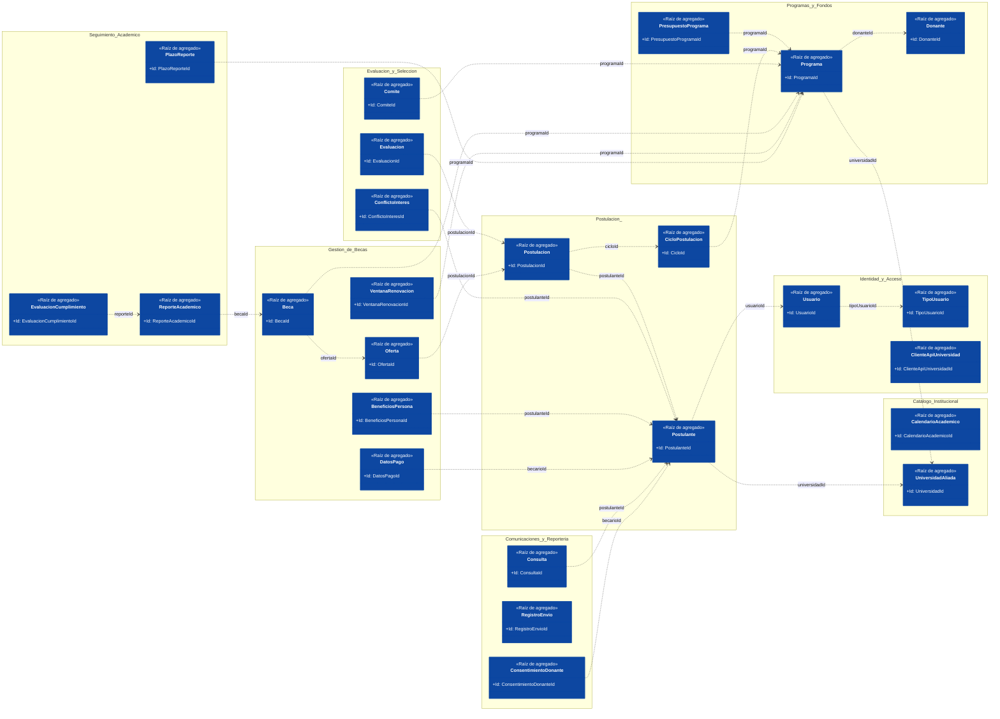

---

### 6.1 Agregados: raíz, contenido y regla que protege

Como en la lámina 30, **la raíz es la única puerta de entrada**: desde afuera nadie modifica una entidad interna sin pasar por la raíz, y otros agregados se referencian solo por Id. Esta tabla responde, para cada agregado, lo que pide la actividad de la lámina 49: raíz, entidades y la regla que protege. Las fuentes de cada regla están en 16.1.

| Contexto | Raíz (AggregateRoot) | Entidades internas | Objetos de valor | Regla que protege la raíz | Referencias por Id |
|---|---|---|---|---|---|
| Catálogo Institucional | `CalendarioAcademico` | `PeriodoAcademico` | `CodigoPeriodo` | Un solo periodo actual; código único | — |
| Catálogo Institucional | `UniversidadAliada` | `CarreraElegible`, `CostoMatricula`, `InicioInscripciones` | `Convenio`, `Contacto` | Costos e inicios de inscripción solo se agregan; vigente = último | — |
| Programas y Fondos | `Programa` | `Rubrica`, `RestriccionElegibilidad` | `Criterio`, `CondicionesPermanencia`, `PoliticaConsecuencias`, `CompromisoRequerido`, `ConfigComunicacion`, `Dinero` | Pesos suman 100 %; rúbrica bloqueada tras abrir la evaluación; cada donante una vez | `DonanteId`, `UniversidadId`, `CodigoPeriodo` |
| Programas y Fondos | `Donante` | `Aporte` | `Contacto`, `Dinero` | Los aportes solo se agregan | `ProgramaId` |
| Programas y Fondos | `PresupuestoPrograma` | `CupoCiclo` | `Dinero` | Disponible ≥ 0; cupo del programa y de cada ciclo nunca se superan | `ProgramaId`, `CicloId` |
| Postulación | `CicloPostulacion` | — | `VentanaFechas`, `CriterioElegibilidad`, `DocumentoRequerido`, `RubricaAplicada` | Apertura antes del cierre; la rúbrica se congela al abrir la evaluación | `ProgramaId`, `CodigoPeriodo` |
| Postulación | `Postulante` | — | `Cedula`, `Contacto`, `PerfilAcademico`, `PromedioCertificado`, `DatosSocioeconomicos` | Una cuenta por cédula; postula solo con perfil completo | `UsuarioId`, `UniversidadId` |
| Postulación | `Postulacion` | `DocumentoCargado`, `AsignacionEvaluador` | `CopiaPerfil`, `ExcepcionAutorizada`, `Seleccion`, `ListaEspera`, `MotivoNoElegibilidad` | Sin saltar etapas; mínimo dos evaluadores o excepción; una sola oferta pendiente; retiro solo antes de evaluar | `PostulanteId`, `CicloId`, `UsuarioId`, `OfertaId` |
| Evaluación y Selección | `Comite` | — | `MiembroComite` | Solo miembros asignados; una jefatura designada | `ProgramaId`, `UsuarioId` |
| Evaluación y Selección | `Evaluacion` | — | `Puntuacion`, `RubricaAplicada` | Puntuaciones en rango; no se envía incompleta | `PostulacionId`, `UsuarioId` |
| Evaluación y Selección | `ConflictoInteres` | — | — | Inmutable una vez declarado | `UsuarioId`, `PostulanteId` |
| Gestión de Becas | `Oferta` | — | `Dinero`, `CondicionesPermanencia`, `FechaLimite`, `ReferenciaArchivo` | Se acepta una sola vez y antes de la fecha límite | `PostulacionId`, `PostulanteId`, `ProgramaId`, `CicloId` |
| Gestión de Becas | `Beca` | `TramoBeca`, `Suspension`, `SolicitudPausa`, `SolicitudRenovacion`, `Desembolso`, `Pago` | `Compromiso`, `Dinero`, `Justificacion`, `FechaLimite` | Solo transiciones permitidas; lo pagado por periodo no supera su tramo; sin pagos sin compromiso exigido ni en estados que lo impiden | `PostulanteId`, `ProgramaId`, `OfertaId` |
| Gestión de Becas | `BeneficiosPersona` | `BeneficioVigente` | `Cedula`, `Dinero` | No dos becas COMPLETO activas; suma por periodo ≤ costo de matrícula (C2) | `PostulanteId`, `BecaId`, `ProgramaId` |
| Gestión de Becas | `DatosPago` | — | `CuentaBancaria` | Solo el becario registra o modifica | `PostulanteId` |
| Gestión de Becas | `VentanaRenovacion` | — | `VentanaFechas` | Solo se solicita la renovación dentro de la ventana | `ProgramaId`, `CodigoPeriodo` |
| Seguimiento Académico | `ReporteAcademico` | — | `Promedio` | Append-only; la entrega tardía la calcula el propio reporte | `BecaId`, `UsuarioId` |
| Seguimiento Académico | `PlazoReporte` | — | `FechaLimite` | Un plazo por programa y periodo | `ProgramaId`, `CodigoPeriodo` |
| Seguimiento Académico | `EvaluacionCumplimiento` | — | `ResultadoCondicion` | Una evaluación por reporte | `ReporteAcademicoId`, `BecaId` |
| Identidad y Acceso | `Usuario` | — | `Cedula`, `Contacto` | Cédula única; se desactiva, nunca se borra | `TipoUsuarioId`, `ProgramaId`, `UniversidadId` |
| Identidad y Acceso | `TipoUsuario` | — | — | Acceso financiero o de decisión exige 2FA | — |
| Identidad y Acceso | `ClienteApiUniversidad` | — | — | Solo envía reportes de su universidad | `UniversidadId` |
| Comunicaciones | `Consulta` | `Mensaje` | `SujetoRef` | Abierta, respondida, cerrada; ningún mensaje se pierde | `PostulanteId` |
| Comunicaciones | `RegistroEnvio` | — | — | Uno por destinatario, hito y anticipación | `UsuarioId` |
| Reportería e Impacto | `ConsentimientoDonante` | — | — | Uno vigente y lo da el propio becario | `PostulanteId` |

`RegistroDecision` no aparece porque no es un agregado (D-6). Los **límites de cada agregado** se ven como paquetes (`Agregado_…`) en el diagrama de clases de su contexto, secciones 7 a 14.

### 6.2 Entidades y objetos de valor

Criterios de las láminas 23 y 25:

- **Entidad:** tiene un identificador que no cambia, sus datos cambian con el tiempo, es igual a otra si tiene el mismo Id y protege sus propias reglas. Toda raíz de agregado es una entidad.
- **Objeto de valor:** no tiene identidad, es igual a otro si todos sus valores son iguales, es inmutable (si cambia, es otro), se valida al nacer y tiene comportamiento.

#### Criterio de clasificación: `Pago` (entidad) frente a `Dinero` (value object)

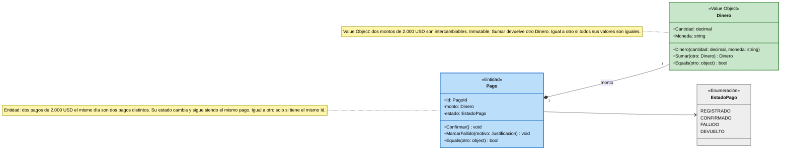

#### Las 43 entidades y los 33 value objects del modelo

Cada paquete `Agregado_…` es un agregado: su raíz (azul oscuro), sus entidades internas (azul claro) y sus value objects (verde), unidos por composición ◆. Esta vista muestra la **identidad y el estado** de cada uno; su comportamiento (métodos), sus eventos y sus repositorios están en el diagrama de clases de su contexto (secciones 7 a 14).

##### a. Entidades y value objects: Catálogo Institucional y Programas y Fondos

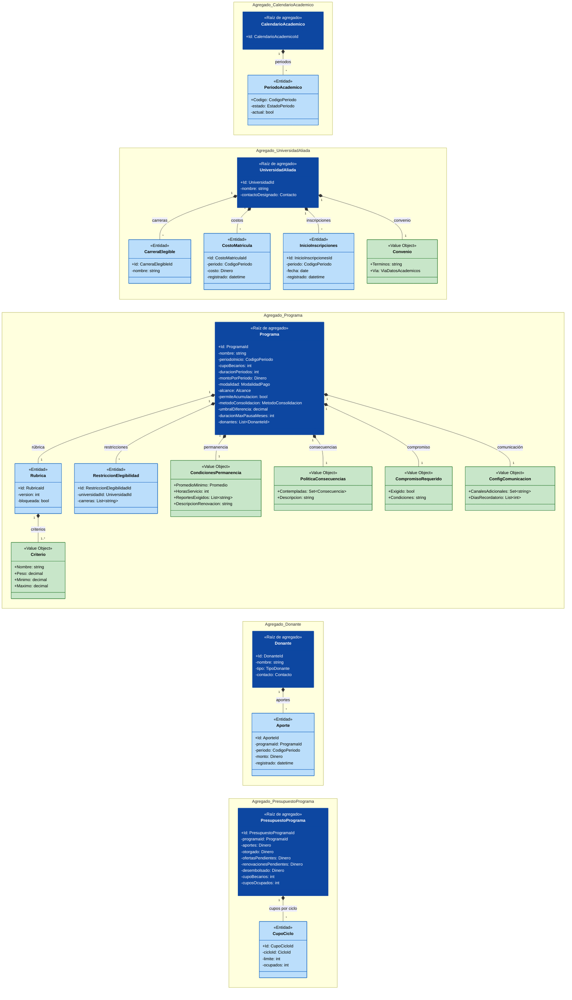

##### b. Entidades y value objects: Postulación y Evaluación y Selección

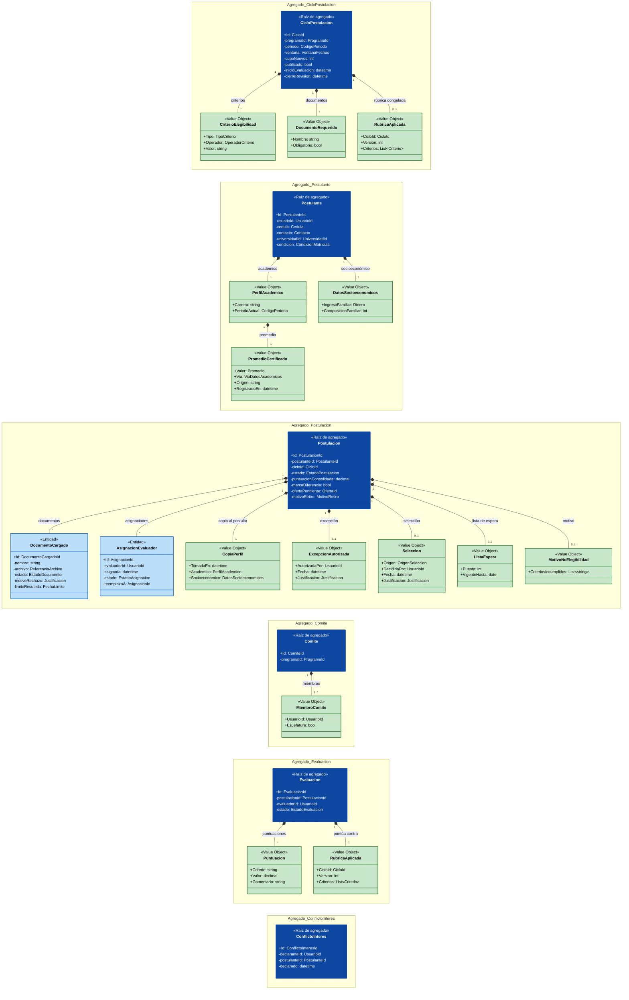

`RubricaAplicada` aparece dos veces porque es la misma copia inmutable dentro de dos agregados: el ciclo y cada evaluación. Se cuenta una sola vez.

##### c. Entidades y value objects: Gestión de Becas

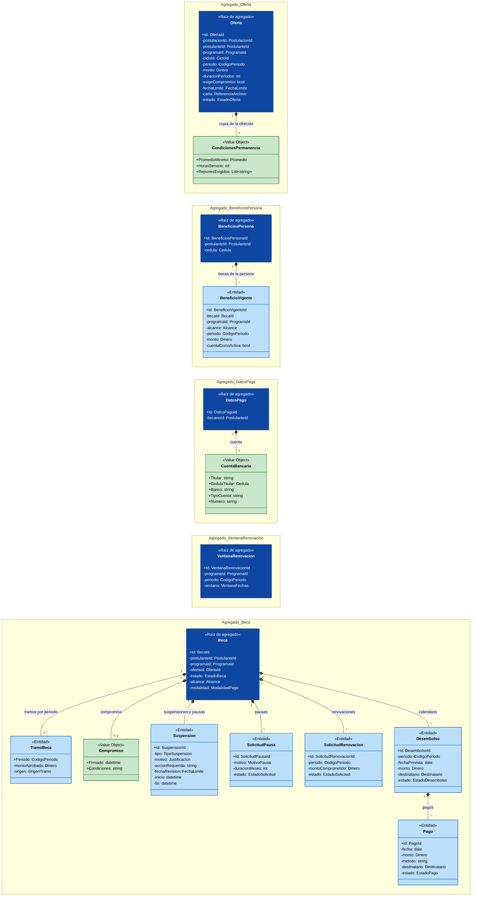

##### d. Entidades y value objects: Seguimiento Académico, Identidad y Acceso, Comunicaciones, Reportería y Trazabilidad

```mermaid
classDiagram
  direction LR
  namespace Agregado_ReporteAcademico {
    class ReporteAcademico {
      <<Raíz de agregado>>
      +Id: ReporteAcademicoId
      -becaId: BecaId
      -periodo: CodigoPeriodo
      -promedio: Promedio
      -materiasAprobadas: int
      -materiasReprobadas: int
      -matricula: EstadoMatricula
      -origen: OrigenReporte
      -autorId: UsuarioId
      -entregado: datetime
      -tardio: bool
    }
  }
  namespace Agregado_PlazoReporte {
    class PlazoReporte {
      <<Raíz de agregado>>
      +Id: PlazoReporteId
      -programaId: ProgramaId
      -periodo: CodigoPeriodo
      -fechaLimite: FechaLimite
    }
  }
  namespace Agregado_EvaluacionCumplimiento {
    class EvaluacionCumplimiento {
      <<Raíz de agregado>>
      +Id: EvaluacionCumplimientoId
      -reporteId: ReporteAcademicoId
      -becaId: BecaId
      -resultado: ResultadoGlobal
      -consecuencia: Consecuencia
      -siguientePaso: string
    }
    class ResultadoCondicion {
      <<Value Object>>
      +Condicion: string
      +Cumple: bool
    }
  }
  namespace Agregado_Usuario {
    class Usuario {
      <<Raíz de agregado>>
      +Id: UsuarioId
      -cedula: Cedula
      -contacto: Contacto
      -canalPreferido: CanalCodigo
      -estado: EstadoUsuario
      -tipos: Set~TipoUsuarioId~
      -programasAsignados: Set~ProgramaId~
      -universidadId: UniversidadId
    }
  }
  namespace Agregado_TipoUsuario {
    class TipoUsuario {
      <<Raíz de agregado>>
      +Id: TipoUsuarioId
      -nombre: string
      -permisos: Set~string~
      -accesoFinancieroODecision: bool
    }
  }
  namespace Agregado_ClienteApiUniversidad {
    class ClienteApiUniversidad {
      <<Raíz de agregado>>
      +Id: ClienteApiUniversidadId
      -universidadId: UniversidadId
      -activo: bool
    }
  }
  namespace Registro_de_decisiones {
    class RegistroDecision {
      <<Registro inmutable>>
      +Id: RegistroDecisionId
      -tipo: TipoDecision
      -ocurrido: datetime
      -justificacion: Justificacion
      -estadoAnterior: string
      -estadoNuevo: string
      -datos: string
    }
    class SujetoRef {
      <<Value Object>>
      +Tipo: TipoSujeto
      +Id: string
    }
    class Actor {
      <<Value Object>>
      +UsuarioId: UsuarioId
      +Rol: string
      +EsSistema: bool
    }
  }
  namespace Agregado_Consulta {
    class Consulta {
      <<Raíz de agregado>>
      +Id: ConsultaId
      -autorId: PostulanteId
      -estado: EstadoConsulta
    }
    class Mensaje {
      <<Entidad>>
      +Id: MensajeId
      -autor: Actor
      -texto: string
      -enviado: datetime
    }
    class SujetoConsulta["SujetoRef"] {
      <<Value Object>>
      +Tipo: TipoSujeto
      +Id: string
    }
  }
  namespace Agregado_RegistroEnvio {
    class RegistroEnvio {
      <<Raíz de agregado>>
      +Id: RegistroEnvioId
      -destinatarioId: UsuarioId
      -hito: string
      -canal: string
      -anticipacionDias: int
      -estado: EstadoEnvio
    }
  }
  namespace Agregado_ConsentimientoDonante {
    class ConsentimientoDonante {
      <<Raíz de agregado>>
      +Id: ConsentimientoDonanteId
      -becarioId: PostulanteId
      -aceptado: datetime
    }
  }
  EvaluacionCumplimiento "1" *-- "*" ResultadoCondicion : resultados
  RegistroDecision "1" *-- "1" SujetoRef : sobre
  RegistroDecision "1" *-- "1" Actor : quién
  Consulta "1" *-- "*" Mensaje : mensajes
  Consulta "1" *-- "1" SujetoConsulta : sobre
  style ReporteAcademico fill:#0d47a1,stroke:#0d47a1,color:#ffffff
  style PlazoReporte fill:#0d47a1,stroke:#0d47a1,color:#ffffff
  style EvaluacionCumplimiento fill:#0d47a1,stroke:#0d47a1,color:#ffffff
  style ResultadoCondicion fill:#c8e6c9,stroke:#2e7d32,color:#000000
  style Usuario fill:#0d47a1,stroke:#0d47a1,color:#ffffff
  style TipoUsuario fill:#0d47a1,stroke:#0d47a1,color:#ffffff
  style ClienteApiUniversidad fill:#0d47a1,stroke:#0d47a1,color:#ffffff
  style RegistroDecision fill:#d7ccc8,stroke:#5d4037,color:#000000
  style SujetoRef fill:#c8e6c9,stroke:#2e7d32,color:#000000
  style Actor fill:#c8e6c9,stroke:#2e7d32,color:#000000
  style Consulta fill:#0d47a1,stroke:#0d47a1,color:#ffffff
  style Mensaje fill:#bbdefb,stroke:#1565c0,color:#000000
  style SujetoConsulta fill:#c8e6c9,stroke:#2e7d32,color:#000000
  style RegistroEnvio fill:#0d47a1,stroke:#0d47a1,color:#ffffff
  style ConsentimientoDonante fill:#0d47a1,stroke:#0d47a1,color:#ffffff
```

`RegistroDecision` aparece en marrón porque no es una entidad ni un agregado (D-6); se muestra solo porque contiene a los value objects `SujetoRef` y `Actor`.

##### e. Value objects del Shared Kernel

```mermaid
classDiagram
  direction LR
  namespace Shared_Kernel {
    class Dinero {
      <<Value Object>>
      +Cantidad: decimal
      +Moneda: string
    }
    class Cedula {
      <<Value Object>>
      +Numero: string
    }
    class Contacto {
      <<Value Object>>
      +Correo: string
      +Telefono: string
    }
    class VentanaFechas {
      <<Value Object>>
      +Apertura: date
      +Cierre: date
    }
    class FechaLimite {
      <<Value Object>>
      +Fecha: date
    }
    class Promedio {
      <<Value Object>>
      +Valor: decimal
    }
    class Justificacion {
      <<Value Object>>
      +Texto: string
    }
    class ReferenciaArchivo {
      <<Value Object>>
      +RutaFirebase: string
    }
    class CodigoPeriodo {
      <<Value Object>>
      +Valor: string
    }
  }
  style Dinero fill:#c8e6c9,stroke:#2e7d32,color:#000000
  style Cedula fill:#c8e6c9,stroke:#2e7d32,color:#000000
  style Contacto fill:#c8e6c9,stroke:#2e7d32,color:#000000
  style VentanaFechas fill:#c8e6c9,stroke:#2e7d32,color:#000000
  style FechaLimite fill:#c8e6c9,stroke:#2e7d32,color:#000000
  style Promedio fill:#c8e6c9,stroke:#2e7d32,color:#000000
  style Justificacion fill:#c8e6c9,stroke:#2e7d32,color:#000000
  style ReferenciaArchivo fill:#c8e6c9,stroke:#2e7d32,color:#000000
  style CodigoPeriodo fill:#c8e6c9,stroke:#2e7d32,color:#000000
```

#### Entidades raíz

Todas tienen un Id propio tipado (`BecaId`, `PostulacionId`, etc.) y ciclo de vida.

| Raíz | Identidad | Además, es única por | Ciclo de vida |
|---|---|---|---|
| `CalendarioAcademico` | `CalendarioAcademicoId` | Uno en el sistema | Sus periodos se abren, cierran y marcan actuales |
| `UniversidadAliada` | `UniversidadId` | — | Agrega carreras, costos e inicios de inscripción |
| `Programa` | `ProgramaId` | — | Configuración y rúbrica, que se bloquea |
| `Donante` | `DonanteId` | — | Acumula aportes |
| `PresupuestoPrograma` | `PresupuestoProgramaId` | Uno por programa | Sus montos y cupos cambian en cada operación |
| `CicloPostulacion` | `CicloId` | — | Se publica, abre evaluación y cierra revisión |
| `Postulante` | `PostulanteId` | Cédula (R1) | Su perfil se actualiza por secciones |
| `Postulacion` | `PostulacionId` | — | Estados de 15.1 |
| `Comite` | `ComiteId` | Uno por programa | Agrega miembros y designa jefatura |
| `Evaluacion` | `EvaluacionId` | Par evaluador y postulación | Estados de 15.10 |
| `ConflictoInteres` | `ConflictoInteresId` | — | Inmutable, pero se consulta después: como la transferencia realizada de la lámina 28 |
| `Oferta` | `OfertaId` | — | Estados de 15.3 |
| `Beca` | `BecaId` | — | Estados de 15.2 |
| `BeneficiosPersona` | `BeneficiosPersonaId` | Uno por postulante | Cambia con cada beca que se acepta o cambia de estado |
| `DatosPago` | `DatosPagoId` | Uno por becario | Su cuenta se registra y se cambia |
| `VentanaRenovacion` | `VentanaRenovacionId` | Programa y periodo | Se define y se consulta |
| `ReporteAcademico` | `ReporteAcademicoId` | — | Inmutable, pero se consulta y se evalúa después |
| `PlazoReporte` | `PlazoReporteId` | Programa y periodo | Se define y se consulta |
| `EvaluacionCumplimiento` | `EvaluacionCumplimientoId` | Uno por reporte | Evalúa y registra la consecuencia |
| `Usuario` | `UsuarioId` | Cédula (R1) | Estados de 15.13 |
| `TipoUsuario` | `TipoUsuarioId` | — | Sus permisos cambian |
| `ClienteApiUniversidad` | `ClienteApiUniversidadId` | Uno por universidad | Activo o revocado |
| `Consulta` | `ConsultaId` | — | Estados de 15.6 |
| `RegistroEnvio` | `RegistroEnvioId` | Destinatario, hito y anticipación | Entregado o fallido |
| `ConsentimientoDonante` | `ConsentimientoDonanteId` | Uno vigente por becario | Se acepta |

#### Entidades internas

Solo se alcanzan a través de su raíz. Su identidad es local al agregado.

| Entidad | Agregado | Identidad | Por qué es entidad y no objeto de valor |
|---|---|---|---|
| `PeriodoAcademico` | `CalendarioAcademico` | `codigo` (natural, por ejemplo 2026-2) | Su estado y la marca de actual cambian, y todo el modelo lo referencia |
| `CarreraElegible` | `UniversidadAliada` | `CarreraElegibleId` | Los programas la restringen; si se corrige su nombre sigue siendo la misma carrera |
| `CostoMatricula` | `UniversidadAliada` | `CostoMatriculaId` | Cada registro, incluso una corrección, es un hecho distinto que se consulta después (HU-14.2) |
| `InicioInscripciones` | `UniversidadAliada` | `InicioInscripcionesId` | Igual que el costo: historial de registros |
| `Rubrica` | `Programa` | `RubricaId` y `version` | Se edita hasta bloquearse y sigue siendo la misma rúbrica |
| `RestriccionElegibilidad` | `Programa` | `RestriccionElegibilidadId` (una por universidad) | Su lista de carreras cambia |
| `Aporte` | `Donante` | `AporteId` | Dos aportes iguales en fechas distintas son dos aportes; se consultan después (HU-13.2) |
| `CupoCiclo` | `PresupuestoPrograma` | `CupoCicloId` (uno por ciclo) | Sus cupos ocupados cambian |
| `DocumentoCargado` | `Postulacion` | `DocumentoCargadoId` | Estados de 15.8 |
| `AsignacionEvaluador` | `Postulacion` | `AsignacionId` | Estados de 15.9; el reemplazo apunta a la asignación anterior |
| `TramoBeca` | `Beca` | `periodo` (natural: uno por periodo) | Los desembolsos y pagos se imputan a un tramo concreto |
| `Suspension` | `Beca` | `SuspensionId` | Se cierra al reanudar (`fin`); una beca acumula varias |
| `SolicitudPausa` | `Beca` | `SolicitudPausaId` | Estados de 15.12 |
| `SolicitudRenovacion` | `Beca` | `SolicitudRenovacionId` | Estados de 15.11 |
| `Desembolso` | `Beca` | `DesembolsoId` | Estados de 15.4; sus pagos lo referencian |
| `Pago` | `Beca` (dentro de `Desembolso`) | `PagoId` | Estados de 15.5; el OTP confirma un pago concreto |
| `BeneficioVigente` | `BeneficiosPersona` | `BeneficioVigenteId` (uno por beca) | Cambia si la beca deja de contar como activa |
| `Mensaje` | `Consulta` | `MensajeId` | Dos mensajes con el mismo texto son dos mensajes distintos, con su autor y su fecha |

#### Objetos de valor

| Objeto de valor | Dónde vive | Por qué solo importa cómo es |
|---|---|---|
| `Dinero`, `Cedula`, `Contacto`, `Promedio`, `Justificacion`, `ReferenciaArchivo`, `CodigoPeriodo` | Shared Kernel | Dos iguales son intercambiables, como el billete de la lámina 25 |
| `VentanaFechas`, `FechaLimite` | Shared Kernel | Un rango o una fecha con la regla R20; si cambia, es otro |
| `Convenio` | `UniversidadAliada` | Términos y vía; si cambian, se reemplaza completo |
| `Criterio`, `CondicionesPermanencia`, `PoliticaConsecuencias`, `CompromisoRequerido`, `ConfigComunicacion` | `Programa` | Configuración que se reemplaza completa |
| `CriterioElegibilidad`, `DocumentoRequerido`, `RubricaAplicada` | `CicloPostulacion` | Definiciones del ciclo; la rúbrica aplicada es una copia inmutable |
| `PerfilAcademico`, `PromedioCertificado`, `DatosSocioeconomicos` | `Postulante` | Se reemplazan por sección al actualizar el perfil |
| `CopiaPerfil`, `ExcepcionAutorizada`, `Seleccion`, `ListaEspera`, `MotivoNoElegibilidad` | `Postulacion` | Fotos o marcas inmutables de un momento |
| `MiembroComite` | `Comite` | Solo importa qué usuario es y si tiene la jefatura |
| `Puntuacion` | `Evaluacion` | Valor y comentario para un criterio |
| `Compromiso` | `Beca` | Fecha y condiciones firmadas, inmutables y una por beca |
| `CuentaBancaria` | `DatosPago` | Si cambia la cuenta, se reemplaza completa |
| `ResultadoCondicion` | `EvaluacionCumplimiento` | Resultado de una condición |
| `SujetoRef`, `Actor` | `RegistroDecision`, `Consulta` | Referencias y fotos del momento |

#### Depende del contexto

Como dice la lámina 28, una misma idea puede ser entidad en un lugar y objeto de valor en otro:

| Concepto | Como entidad | Como objeto de valor |
|---|---|---|
| Rúbrica | `Rubrica` en `Programa`: se edita y se versiona | `RubricaAplicada` en el ciclo: copia inmutable contra la que se puntúa |
| Perfil del postulante | Los datos viven en el `Postulante`, que cambia | `CopiaPerfil` en la postulación: foto del momento de postular (R22) |
| Condiciones de permanencia | — | En `Programa` son configuración; en `Oferta`, la copia de lo ofrecido |
| Universidad | `UniversidadAliada` en Catálogo Institucional | En Postulación solo se guarda su Id |
| Persona del comité | `Usuario` en Identidad y Acceso | `MiembroComite` en Evaluación y Selección |
| Cuenta bancaria | Lo sería en el sistema de un banco | En ASCENSO, `CuentaBancaria` dentro de `DatosPago` |

### 6.3 Totales del modelo

Contados sobre los diagramas de esta versión.

| Elemento | Cantidad |
|---|---|
| Bounded Contexts | 12 (2 Core, 7 Soporte, 3 Genéricos) |
| Agregados | 25 |
| Raíces de agregado | 25 (cada agregado tiene exactamente una) |
| Entidades internas | 18 |
| **Entidades en total** (raíces + internas) | **43** |
| **Value Objects** | **33** (9 del Shared Kernel + 24 de los contextos) |
| Enumeraciones | 34 |
| Eventos de dominio | 34 |
| Servicios de dominio | 4 |
| Fábricas | 3 |
| Repositorios | 25 (uno por raíz) |
| Registro inmutable (no es agregado) | 1 (`RegistroDecision`) |
| Tipos base | 4 (`Entidad`, `RaizDeAgregado`, `IEventoDeDominio`, `IManejador`) |
| Capas anticorrupción | 4 interfaces con 4 traductores o adaptadores |
| Sistemas externos | 4 |
| Modelos de lectura (CQRS) | 10 |
| Máquinas de estado | 13 |

| Contexto | Agregados (raíces) | Entidades internas | Value Objects | Enumeraciones | Eventos | Repositorios |
|---|---|---|---|---|---|---|
| Catálogo Institucional | 2 | 4 | 1 | 2 | 2 | 2 |
| Programas y Fondos | 3 | 4 | 5 | 5 | 3 | 3 |
| Postulación | 3 | 2 | 11 | 8 | 7 | 3 |
| Evaluación y Selección | 3 | 0 | 2 | 1 | 2 | 3 |
| Gestión de Becas | 5 | 7 | 2 | 9 | 18 | 5 |
| Seguimiento Académico | 3 | 0 | 1 | 3 | 2 | 3 |
| Identidad y Acceso | 3 | 0 | 0 | 2 | 0 | 3 |
| Comunicaciones | 2 | 1 | 0 | 2 | 0 | 2 |
| Reportería e Impacto | 1 | 0 | 0 | 0 | 0 | 1 |
| Trazabilidad | 0 | 0 | 2 | 2 | 0 | 0 |
| Shared Kernel | — | — | 9 | — | — | — |
| **Total** | **25** | **18** | **33** | **34** | **34** | **25** |

De los 25 agregados, 9 tienen entidades internas (`Beca` tiene 7) y 16 son solo la raíz con sus value objects. Un mismo value object copiado en dos agregados se cuenta una vez: `CondicionesPermanencia` (en `Programa` y en `Oferta`) y `RubricaAplicada` (en el ciclo y en `Evaluacion`).

---

## 7. Catálogo Institucional

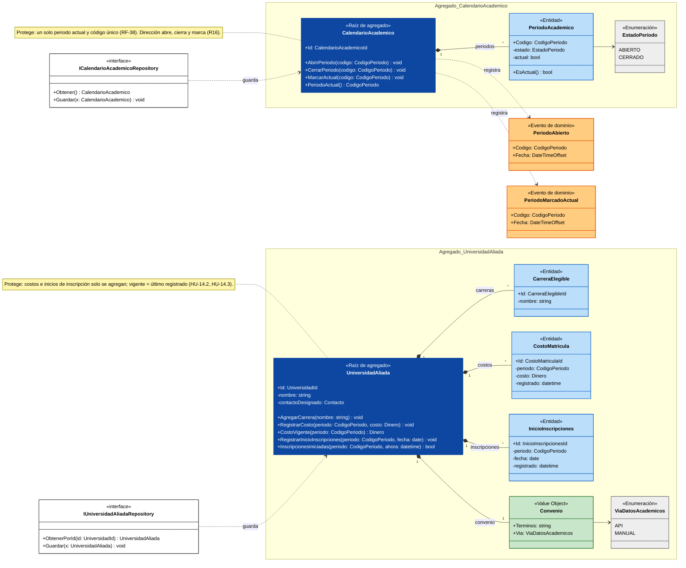

---

## 8. Programas y Fondos

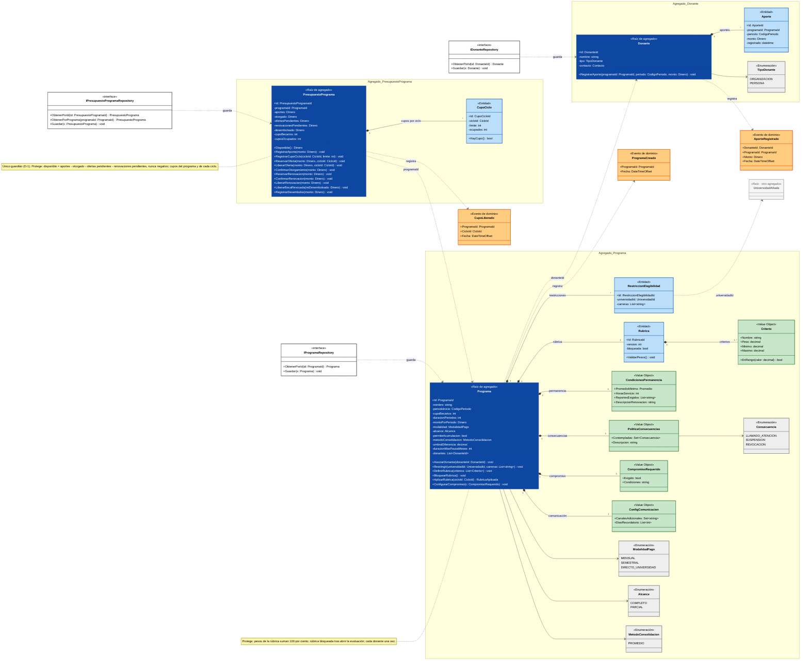

---

## 9. Postulación

### 9a. Ciclo de postulación y postulante

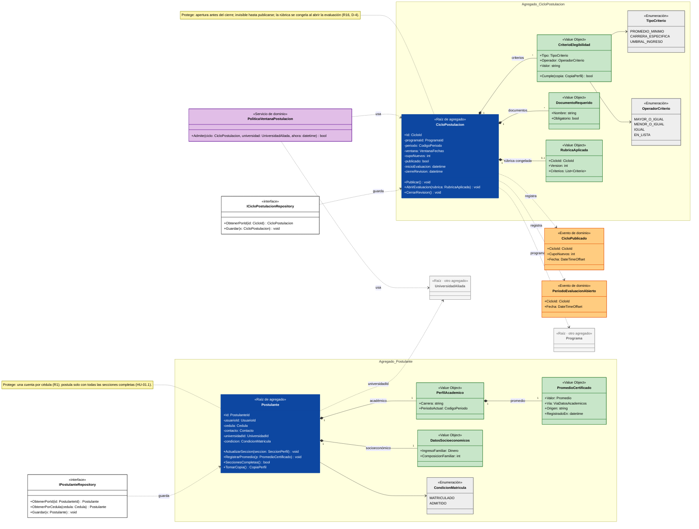

### 9b. La postulación

```mermaid
classDiagram
  direction LR
  namespace Agregado_Postulacion {
    class Postulacion {
      <<Raíz de agregado>>
      +Id: PostulacionId
      -postulanteId: PostulanteId
      -cicloId: CicloId
      -estado: EstadoPostulacion
      -puntuacionConsolidada: decimal
      -marcaDiferencia: bool
      -ofertaPendiente: OfertaId
      -motivoRetiro: MotivoRetiro
      +CargarDocumento(nombre: string, archivo: ReferenciaArchivo) void
      +RechazarDocumento(nombre: string, motivo: Justificacion, limite: FechaLimite) void
      +RegistrarVerificacion(cumple: bool, motivo: MotivoNoElegibilidad) void
      +AnularNoElegible(coordinadorId: UsuarioId, j: Justificacion) void
      +AsignarEvaluador(evaluadorId: UsuarioId) void
      +ReemplazarEvaluador(saliente: UsuarioId, entrante: UsuarioId) void
      +AutorizarExcepcion(coordinadorId: UsuarioId, j: Justificacion) void
      +Consolidar(totales: List~decimal~, umbral: decimal) void
      +SeleccionarPorRanking() void
      +ResolverCasoLimite(decisorId: UsuarioId, seleccionar: bool, j: Justificacion) void
      +ConfirmarListaEspera(puesto: int, hasta: date) void
      +TerminarListaEspera() void
      +RegistrarOfertaEmitida(ofertaId: OfertaId) void
      +RegistrarOfertaAceptada() void
      +RegistrarOfertaCerrada(motivo: MotivoRetiro) void
      +Retirar() void
    }
    class DocumentoCargado {
      <<Entidad>>
      +Id: DocumentoCargadoId
      -nombre: string
      -archivo: ReferenciaArchivo
      -estado: EstadoDocumento
      -motivoRechazo: Justificacion
      -limiteResubida: FechaLimite
      +Rechazar(motivo: Justificacion, limite: FechaLimite) void
    }
    class AsignacionEvaluador {
      <<Entidad>>
      +Id: AsignacionId
      -evaluadorId: UsuarioId
      -asignada: datetime
      -estado: EstadoAsignacion
      -reemplazaA: AsignacionId
      +RetirarPorConflicto() void
    }
    class CopiaPerfil {
      <<Value Object>>
      +TomadaEn: datetime
      +Academico: PerfilAcademico
      +Socioeconomico: DatosSocioeconomicos
    }
    class ExcepcionAutorizada {
      <<Value Object>>
      +AutorizadaPor: UsuarioId
      +Fecha: datetime
      +Justificacion: Justificacion
    }
    class Seleccion {
      <<Value Object>>
      +Origen: OrigenSeleccion
      +DecididaPor: UsuarioId
      +Fecha: datetime
      +Justificacion: Justificacion
    }
    class ListaEspera {
      <<Value Object>>
      +Puesto: int
      +VigenteHasta: date
    }
    class MotivoNoElegibilidad {
      <<Value Object>>
      +CriteriosIncumplidos: List~string~
    }
    class EstadoPostulacion {
      <<Enumeración>>
      RECIBIDA
      EN_VERIFICACION
      EN_EVALUACION
      NO_ELEGIBLE
      OTORGADA
      RECHAZADA
      RETIRADA
    }
    class MotivoRetiro {
      <<Enumeración>>
      VOLUNTARIO
      OFERTA_RECHAZADA
      OFERTA_EXPIRADA
    }
    class EstadoDocumento {
      <<Enumeración>>
      FALTANTE
      CARGADO
      RECHAZADO
    }
    class EstadoAsignacion {
      <<Enumeración>>
      VIGENTE
      RETIRADA_POR_CONFLICTO
    }
    class OrigenSeleccion {
      <<Enumeración>>
      RANKING
      CASO_LIMITE
    }
  }
  class PostulacionFactory {
    <<Fábrica>>
    +Crear(postulante: Postulante, ciclo: CicloPostulacion, ahora: datetime)$ Postulacion
  }
  class VerificadorElegibilidad {
    <<Servicio de dominio>>
    +Verificar(copia: CopiaPerfil, criterios: List~CriterioElegibilidad~, restricciones: List~RestriccionElegibilidad~) MotivoNoElegibilidad
  }
  class PostulacionRecibida {
    <<Evento de dominio>>
    +PostulacionId: PostulacionId
    +Fecha: DateTimeOffset
  }
  class DocumentosCompletados {
    <<Evento de dominio>>
    +PostulacionId: PostulacionId
    +Fecha: DateTimeOffset
  }
  class PostulacionVerificada {
    <<Evento de dominio>>
    +PostulacionId: PostulacionId
    +Elegible: bool
    +Fecha: DateTimeOffset
  }
  class PostulacionConsolidada {
    <<Evento de dominio>>
    +PostulacionId: PostulacionId
    +Puntuacion: decimal
    +Fecha: DateTimeOffset
  }
  class ListaEsperaConfirmada {
    <<Evento de dominio>>
    +PostulacionId: PostulacionId
    +Puesto: int
    +Fecha: DateTimeOffset
  }
  class IPostulacionRepository {
    <<interface>>
    +ObtenerPorId(id: PostulacionId) Postulacion
    +EnListaEspera(cicloId: CicloId) List~Postulacion~
    +Guardar(x: Postulacion) void
  }
  class Postulante {
    <<Raíz · otro agregado>>
  }
  class CicloPostulacion {
    <<Raíz · otro agregado>>
  }
  class Oferta {
    <<Raíz · otro agregado>>
  }
  Postulacion "1" *-- "*" DocumentoCargado : documentos
  Postulacion "1" *-- "*" AsignacionEvaluador : asignaciones
  Postulacion "1" *-- "1" CopiaPerfil : copia al postular
  Postulacion "1" *-- "0..1" ExcepcionAutorizada : excepción
  Postulacion "1" *-- "0..1" Seleccion : selección
  Postulacion "1" *-- "0..1" ListaEspera : lista de espera
  Postulacion "1" *-- "0..1" MotivoNoElegibilidad : motivo
  Postulacion --> EstadoPostulacion
  Postulacion --> MotivoRetiro
  DocumentoCargado --> EstadoDocumento
  AsignacionEvaluador --> EstadoAsignacion
  Seleccion --> OrigenSeleccion
  Postulacion ..> Postulante : postulanteId
  Postulacion ..> CicloPostulacion : cicloId
  Postulacion ..> Oferta : ofertaPendiente
  PostulacionFactory ..> Postulacion : crea
  VerificadorElegibilidad ..> Postulacion : usa
  Postulacion ..> PostulacionRecibida : registra
  Postulacion ..> DocumentosCompletados : registra
  Postulacion ..> PostulacionVerificada : registra
  Postulacion ..> PostulacionConsolidada : registra
  Postulacion ..> ListaEsperaConfirmada : registra
  IPostulacionRepository ..> Postulacion : guarda
  note for Postulacion "Protege: sin saltar etapas; mínimo dos evaluadores vigentes o excepción; una sola oferta pendiente; retiro solo en Recibida o En verificación (HU-04.1, 05.1, 06.2, 15.1)."
  style Postulacion fill:#0d47a1,stroke:#0d47a1,color:#ffffff
  style DocumentoCargado fill:#bbdefb,stroke:#1565c0,color:#000000
  style AsignacionEvaluador fill:#bbdefb,stroke:#1565c0,color:#000000
  style CopiaPerfil fill:#c8e6c9,stroke:#2e7d32,color:#000000
  style ExcepcionAutorizada fill:#c8e6c9,stroke:#2e7d32,color:#000000
  style Seleccion fill:#c8e6c9,stroke:#2e7d32,color:#000000
  style ListaEspera fill:#c8e6c9,stroke:#2e7d32,color:#000000
  style MotivoNoElegibilidad fill:#c8e6c9,stroke:#2e7d32,color:#000000
  style EstadoPostulacion fill:#eeeeee,stroke:#757575,color:#000000
  style MotivoRetiro fill:#eeeeee,stroke:#757575,color:#000000
  style EstadoDocumento fill:#eeeeee,stroke:#757575,color:#000000
  style EstadoAsignacion fill:#eeeeee,stroke:#757575,color:#000000
  style OrigenSeleccion fill:#eeeeee,stroke:#757575,color:#000000
  style PostulacionFactory fill:#fff59d,stroke:#f9a825,color:#000000
  style VerificadorElegibilidad fill:#e1bee7,stroke:#6a1b9a,color:#000000
  style PostulacionRecibida fill:#ffcc80,stroke:#e65100,color:#000000
  style DocumentosCompletados fill:#ffcc80,stroke:#e65100,color:#000000
  style PostulacionVerificada fill:#ffcc80,stroke:#e65100,color:#000000
  style PostulacionConsolidada fill:#ffcc80,stroke:#e65100,color:#000000
  style ListaEsperaConfirmada fill:#ffcc80,stroke:#e65100,color:#000000
  style IPostulacionRepository fill:#ffffff,stroke:#424242,color:#000000
  style Postulante fill:#f5f5f5,stroke:#9e9e9e,color:#616161
  style CicloPostulacion fill:#f5f5f5,stroke:#9e9e9e,color:#616161
  style Oferta fill:#f5f5f5,stroke:#9e9e9e,color:#616161
```

---

## 10. Evaluación y Selección

Las asignaciones, la excepción, la consolidación, la selección y la lista de espera viven dentro de `Postulacion` (sección 9), por la Partnership con Postulación. Aquí están los agregados propios del contexto.

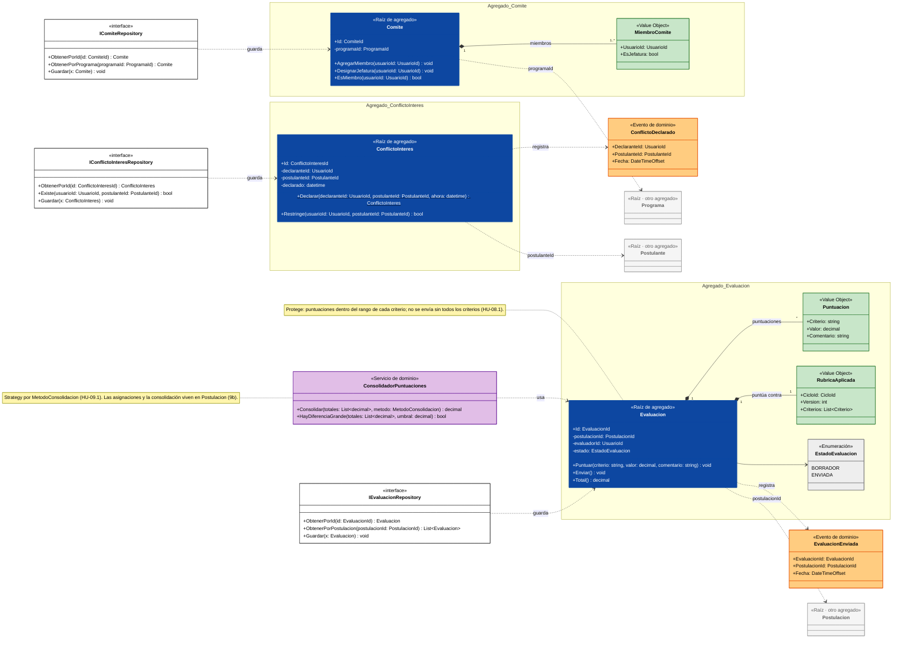

El **ranking** (HU-09.2) es un modelo de lectura que se genera a pedido del coordinador, ordenado por `puntuacionConsolidada` y contrastado con la disponibilidad de `PresupuestoPrograma`. No es un agregado. PENDIENTE (HU-09.2): si se registra cada generación del ranking.

---

## 11. Gestión de Becas

### 11a. Oferta, no doble beneficio, datos de pago y ventana de renovación

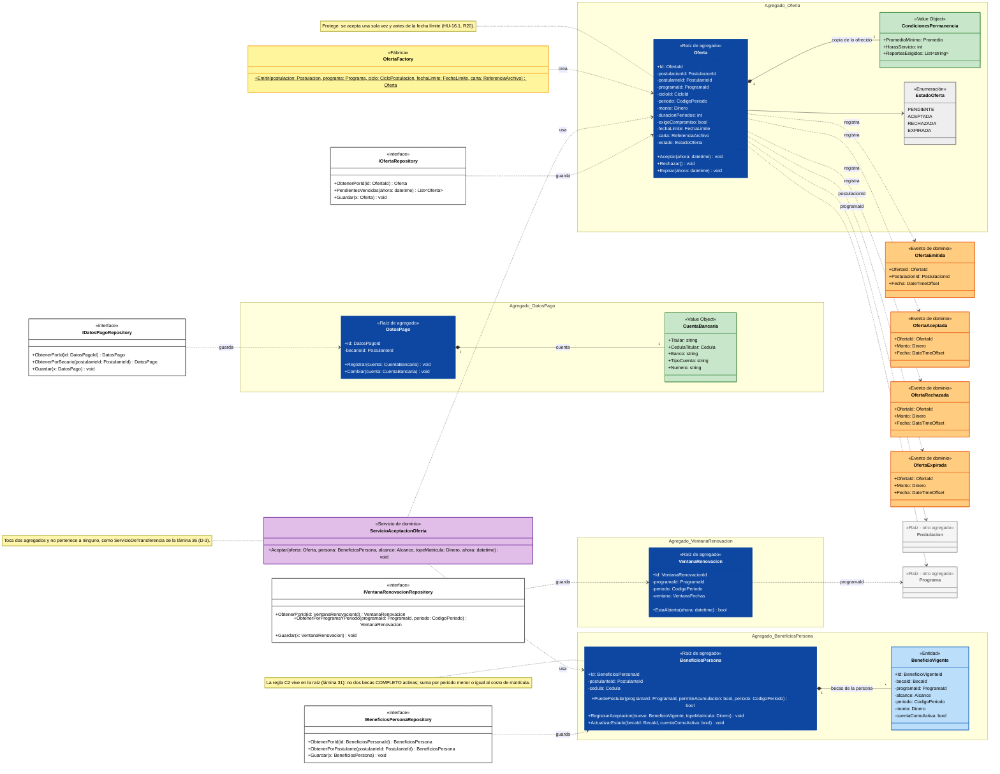

### 11b. Beca: tramos, compromiso, suspensiones, renovaciones y calendario de desembolsos

```mermaid
classDiagram
  direction LR
  namespace Agregado_Beca {
    class Beca {
      <<Raíz de agregado>>
      +Id: BecaId
      -postulanteId: PostulanteId
      -programaId: ProgramaId
      -ofertaId: OfertaId
      -estado: EstadoBeca
      -alcance: Alcance
      -modalidad: ModalidadPago
      +Activar() void
      +FirmarCompromiso() void
      +Suspender(motivo: Justificacion, accion: string, revision: FechaLimite) void
      +Reanudar(j: Justificacion) void
      +SolicitarPausa(motivo: MotivoPausa, meses: int) void
      +AprobarPausa(solicitudId: SolicitudPausaId, j: Justificacion) void
      +RechazarPausa(solicitudId: SolicitudPausaId, j: Justificacion) void
      +ReactivarTrasPausa(estatusVerificado: bool, j: Justificacion) void
      +VencerPausa() void
      +SolicitarRenovacion(periodo: CodigoPeriodo, monto: Dinero) void
      +AprobarRenovacion(j: Justificacion) void
      +RechazarRenovacion(j: Justificacion) void
      +IniciarNuevoPeriodo(periodo: CodigoPeriodo) void
      +SalirDeInactiva(aActiva: bool, j: Justificacion) void
      +Concluir(j: Justificacion) void
      +Revocar(motivo: Justificacion, grave: bool) void
      +ProgramarDesembolsos(periodo: CodigoPeriodo, fechas: List~date~) void
      +RegistrarPago(desembolsoId: DesembolsoId, fecha: date, metodo: string) void
      +ConfirmarPago(pagoId: PagoId) void
      +MarcarPagoFallido(pagoId: PagoId, j: Justificacion) void
      +MarcarPagoDevuelto(pagoId: PagoId, j: Justificacion) void
    }
    class TramoBeca {
      <<Entidad>>
      +Periodo: CodigoPeriodo
      -montoAprobado: Dinero
      -origen: OrigenTramo
    }
    class Suspension {
      <<Entidad>>
      +Id: SuspensionId
      -tipo: TipoSuspension
      -motivo: Justificacion
      -accionRequerida: string
      -fechaRevision: FechaLimite
      -inicio: datetime
      -fin: datetime
    }
    class SolicitudPausa {
      <<Entidad>>
      +Id: SolicitudPausaId
      -motivo: MotivoPausa
      -duracionMeses: int
      -estado: EstadoSolicitud
    }
    class SolicitudRenovacion {
      <<Entidad>>
      +Id: SolicitudRenovacionId
      -periodo: CodigoPeriodo
      -montoComprometido: Dinero
      -estado: EstadoSolicitud
    }
    class Desembolso {
      <<Entidad>>
      +Id: DesembolsoId
      -periodo: CodigoPeriodo
      -fechaPrevista: date
      -monto: Dinero
      -destinatario: Destinatario
      -estado: EstadoDesembolso
    }
    class Pago {
      <<Entidad>>
      +Id: PagoId
      -fecha: date
      -monto: Dinero
      -metodo: string
      -destinatario: Destinatario
      -estado: EstadoPago
      +Confirmar() void
      +MarcarFallido(j: Justificacion) void
    }
    class Compromiso {
      <<Value Object>>
      +Firmado: datetime
      +Condiciones: string
    }
    class EstadoBeca {
      <<Enumeración>>
      OTORGADA
      ACTIVA
      SUSPENDIDA
      RENOVADA
      INACTIVA
      CONCLUIDA
      REVOCADA
    }
    class OrigenTramo {
      <<Enumeración>>
      OFERTA
      RENOVACION
    }
    class TipoSuspension {
      <<Enumeración>>
      SUSPENSION
      PAUSA
    }
    class MotivoPausa {
      <<Enumeración>>
      LICENCIA_MEDICA
      RETIRO_TEMPORAL
    }
    class EstadoSolicitud {
      <<Enumeración>>
      PENDIENTE
      APROBADA
      RECHAZADA
    }
    class Destinatario {
      <<Enumeración>>
      BECARIO
      UNIVERSIDAD
    }
    class EstadoDesembolso {
      <<Enumeración>>
      PROGRAMADO
      PAGADO
      CON_INCIDENCIA
      CANCELADO
    }
    class EstadoPago {
      <<Enumeración>>
      REGISTRADO
      CONFIRMADO
      FALLIDO
      DEVUELTO
    }
  }
  class BecaFactory {
    <<Fábrica>>
    +DesdeOferta(oferta: Oferta, programa: Programa)$ Beca
  }
  class BecaActivada {
    <<Evento de dominio>>
    +BecaId: BecaId
    +Fecha: DateTimeOffset
  }
  class BecaSuspendida {
    <<Evento de dominio>>
    +BecaId: BecaId
    +Motivo: Justificacion
    +Fecha: DateTimeOffset
  }
  class BecaInactivada {
    <<Evento de dominio>>
    +BecaId: BecaId
    +Fecha: DateTimeOffset
  }
  class BecaRevocada {
    <<Evento de dominio>>
    +BecaId: BecaId
    +MontoNoDesembolsado: Dinero
    +Fecha: DateTimeOffset
  }
  class RenovacionSolicitada {
    <<Evento de dominio>>
    +BecaId: BecaId
    +Monto: Dinero
    +Fecha: DateTimeOffset
  }
  class PagoConfirmado {
    <<Evento de dominio>>
    +BecaId: BecaId
    +PagoId: PagoId
    +Monto: Dinero
    +Fecha: DateTimeOffset
  }
  class CompromisoFirmado {
    <<Evento de dominio>>
    +BecaId: BecaId
    +Fecha: DateTimeOffset
  }
  class BecaReanudada {
    <<Evento de dominio>>
    +BecaId: BecaId
    +Fecha: DateTimeOffset
  }
  class BecaRenovada {
    <<Evento de dominio>>
    +BecaId: BecaId
    +Periodo: CodigoPeriodo
    +Fecha: DateTimeOffset
  }
  class BecaConcluida {
    <<Evento de dominio>>
    +BecaId: BecaId
    +Fecha: DateTimeOffset
  }
  class RenovacionAprobada {
    <<Evento de dominio>>
    +BecaId: BecaId
    +Monto: Dinero
    +Fecha: DateTimeOffset
  }
  class RenovacionRechazada {
    <<Evento de dominio>>
    +BecaId: BecaId
    +Monto: Dinero
    +Fecha: DateTimeOffset
  }
  class PagoFallido {
    <<Evento de dominio>>
    +BecaId: BecaId
    +PagoId: PagoId
    +Fecha: DateTimeOffset
  }
  class PagoDevuelto {
    <<Evento de dominio>>
    +BecaId: BecaId
    +PagoId: PagoId
    +Fecha: DateTimeOffset
  }
  class IBecaRepository {
    <<interface>>
    +ObtenerPorId(id: BecaId) Beca
    +ParaCambioDePeriodo(periodo: CodigoPeriodo) List~BecaId~
    +Guardar(x: Beca) void
  }
  class Oferta {
    <<Raíz · otro agregado>>
  }
  class Programa {
    <<Raíz · otro agregado>>
  }
  Beca "1" *-- "1..*" TramoBeca : tramos por periodo
  Beca "1" *-- "0..1" Compromiso : compromiso
  Beca "1" *-- "*" Suspension : suspensiones y pausas
  Beca "1" *-- "*" SolicitudPausa : pausas
  Beca "1" *-- "*" SolicitudRenovacion : renovaciones
  Beca "1" *-- "*" Desembolso : calendario
  Desembolso "1" *-- "*" Pago : pagos
  Beca --> EstadoBeca
  TramoBeca --> OrigenTramo
  Suspension --> TipoSuspension
  SolicitudPausa --> MotivoPausa
  SolicitudPausa --> EstadoSolicitud
  SolicitudRenovacion --> EstadoSolicitud
  Desembolso --> Destinatario
  Desembolso --> EstadoDesembolso
  Pago --> EstadoPago
  Beca ..> Oferta : ofertaId
  Beca ..> Programa : programaId
  BecaFactory ..> Beca : crea
  Beca ..> BecaActivada : registra
  Beca ..> BecaSuspendida : registra
  Beca ..> BecaInactivada : registra
  Beca ..> BecaRevocada : registra
  Beca ..> RenovacionSolicitada : registra
  Beca ..> PagoConfirmado : registra
  Beca ..> CompromisoFirmado : registra
  Beca ..> BecaReanudada : registra
  Beca ..> BecaRenovada : registra
  Beca ..> BecaConcluida : registra
  Beca ..> RenovacionAprobada : registra
  Beca ..> RenovacionRechazada : registra
  Beca ..> PagoFallido : registra
  Beca ..> PagoDevuelto : registra
  IBecaRepository ..> Beca : guarda
  note for Beca "Protege: solo las transiciones de 15.2 (patrón State); lo pagado por periodo no supera su tramo; sin pagos sin compromiso exigido, ni en Suspendida, Revocada, Concluida o Inactiva para el periodo siguiente."
  note for TramoBeca "Identidad natural: su periodo dentro de la beca (C1)."
  style Beca fill:#0d47a1,stroke:#0d47a1,color:#ffffff
  style TramoBeca fill:#bbdefb,stroke:#1565c0,color:#000000
  style Suspension fill:#bbdefb,stroke:#1565c0,color:#000000
  style SolicitudPausa fill:#bbdefb,stroke:#1565c0,color:#000000
  style SolicitudRenovacion fill:#bbdefb,stroke:#1565c0,color:#000000
  style Desembolso fill:#bbdefb,stroke:#1565c0,color:#000000
  style Pago fill:#bbdefb,stroke:#1565c0,color:#000000
  style Compromiso fill:#c8e6c9,stroke:#2e7d32,color:#000000
  style EstadoBeca fill:#eeeeee,stroke:#757575,color:#000000
  style OrigenTramo fill:#eeeeee,stroke:#757575,color:#000000
  style TipoSuspension fill:#eeeeee,stroke:#757575,color:#000000
  style MotivoPausa fill:#eeeeee,stroke:#757575,color:#000000
  style EstadoSolicitud fill:#eeeeee,stroke:#757575,color:#000000
  style Destinatario fill:#eeeeee,stroke:#757575,color:#000000
  style EstadoDesembolso fill:#eeeeee,stroke:#757575,color:#000000
  style EstadoPago fill:#eeeeee,stroke:#757575,color:#000000
  style BecaFactory fill:#fff59d,stroke:#f9a825,color:#000000
  style BecaActivada fill:#ffcc80,stroke:#e65100,color:#000000
  style BecaSuspendida fill:#ffcc80,stroke:#e65100,color:#000000
  style BecaInactivada fill:#ffcc80,stroke:#e65100,color:#000000
  style BecaRevocada fill:#ffcc80,stroke:#e65100,color:#000000
  style RenovacionSolicitada fill:#ffcc80,stroke:#e65100,color:#000000
  style PagoConfirmado fill:#ffcc80,stroke:#e65100,color:#000000
  style CompromisoFirmado fill:#ffcc80,stroke:#e65100,color:#000000
  style BecaReanudada fill:#ffcc80,stroke:#e65100,color:#000000
  style BecaRenovada fill:#ffcc80,stroke:#e65100,color:#000000
  style BecaConcluida fill:#ffcc80,stroke:#e65100,color:#000000
  style RenovacionAprobada fill:#ffcc80,stroke:#e65100,color:#000000
  style RenovacionRechazada fill:#ffcc80,stroke:#e65100,color:#000000
  style PagoFallido fill:#ffcc80,stroke:#e65100,color:#000000
  style PagoDevuelto fill:#ffcc80,stroke:#e65100,color:#000000
  style IBecaRepository fill:#ffffff,stroke:#424242,color:#000000
  style Oferta fill:#f5f5f5,stroke:#9e9e9e,color:#616161
  style Programa fill:#f5f5f5,stroke:#9e9e9e,color:#616161
```

---

## 12. Seguimiento Académico

```mermaid
classDiagram
  direction LR
  namespace Agregado_ReporteAcademico {
    class ReporteAcademico {
      <<Raíz de agregado>>
      +Id: ReporteAcademicoId
      -becaId: BecaId
      -periodo: CodigoPeriodo
      -promedio: Promedio
      -materiasAprobadas: int
      -materiasReprobadas: int
      -matricula: EstadoMatricula
      -origen: OrigenReporte
      -autorId: UsuarioId
      -entregado: datetime
      -tardio: bool
      +Registrar(becaId: BecaId, periodo: CodigoPeriodo, promedio: Promedio, origen: OrigenReporte, plazo: PlazoReporte, ahora: datetime)$ ReporteAcademico
      +EsTardio() bool
    }
    class OrigenReporte {
      <<Enumeración>>
      BECARIO
      ENLACE_UNIVERSIDAD
      API_UNIVERSIDAD
    }
    class EstadoMatricula {
      <<Enumeración>>
      INSCRITO
    }
  }
  namespace Agregado_PlazoReporte {
    class PlazoReporte {
      <<Raíz de agregado>>
      +Id: PlazoReporteId
      -programaId: ProgramaId
      -periodo: CodigoPeriodo
      -fechaLimite: FechaLimite
      +Vencido(momento: datetime) bool
    }
  }
  namespace Agregado_EvaluacionCumplimiento {
    class EvaluacionCumplimiento {
      <<Raíz de agregado>>
      +Id: EvaluacionCumplimientoId
      -reporteId: ReporteAcademicoId
      -becaId: BecaId
      -resultado: ResultadoGlobal
      -consecuencia: Consecuencia
      -siguientePaso: string
      +Evaluar(condiciones: CondicionesPermanencia, reporte: ReporteAcademico) void
      +RegistrarConsecuencia(tipo: Consecuencia, siguientePaso: string, j: Justificacion) void
    }
    class ResultadoCondicion {
      <<Value Object>>
      +Condicion: string
      +Cumple: bool
    }
    class ResultadoGlobal {
      <<Enumeración>>
      CUMPLE
      NO_CUMPLE
    }
  }
  class ReporteAcademicoRegistrado {
    <<Evento de dominio>>
    +ReporteId: ReporteAcademicoId
    +BecaId: BecaId
    +Tardio: bool
    +Fecha: DateTimeOffset
  }
  class IncumplimientoDetectado {
    <<Evento de dominio>>
    +BecaId: BecaId
    +Condiciones: List~string~
    +Fecha: DateTimeOffset
  }
  class IReporteAcademicoRepository {
    <<interface>>
    +ObtenerPorId(id: ReporteAcademicoId) ReporteAcademico
    +Guardar(x: ReporteAcademico) void
  }
  class IPlazoReporteRepository {
    <<interface>>
    +ObtenerPorId(id: PlazoReporteId) PlazoReporte
    +ObtenerPorProgramaYPeriodo(programaId: ProgramaId, periodo: CodigoPeriodo) PlazoReporte
    +Guardar(x: PlazoReporte) void
  }
  class IEvaluacionCumplimientoRepository {
    <<interface>>
    +ObtenerPorId(id: EvaluacionCumplimientoId) EvaluacionCumplimiento
    +ExisteParaReporte(reporteId: ReporteAcademicoId) bool
    +Guardar(x: EvaluacionCumplimiento) void
  }
  class Beca {
    <<Raíz · otro agregado>>
  }
  ReporteAcademico --> OrigenReporte
  ReporteAcademico --> EstadoMatricula
  EvaluacionCumplimiento "1" *-- "*" ResultadoCondicion : resultados
  EvaluacionCumplimiento --> ResultadoGlobal
  ReporteAcademico ..> Beca : becaId
  ReporteAcademico ..> PlazoReporte : compara contra
  EvaluacionCumplimiento ..> ReporteAcademico : reporteId
  ReporteAcademico ..> ReporteAcademicoRegistrado : registra
  EvaluacionCumplimiento ..> IncumplimientoDetectado : registra
  IReporteAcademicoRepository ..> ReporteAcademico : guarda
  IPlazoReporteRepository ..> PlazoReporte : guarda
  IEvaluacionCumplimientoRepository ..> EvaluacionCumplimiento : guarda
  note for ReporteAcademico "Protege: append-only; Registrar calcula si es tardío con el PlazoReporte (lámina 44: sin modelo anémico)."
  note for EvaluacionCumplimiento "Protege: una por reporte. Incumplir la permanencia es incumplimiento grave (R19)."
  note for EstadoMatricula "PENDIENTE: valores sin definir en el PRD y las HU."
  style ReporteAcademico fill:#0d47a1,stroke:#0d47a1,color:#ffffff
  style OrigenReporte fill:#eeeeee,stroke:#757575,color:#000000
  style EstadoMatricula fill:#eeeeee,stroke:#757575,color:#000000
  style PlazoReporte fill:#0d47a1,stroke:#0d47a1,color:#ffffff
  style EvaluacionCumplimiento fill:#0d47a1,stroke:#0d47a1,color:#ffffff
  style ResultadoCondicion fill:#c8e6c9,stroke:#2e7d32,color:#000000
  style ResultadoGlobal fill:#eeeeee,stroke:#757575,color:#000000
  style ReporteAcademicoRegistrado fill:#ffcc80,stroke:#e65100,color:#000000
  style IncumplimientoDetectado fill:#ffcc80,stroke:#e65100,color:#000000
  style IReporteAcademicoRepository fill:#ffffff,stroke:#424242,color:#000000
  style IPlazoReporteRepository fill:#ffffff,stroke:#424242,color:#000000
  style IEvaluacionCumplimientoRepository fill:#ffffff,stroke:#424242,color:#000000
  style Beca fill:#f5f5f5,stroke:#9e9e9e,color:#616161
```

---

## 13. Identidad y Acceso

```mermaid
classDiagram
  direction LR
  namespace Agregado_Usuario {
    class Usuario {
      <<Raíz de agregado>>
      +Id: UsuarioId
      -cedula: Cedula
      -contacto: Contacto
      -canalPreferido: CanalCodigo
      -estado: EstadoUsuario
      -tipos: Set~TipoUsuarioId~
      -programasAsignados: Set~ProgramaId~
      -universidadId: UniversidadId
      +RequiereSegundoFactor() bool
      +Desactivar() void
    }
    class CanalCodigo {
      <<Enumeración>>
      CORREO
      SMS
    }
    class EstadoUsuario {
      <<Enumeración>>
      ACTIVO
      DESACTIVADO
    }
  }
  namespace Agregado_TipoUsuario {
    class TipoUsuario {
      <<Raíz de agregado>>
      +Id: TipoUsuarioId
      -nombre: string
      -permisos: Set~string~
      -accesoFinancieroODecision: bool
      +OtorgarPermiso(permiso: string) void
      +ExigeSegundoFactor() bool
    }
  }
  namespace Agregado_ClienteApiUniversidad {
    class ClienteApiUniversidad {
      <<Raíz de agregado>>
      +Id: ClienteApiUniversidadId
      -universidadId: UniversidadId
      -activo: bool
      +PuedeEnviarPor(universidadId: UniversidadId) bool
      +Revocar() void
    }
  }
  class IUsuarioRepository {
    <<interface>>
    +ObtenerPorId(id: UsuarioId) Usuario
    +ObtenerPorCedula(cedula: Cedula) Usuario
    +Guardar(x: Usuario) void
  }
  class ITipoUsuarioRepository {
    <<interface>>
    +ObtenerPorId(id: TipoUsuarioId) TipoUsuario
    +ObtenerTodos() List~TipoUsuario~
    +Guardar(x: TipoUsuario) void
  }
  class IClienteApiUniversidadRepository {
    <<interface>>
    +ObtenerPorId(id: ClienteApiUniversidadId) ClienteApiUniversidad
    +Guardar(x: ClienteApiUniversidad) void
  }
  class UniversidadAliada {
    <<Raíz · otro agregado>>
  }
  Usuario --> CanalCodigo
  Usuario --> EstadoUsuario
  Usuario ..> TipoUsuario : tipoUsuarioId
  ClienteApiUniversidad ..> UniversidadAliada : universidadId
  Usuario ..> UniversidadAliada : universidadId del enlace
  IUsuarioRepository ..> Usuario : guarda
  ITipoUsuarioRepository ..> TipoUsuario : guarda
  IClienteApiUniversidadRepository ..> ClienteApiUniversidad : guarda
  note for Usuario "Protege: cédula única (R1); se desactiva, nunca se borra. La cuenta del postulante también es un Usuario (HU-01.1)."
  note for TipoUsuario "Catálogo configurable: un tipo nuevo no exige código (Anexo A HU-37.1)."
  style Usuario fill:#0d47a1,stroke:#0d47a1,color:#ffffff
  style CanalCodigo fill:#eeeeee,stroke:#757575,color:#000000
  style EstadoUsuario fill:#eeeeee,stroke:#757575,color:#000000
  style TipoUsuario fill:#0d47a1,stroke:#0d47a1,color:#ffffff
  style ClienteApiUniversidad fill:#0d47a1,stroke:#0d47a1,color:#ffffff
  style IUsuarioRepository fill:#ffffff,stroke:#424242,color:#000000
  style ITipoUsuarioRepository fill:#ffffff,stroke:#424242,color:#000000
  style IClienteApiUniversidadRepository fill:#ffffff,stroke:#424242,color:#000000
  style UniversidadAliada fill:#f5f5f5,stroke:#9e9e9e,color:#616161
```

Las credenciales, el segundo factor de sesión y el código de un solo uso (OTP) por operación pertenecen a este contexto y al proveedor de identidad: el modelo de negocio no los conoce (D-8). El OTP se exige para confirmar un pago, revocar una beca y registrar o modificar datos de pago; vale 15 minutos, admite 3 intentos y luego exige esperar 1 hora (R4).

---

## 14. Trazabilidad, Comunicaciones y Reportería

```mermaid
classDiagram
  direction LR
  namespace Registro_de_decisiones {
    class RegistroDecision {
      <<Registro inmutable>>
      +Id: RegistroDecisionId
      -tipo: TipoDecision
      -ocurrido: datetime
      -justificacion: Justificacion
      -estadoAnterior: string
      -estadoNuevo: string
      -datos: string
    }
    class SujetoRef {
      <<Value Object>>
      +Tipo: TipoSujeto
      +Id: string
    }
    class Actor {
      <<Value Object>>
      +UsuarioId: UsuarioId
      +Rol: string
      +EsSistema: bool
    }
    class TipoSujeto {
      <<Enumeración>>
      POSTULACION
      BECA
      POSTULANTE
      PROGRAMA
      DATOS_PAGO
    }
    class TipoDecision {
      <<Enumeración>>
      POSTULACION_RECIBIDA
      NO_ELEGIBLE
      ANULACION_NO_ELEGIBLE
      RETIRO
      ASIGNACION_EVALUADOR
      EXCEPCION_UN_EVALUADOR
      CONFLICTO_DECLARADO
      CONSOLIDACION
      CASO_LIMITE_RESUELTO
      LISTA_ESPERA
      OFERTA_EMITIDA
      OFERTA_ACEPTADA
      OFERTA_RECHAZADA
      OFERTA_EXPIRADA
      COMPROMISO_FIRMADO
      ACTIVACION
      SUSPENSION
      REANUDACION
      PAUSA
      REACTIVACION
      INACTIVACION
      SALIDA_DE_INACTIVA
      RENOVACION_SOLICITADA
      RENOVACION_APROBADA
      RENOVACION_RECHAZADA
      CONCLUSION
      REVOCACION
      PAGO_REGISTRADO
      PAGO_CONFIRMADO
      PAGO_FALLIDO
      PAGO_DEVUELTO
      DATOS_PAGO_MODIFICADOS
      DATOS_PAGO_CONSULTADOS
      DOCUMENTO_RECHAZADO
      REPORTE_ACADEMICO
      CUMPLIMIENTO_EVALUADO
      CONSECUENCIA_APLICADA
      APORTE_REGISTRADO
    }
  }
  namespace Agregado_Consulta {
    class Consulta {
      <<Raíz de agregado>>
      +Id: ConsultaId
      -autorId: PostulanteId
      -estado: EstadoConsulta
      +Responder(autorId: UsuarioId, texto: string) void
      +Cerrar() void
    }
    class Mensaje {
      <<Entidad>>
      +Id: MensajeId
      -autor: Actor
      -texto: string
      -enviado: datetime
    }
    class SujetoConsulta["SujetoRef"] {
      <<Value Object>>
      +Tipo: TipoSujeto
      +Id: string
    }
    class EstadoConsulta {
      <<Enumeración>>
      ABIERTA
      RESPONDIDA
      CERRADA
    }
  }
  namespace Agregado_RegistroEnvio {
    class RegistroEnvio {
      <<Raíz de agregado>>
      +Id: RegistroEnvioId
      -destinatarioId: UsuarioId
      -hito: string
      -canal: string
      -anticipacionDias: int
      -estado: EstadoEnvio
      +MarcarEntregado() void
      +MarcarFallido() void
    }
    class EstadoEnvio {
      <<Enumeración>>
      ENTREGADO
      FALLIDO
    }
  }
  namespace Agregado_ConsentimientoDonante {
    class ConsentimientoDonante {
      <<Raíz de agregado>>
      +Id: ConsentimientoDonanteId
      -becarioId: PostulanteId
      -aceptado: datetime
      +Aceptar(ahora: datetime) void
    }
  }
  class IConsultaRepository {
    <<interface>>
    +ObtenerPorId(id: ConsultaId) Consulta
    +Guardar(x: Consulta) void
  }
  class IRegistroEnvioRepository {
    <<interface>>
    +ObtenerPorId(id: RegistroEnvioId) RegistroEnvio
    +Existe(destinatarioId: UsuarioId, hito: string, anticipacion: int) bool
    +Guardar(x: RegistroEnvio) void
  }
  class IConsentimientoDonanteRepository {
    <<interface>>
    +ObtenerPorId(id: ConsentimientoDonanteId) ConsentimientoDonante
    +ObtenerPorBecario(postulanteId: PostulanteId) ConsentimientoDonante
    +Guardar(x: ConsentimientoDonante) void
  }
  class IEventoDeDominio {
    <<interface>>
    +Fecha: DateTimeOffset
  }
  RegistroDecision "1" *-- "1" SujetoRef : sobre
  RegistroDecision "1" *-- "1" Actor : quién
  SujetoRef --> TipoSujeto
  RegistroDecision --> TipoDecision
  RegistroDecision ..> IEventoDeDominio : forma persistida de
  Consulta "1" *-- "*" Mensaje : mensajes
  Consulta "1" *-- "1" SujetoConsulta : sobre
  Consulta --> EstadoConsulta
  RegistroEnvio --> EstadoEnvio
  IConsultaRepository ..> Consulta : guarda
  IRegistroEnvioRepository ..> RegistroEnvio : guarda
  IConsentimientoDonanteRepository ..> ConsentimientoDonante : guarda
  note for RegistroDecision "No es agregado ni tiene repositorio: se guarda con el agregado que registró el evento (D-6). Append-only, ni Dirección lo edita (HU-35.1)."
  note for RegistroEnvio "Uno por destinatario, hito y anticipación: no duplica avisos (Anexo A HU-29.1, HU-30.1)."
  note for ConsentimientoDonante "Lo da el propio becario; uno vigente (HU-33.2)."
  style RegistroDecision fill:#d7ccc8,stroke:#5d4037,color:#000000
  style SujetoRef fill:#c8e6c9,stroke:#2e7d32,color:#000000
  style Actor fill:#c8e6c9,stroke:#2e7d32,color:#000000
  style TipoSujeto fill:#eeeeee,stroke:#757575,color:#000000
  style TipoDecision fill:#eeeeee,stroke:#757575,color:#000000
  style Consulta fill:#0d47a1,stroke:#0d47a1,color:#ffffff
  style Mensaje fill:#bbdefb,stroke:#1565c0,color:#000000
  style SujetoConsulta fill:#c8e6c9,stroke:#2e7d32,color:#000000
  style EstadoConsulta fill:#eeeeee,stroke:#757575,color:#000000
  style RegistroEnvio fill:#0d47a1,stroke:#0d47a1,color:#ffffff
  style EstadoEnvio fill:#eeeeee,stroke:#757575,color:#000000
  style ConsentimientoDonante fill:#0d47a1,stroke:#0d47a1,color:#ffffff
  style IConsultaRepository fill:#ffffff,stroke:#424242,color:#000000
  style IRegistroEnvioRepository fill:#ffffff,stroke:#424242,color:#000000
  style IConsentimientoDonanteRepository fill:#ffffff,stroke:#424242,color:#000000
  style IEventoDeDominio fill:#ffffff,stroke:#424242,color:#000000
```

**Modelos de lectura (CQRS, D-10).** No son agregados; se proyectan desde los eventos de dominio y el registro de decisiones, y viven en la **base de datos de consulta** (sección 18):

| Modelo de lectura | HU | Se alimenta de |
|---|---|---|
| Ranking del ciclo | HU-09.2 | `Postulacion` consolidadas + disponibilidad de `PresupuestoPrograma` |
| Historial de becas por persona, programa o periodo | HU-18.1 | Eventos de `Beca` |
| Línea de tiempo de la beca | HU-28.1 | `RegistroDecision` filtrado por beca |
| Estado financiero del programa | HU-23.1 | Eventos de `PresupuestoPrograma` y pagos |
| Reporte de impacto al donante | HU-33.1 | Agregados anonimizados + `ConsentimientoDonante` |
| Reporte consolidado institucional | HU-34.1 | Proyecciones por periodo, universidad y carrera |
| Panel de indicadores | HU-40.1 | Contadores incrementales por evento |
| Registro de decisiones para auditoría | HU-35.2, HU-36.1 | `RegistroDecision` en solo lectura |

---

## 15. Estados de las entidades

Todas las entidades del modelo que tienen ciclo de vida, con sus estados y el diagrama donde se ven sus transiciones. En notación UML, cada transición indica **el método que la dispara** y, entre corchetes, **la condición** que debe cumplirse; son los mismos métodos de los diagramas de clases.

| Entidad | Estados | Diagrama |
|---|---|---|
| Postulación | Recibida, En verificación, En evaluación, No elegible, Otorgada, Rechazada, Retirada | 15.1 |
| Beca | Otorgada, Activa, Suspendida, Renovada, Inactiva, Concluida, Revocada | 15.2 |
| Oferta | Pendiente, Aceptada, Rechazada, Expirada | 15.3 |
| Desembolso (programado) | Programado, Pagado, Con incidencia, Cancelado | 15.4 |
| Pago | Registrado, Confirmado, Fallido, Devuelto | 15.5 |
| Consulta | Abierta, Respondida, Cerrada | 15.6 |
| Periodo académico | Abierto (actual o no actual), Cerrado | 15.7 |
| Documento cargado | Faltante, Cargado, Rechazado | 15.8 |
| Asignación de evaluador | Vigente, Retirada por conflicto | 15.9 |
| Evaluación | Borrador, Enviada | 15.10 |
| Solicitud de renovación | Pendiente, Aprobada, Rechazada | 15.11 |
| Solicitud de pausa | Pendiente, Aprobada, Rechazada | 15.12 |
| Usuario | Activo, Desactivado | 15.13 |

### 15.1 Estados de la Postulación

```mermaid
stateDiagram-v2
  state "En verificación" as EnVerificacion
  state "En evaluación" as EnEvaluacion
  state "No elegible" as NoElegible
  [*] --> Recibida : PostulacionFactory.Crear()
  Recibida --> EnVerificacion : CargarDocumento() [obligatorios completos]
  Recibida --> Retirada : Retirar()
  EnVerificacion --> EnEvaluacion : RegistrarVerificacion() [cumple]
  EnVerificacion --> NoElegible : RegistrarVerificacion() [no cumple]
  EnVerificacion --> Retirada : Retirar()
  NoElegible --> EnEvaluacion : AnularNoElegible()
  EnEvaluacion --> Otorgada : RegistrarOfertaAceptada()
  EnEvaluacion --> Retirada : RegistrarOfertaCerrada() [oferta rechazada o expirada]
  EnEvaluacion --> Rechazada : PENDIENTE HU-10.2
  Otorgada --> [*]
  Rechazada --> [*]
  Retirada --> [*]
  NoElegible --> [*]
```

Sin saltar etapas (regla transversal). La lista de espera y la selección son marcas dentro de En evaluación, no estados (S2). Retirada guarda su `MotivoRetiro`. PENDIENTE (HU-03.2): qué pasa si vence la resubida de un documento rechazado.

### 15.2 Estados de la Beca

```mermaid
stateDiagram-v2
  [*] --> Otorgada : BecaFactory.DesdeOferta()
  Otorgada --> Activa : FirmarCompromiso()
  Otorgada --> Activa : Activar() [sin compromiso exigido]
  Activa --> Suspendida : Suspender() o AprobarPausa()
  Suspendida --> Activa : Reanudar() o ReactivarTrasPausa() [estatus verificado]
  Suspendida --> Inactiva : VencerPausa()
  Suspendida --> Revocada : Revocar()
  Activa --> Renovada : AprobarRenovacion()
  Renovada --> Activa : IniciarNuevoPeriodo()
  Activa --> Inactiva : IniciarNuevoPeriodo() [renovación rechazada o no solicitada]
  Inactiva --> Activa : SalirDeInactiva() [a Activa]
  Inactiva --> Concluida : SalirDeInactiva() [a Concluida]
  Inactiva --> Revocada : Revocar()
  Activa --> Concluida : Concluir()
  Activa --> Revocada : Revocar() [incumplimiento grave]
  Concluida --> [*]
  Revocada --> [*]
```

Se implementa con el patrón **State** (HU, base común): cada estado acepta solo sus transiciones. Para la regla de no doble beneficio cuentan como activas Otorgada, Activa, Suspendida y Renovada; Inactiva no (S6). Inactiva conserva cupo y presupuesto (R27). PENDIENTE (HU-22.1): revocación directa desde Otorgada o Renovada.

### 15.3 Estados de la Oferta

```mermaid
stateDiagram-v2
  [*] --> Pendiente : OfertaFactory.Emitir()
  Pendiente --> Aceptada : Aceptar() [antes de la fecha límite]
  Pendiente --> Rechazada : Rechazar()
  Pendiente --> Expirada : Expirar() [fecha límite vencida]
  Aceptada --> [*]
  Rechazada --> [*]
  Expirada --> [*]
```

### 15.4 Estados del Desembolso (programado)

```mermaid
stateDiagram-v2
  state "Con incidencia" as ConIncidencia
  [*] --> Programado : ProgramarDesembolsos()
  Programado --> Pagado : ConfirmarPago() [OTP válido]
  Pagado --> ConIncidencia : MarcarPagoFallido() o MarcarPagoDevuelto()
  ConIncidencia --> Pagado : ConfirmarPago() [nuevo pago, OTP válido]
  Programado --> Cancelado : Revocar() o Concluir() de la beca
  ConIncidencia --> Cancelado : Revocar() o Concluir() de la beca
  Pagado --> [*]
  Cancelado --> [*]
```

### 15.5 Estados del Pago

```mermaid
stateDiagram-v2
  [*] --> Registrado : RegistrarPago()
  Registrado --> Confirmado : ConfirmarPago() [OTP válido]
  Confirmado --> Fallido : MarcarPagoFallido()
  Confirmado --> Devuelto : MarcarPagoDevuelto()
  Confirmado --> [*]
  Fallido --> [*]
  Devuelto --> [*]
```

Un pago Fallido o Devuelto no vuelve a cambiar: la marca conserva quién y cuándo (HU-20.2).

### 15.6 Estados de la Consulta

```mermaid
stateDiagram-v2
  [*] --> Abierta : new Consulta()
  Abierta --> Respondida : Responder()
  Respondida --> Cerrada : Cerrar()
  Cerrada --> [*]
```

PENDIENTE (HU-32.2): si la persona puede cerrar y si una nueva respuesta reabre la consulta.

### 15.7 Estados del Periodo académico

```mermaid
stateDiagram-v2
  [*] --> Abierto : AbrirPeriodo()
  Abierto --> Cerrado : CerrarPeriodo()
  Cerrado --> [*]
  state Abierto {
    state "No actual" as NoActual
    [*] --> NoActual
    NoActual --> Actual : MarcarActual()
    Actual --> NoActual : MarcarActual() de otro periodo
  }
```

Un solo periodo actual a la vez (RF-38). Un periodo cerrado sigue siendo consultable (HU-38.1). PENDIENTE (supuesto del equipo): solo un periodo abierto puede ser el actual.

### 15.8 Estados del Documento cargado

```mermaid
stateDiagram-v2
  [*] --> Faltante : PostulacionFactory.Crear()
  Faltante --> Cargado : CargarDocumento()
  Cargado --> Rechazado : RechazarDocumento()
  Rechazado --> Cargado : CargarDocumento() [antes del límite]
```

Un documento obligatorio rechazado no cuenta como cargado (HU-03.1). PENDIENTE (HU-03.2): qué pasa con la postulación si vence la fecha límite sin resubida.

### 15.9 Estados de la Asignación de evaluador

```mermaid
stateDiagram-v2
  state "Retirada por conflicto" as RetiradaPorConflicto
  [*] --> Vigente : AsignarEvaluador()
  Vigente --> RetiradaPorConflicto : ReemplazarEvaluador() [conflicto declarado]
  RetiradaPorConflicto --> [*]
```

Al retirarse una asignación, el coordinador asigna un reemplazo del mismo comité; mientras falte, vuelve a regir el mínimo de dos evaluadores o la excepción (HU-06.2).

### 15.10 Estados de la Evaluación

```mermaid
stateDiagram-v2
  [*] --> Borrador : Puntuar()
  Borrador --> Enviada : Enviar() [todos los criterios en rango]
  Enviada --> [*]
```

PENDIENTE (HU-08.1): si una evaluación enviada puede corregirse mientras el periodo de revisión sigue abierto.

### 15.11 Estados de la Solicitud de renovación

```mermaid
stateDiagram-v2
  [*] --> Pendiente : SolicitarRenovacion() [ventana abierta]
  Pendiente --> Aprobada : AprobarRenovacion()
  Pendiente --> Rechazada : RechazarRenovacion()
  Aprobada --> [*]
  Rechazada --> [*]
```

### 15.12 Estados de la Solicitud de pausa

```mermaid
stateDiagram-v2
  [*] --> Pendiente : SolicitarPausa() [meses dentro del máximo]
  Pendiente --> Aprobada : AprobarPausa()
  Pendiente --> Rechazada : RechazarPausa()
  Aprobada --> [*]
  Rechazada --> [*]
```

La duración solicitada no puede superar la máxima del programa (HU-27.1).

### 15.13 Estados del Usuario

```mermaid
stateDiagram-v2
  [*] --> Activo : new Usuario()
  Activo --> Desactivado : Desactivar()
  Desactivado --> [*]
```

---

## 16. Invariantes, eventos, servicios y flujos de consistencia

### 16.1 Invariantes por agregado

| Agregado | Invariante | Fuente |
|---|---|---|
| `CalendarioAcademico` | Código de periodo único; un solo periodo actual a la vez, también ante dos solicitudes simultáneas. | RF-38, HU-38.1, Anexo A HU-38.2 |
| `UniversidadAliada` | Costo de matrícula e inicio de inscripciones solo se agregan; el vigente es el último registrado. | HU-14.2, HU-14.3 |
| `Programa` | Cupo, duración y monto mayores que cero; pesos de la rúbrica suman 100 % exacto; rúbrica inmutable tras abrir la evaluación; cada donante asociado una vez. | HU-07.1, HU-07.2, HU-11.1, HU-11.2 |
| `PresupuestoPrograma` | Disponible ≥ 0; cupos ocupados ≤ cupo del programa; ocupados de cada ciclo ≤ su límite. Un monto igual al disponible sí alcanza. | Regla 8, R10, HU-12.1 |
| `Donante` | Los aportes solo se agregan. | HU-13.2 |
| `CicloPostulacion` | Apertura anterior al cierre; invisible hasta publicarse. | HU-02.1, HU-02.2 |
| `Postulante` | Una cuenta por cédula; universidad aliada; postula solo con perfil completo. | R1, HU-01.1 |
| `Postulacion` | Sin saltar etapas; retiro solo en Recibida o En verificación; mínimo dos evaluadores vigentes o excepción autorizada; solo miembros del comité sin conflicto; una sola oferta pendiente; lista de espera solo para elegibles. | HU-04.1, HU-05.1, HU-06.2, HU-10.2, HU-15.1 |
| `Evaluacion` | Cada puntuación en el rango de su criterio; no se envía sin todos los criterios. | HU-08.1 |
| `ConflictoInteres` | Inmutable una vez declarado. | HU-39.1 |
| `Oferta` | Se acepta una sola vez y antes de las 23:59 (UTC-4) de la fecha límite; solo el titular responde. | HU-16.1, R20 |
| `BeneficiosPersona` | Nunca dos becas activas de programas COMPLETO; la suma por periodo no supera el costo de matrícula vigente. | C2, S6, HU-01.2, HU-16.1 |
| `Beca` | Solo transiciones de 14.2; lo programado y lo pagado de un periodo no superan su tramo; sin desembolsos sin compromiso exigido, ni en Suspendida, Revocada, Concluida o Inactiva para el periodo siguiente; un desembolso se paga una sola vez. | HU-17.1, HU-19.1, HU-20.1, HU-20.2 |
| `DatosPago` | Solo el becario los registra o modifica. | R5, R6 |
| `EvaluacionCumplimiento` | Una evaluación por reporte. | Anexo A HU-25.1 |
| `RegistroDecision` | Sin edición ni borrado; toda decisión humana tiene justificación. | HU-35.1 |

### 16.2 Eventos de dominio

Se nombran en pasado y son inmutables (lámina 38). Como en la lámina 39, **el agregado registra el evento** y **la capa de aplicación lo publica después de guardar con éxito** (en .NET, con MediatR). Al guardar el agregado se escriben también, en la misma transacción, el Outbox y el `RegistroDecision` (D-6); ninguno de los dos es otro agregado. Cada consumidor trabaja en su propia transacción (lámina 34).

| Evento | Lo publica | Lo consumen |
|---|---|---|
| `PeriodoAbierto` | `CalendarioAcademico` | Comunicaciones; reportería por periodo |
| `ProgramaCreado` | `Programa` | Crear su `PresupuestoPrograma` |
| `PostulacionRecibida` | `Postulacion` | Comunicaciones, panel |
| `DocumentosCompletados` | `Postulacion` | Verificación de elegibilidad en segundo plano (Anexo A HU-04.1) |
| `PostulacionVerificada` (elegible o no) | `Postulacion` | Comunicaciones |
| `CicloPublicado` | `CicloPostulacion` | `PresupuestoPrograma.RegistrarCupoCiclo` |
| `PeriodoEvaluacionAbierto` | `CicloPostulacion` | `Programa.BloquearRubrica`; aviso al comité (HU-31.1) |
| `ConflictoDeclarado` | `ConflictoInteres` | `Postulacion` retira al evaluador y espera reemplazo (HU-06.2) |
| `EvaluacionEnviada` | `Evaluacion` | Consolidación idempotente (Anexo A HU-09.1) |
| `PostulacionConsolidada` | `Postulacion` | Ranking (modelo de lectura) |
| `ListaEsperaConfirmada` | `Postulacion` | Comunicaciones |
| `OfertaEmitida` | `Oferta` | `Postulacion.RegistrarOfertaEmitida`; Comunicaciones |
| `OfertaAceptada` | `Oferta` | `BecaFactory` crea la `Beca`; `PresupuestoPrograma.ConfirmarOtorgamiento`; `Postulacion` a Otorgada |
| `OfertaRechazada` / `OfertaExpirada` | `Oferta` | `PresupuestoPrograma.LiberarOferta`; `Postulacion` a Retirada; siguiente de la lista de espera |
| `CupoLiberado` | `PresupuestoPrograma` | Aviso al coordinador para la lista de espera (HU-22.2) |
| `AporteRegistrado` | `Donante` | `PresupuestoPrograma.RegistrarAporte` (S8) |
| `CompromisoFirmado` | `Beca` | Comunicaciones; línea de tiempo |
| `BecaActivada` / `BecaSuspendida` / `BecaReanudada` / `BecaInactivada` / `BecaRenovada` / `BecaConcluida` | `Beca` | `BeneficiosPersona.ActualizarEstado`; Comunicaciones; línea de tiempo |
| `BecaRevocada` | `Beca` | `PresupuestoPrograma.LiberarBecaRevocada` (16.4b); `BeneficiosPersona`; Comunicaciones |
| `RenovacionSolicitada` | `Beca` | Comunicaciones (la reserva ya se hizo antes, D-1) |
| `RenovacionAprobada` / `RenovacionRechazada` | `Beca` | `PresupuestoPrograma` confirma o libera (HU-26.2) |
| `PagoConfirmado` / `PagoFallido` / `PagoDevuelto` | `Beca` | `PresupuestoPrograma.RegistrarDesembolso`; Comunicaciones; panel. El tope por periodo se protege dentro de `Beca`, porque lo pagado nunca supera el tramo ya otorgado. |
| `ReporteAcademicoRegistrado` | `ReporteAcademico` | `EvaluacionCumplimiento` |
| `IncumplimientoDetectado` | `EvaluacionCumplimiento` | Coordinador (consecuencia); panel de becarios en riesgo (HU-40.1) |
| `PeriodoMarcadoActual` | `CalendarioAcademico` | `Beca.IniciarNuevoPeriodo` en segundo plano (HU-38.2) |

Además hay **disparadores por fecha** que ejecuta un proceso programado idempotente y que invocan métodos de agregado: `Oferta.Expirar`, `Beca.VencerPausa`, `Postulacion.TerminarListaEspera` (inicio de inscripciones), aviso de fecha de revisión de una suspensión (HU-21.3), reporte tardío (HU-24.1) y recordatorios (HU-30.1).

### 16.3 Servicios de dominio y políticas

| Servicio | Responsabilidad | Patrón | Fuente |
|---|---|---|---|
| `PoliticaVentanaPostulacion` | Ventana común del ciclo y cierre por universidad en una sola regla. | — | HU-02.2, C4 |
| `VerificadorElegibilidad` | Evalúa criterios del ciclo y restricciones del programa sobre la copia del perfil. | Specification | HU-04.1 |
| `ConsolidadorPuntuaciones` | Consolida totales y marca diferencias grandes. | Strategy por `MetodoConsolidacion` | HU-09.1 |
| `ServicioAceptacionOferta` | Acepta la oferta y registra el beneficio de la persona; la regla C2 la aplica la raíz `BeneficiosPersona`. Toca dos agregados, como `ServicioDeTransferencia` (lámina 36). | — | C2, HU-16.1 |

Como pide la lámina 36, los servicios de dominio **reciben los agregados ya cargados y no usan repositorios**; cargarlos y guardarlos es tarea del caso de uso (lámina 46). El patrón **State** se reserva para `Beca` y `Postulacion`. En `Oferta`, `Desembolso`, `Pago`, `Consulta` y `PeriodoAcademico` basta un enum con validación de transición: usar State ahí sería sobreingeniería.

### 16.4 Flujos de consistencia

Notación de la Clase 4: instancias `:Clase`, llamadas como métodos y retornos punteados. Cada caso de uso sigue la lámina 46: el handler carga con el repositorio, llama al agregado o al servicio, guarda y publica los eventos. Cada flujo respeta la regla de la lámina 34: una transacción, un agregado; lo demás, con eventos. La única excepción es la aceptación (D-3).

#### a. Emisión de una oferta

```mermaid
sequenceDiagram
  participant UI as :UI
  participant H as :EmitirOfertaHandler
  participant RP as :IPresupuestoProgramaRepository
  participant PP as :PresupuestoPrograma
  participant F as OfertaFactory
  participant RO as :IOfertaRepository
  participant EV as :PublicadorEventos
  UI->>H: Manejar(EmitirOferta)
  H->>RP: ObtenerPorPrograma(programaId)
  RP-->>H: presupuesto
  H->>PP: ReservarOferta(monto, cicloId)
  H->>RP: Guardar(presupuesto)
  Note over H,PP: Transacción 1: solo PresupuestoPrograma
  H->>F: Emitir(postulacion, programa, ciclo, fechaLimite, carta)
  F-->>H: oferta
  H->>RO: Guardar(oferta)
  Note over H,RO: Transacción 2: solo Oferta. Si falla, la aplicación invoca LiberarOferta (compensación, HU-15.1)
  H->>EV: Publicar(oferta.EventosPendientes)
  H-->>UI: ok
```

#### b. Aceptación de una oferta

```mermaid
sequenceDiagram
  participant UI as :UI
  participant H as :AceptarOfertaHandler
  participant RO as :IOfertaRepository
  participant RB as :IBeneficiosPersonaRepository
  participant S as :ServicioAceptacionOferta
  participant BP as :BeneficiosPersona
  participant O as :Oferta
  participant EV as :PublicadorEventos
  UI->>H: Manejar(AceptarOferta)
  H->>RO: ObtenerPorId(ofertaId)
  RO-->>H: oferta
  H->>RB: ObtenerPorPostulante(postulanteId)
  RB-->>H: beneficios
  H->>S: Aceptar(oferta, beneficios, alcance, topeMatricula, ahora)
  S->>BP: RegistrarAceptacion(beneficio, topeMatricula)
  S->>O: Aceptar(ahora)
  S-->>H: ok
  H->>RO: Guardar(oferta)
  H->>RB: Guardar(beneficios)
  Note over H,RB: Una transacción con dos agregados: única excepción (D-3), como ServicioDeTransferencia (lámina 36)
  H->>EV: Publicar(oferta.EventosPendientes)
  H-->>UI: ok
```

#### c. Reacciones a `OfertaAceptada`

```mermaid
sequenceDiagram
  participant EV as :PublicadorEventos
  participant M1 as :CrearBecaAlAceptar
  participant F as BecaFactory
  participant RB as :IBecaRepository
  participant M2 as :ConfirmarOtorgamientoAlAceptar
  participant PP as :PresupuestoPrograma
  participant M3 as :OtorgarPostulacionAlAceptar
  participant PO as :Postulacion
  EV->>M1: Manejar(OfertaAceptada)
  M1->>F: DesdeOferta(oferta, programa)
  F-->>M1: beca
  M1->>RB: Guardar(beca)
  EV->>M2: Manejar(OfertaAceptada)
  M2->>PP: ConfirmarOtorgamiento(monto)
  EV->>M3: Manejar(OfertaAceptada)
  M3->>PO: RegistrarOfertaAceptada()
  Note over EV,PO: Cada manejador implementa IManejador de OfertaAceptada y guarda su agregado en su propia transacción
```

Cada manejador procesa el evento después de que la aceptación se guardó con éxito (lámina 39).

#### d. Revocación con liberación de presupuesto y cupo

```mermaid
sequenceDiagram
  participant UI as :UI
  participant H as :RevocarBecaHandler
  participant OTP as :IServicioOtp
  participant RB as :IBecaRepository
  participant B as :Beca
  participant EV as :PublicadorEventos
  participant M as :LiberarPresupuestoAlRevocar
  participant RP as :IPresupuestoProgramaRepository
  participant PP as :PresupuestoPrograma
  UI->>H: Manejar(RevocarBeca)
  H->>OTP: Validar(usuarioId, codigo)
  OTP-->>H: true
  H->>RB: ObtenerPorId(becaId)
  RB-->>H: beca
  H->>B: Revocar(motivo, grave)
  H->>RB: Guardar(beca)
  Note over H,B: Transacción 1: Beca, con su RegistroDecision y su Outbox
  H->>EV: Publicar(beca.EventosPendientes)
  H-->>UI: ok
  EV->>M: Manejar(BecaRevocada)
  M->>RP: ObtenerPorPrograma(programaId)
  RP-->>M: presupuesto
  M->>PP: LiberarBecaRevocada(montoNoDesembolsado)
  M->>RP: Guardar(presupuesto)
  Note over M,PP: Transacción 2: liberar solo aumenta lo disponible, por eso puede ir después
```

Si finanzas confirma un pago mientras se revoca la misma beca, las dos operaciones compiten por la versión de `Beca` y una recibe un error de concurrencia (RNF del PRD; lámina 31).

#### e. Cambio de periodo actual

```mermaid
sequenceDiagram
  participant UI as :UI
  participant H as :MarcarPeriodoActualHandler
  participant RC as :ICalendarioAcademicoRepository
  participant CA as :CalendarioAcademico
  participant EV as :PublicadorEventos
  participant M as :IniciarPeriodoEnBecas
  participant RB as :IBecaRepository
  participant B as :Beca
  UI->>H: Manejar(MarcarPeriodoActual)
  H->>RC: Obtener()
  RC-->>H: calendario
  H->>CA: MarcarActual(2027-1)
  H->>RC: Guardar(calendario)
  H->>EV: Publicar(calendario.EventosPendientes)
  H-->>UI: ok
  EV->>M: Manejar(PeriodoMarcadoActual)
  M->>RB: ParaCambioDePeriodo(2027-1)
  RB-->>M: becaIds
  loop Por cada beca, paginado e idempotente
    M->>RB: ObtenerPorId(becaId)
    RB-->>M: beca
    M->>B: IniciarNuevoPeriodo(2027-1)
    M->>RB: Guardar(beca)
  end
  Note over M,B: Una transacción por beca, con su RegistroDecision y actor sistema
```

## 17. Fábricas

Siguiendo las láminas 40 y 41, hay fábrica solo donde crear el agregado tiene varios pasos o reglas que, sin ella, se repetirían en el caso de uso, en las pruebas y en el seeder de datos del profesor. Son métodos estáticos: la forma simple que propone la lámina 41.

```mermaid
classDiagram
  direction LR
  class PostulacionFactory {
    <<Fábrica>>
    +Crear(postulante: Postulante, ciclo: CicloPostulacion, ahora: datetime)$ Postulacion
  }
  class OfertaFactory {
    <<Fábrica>>
    +Emitir(postulacion: Postulacion, programa: Programa, ciclo: CicloPostulacion, fechaLimite: FechaLimite, carta: ReferenciaArchivo)$ Oferta
  }
  class BecaFactory {
    <<Fábrica>>
    +DesdeOferta(oferta: Oferta, programa: Programa)$ Beca
  }
  class Postulacion {
    <<Raíz de agregado>>
    +Id: PostulacionId
  }
  class Oferta {
    <<Raíz de agregado>>
    +Id: OfertaId
  }
  class Beca {
    <<Raíz de agregado>>
    +Id: BecaId
  }
  class Postulante {
    <<Raíz · otro agregado>>
  }
  class CicloPostulacion {
    <<Raíz · otro agregado>>
  }
  class Programa {
    <<Raíz · otro agregado>>
  }
  PostulacionFactory ..> Postulacion : crea
  OfertaFactory ..> Oferta : crea
  BecaFactory ..> Beca : crea
  PostulacionFactory ..> Postulante : lee
  PostulacionFactory ..> CicloPostulacion : lee
  OfertaFactory ..> Programa : lee
  BecaFactory ..> Programa : lee
  note for PostulacionFactory "Copia el perfil (R22) y crea un DocumentoCargado FALTANTE por documento del ciclo."
  note for BecaFactory "Crea la Beca en OTORGADA con su primer TramoBeca; si el programa no exige compromiso invoca Activar() (S10)."
  style PostulacionFactory fill:#fff59d,stroke:#f9a825,color:#000000
  style OfertaFactory fill:#fff59d,stroke:#f9a825,color:#000000
  style BecaFactory fill:#fff59d,stroke:#f9a825,color:#000000
  style Postulacion fill:#0d47a1,stroke:#0d47a1,color:#ffffff
  style Oferta fill:#0d47a1,stroke:#0d47a1,color:#ffffff
  style Beca fill:#0d47a1,stroke:#0d47a1,color:#ffffff
  style Postulante fill:#f5f5f5,stroke:#9e9e9e,color:#616161
  style CicloPostulacion fill:#f5f5f5,stroke:#9e9e9e,color:#616161
  style Programa fill:#f5f5f5,stroke:#9e9e9e,color:#616161
```

| Fábrica | Qué arma | Reglas que concentra | Fuente |
|---|---|---|---|
| `PostulacionFactory.Crear` | Una `Postulacion` en estado Recibida. | Guarda la copia del perfil en ese momento; crea un `DocumentoCargado` en estado Faltante por cada documento que pide el ciclo. | R22, HU-01.1, HU-03.1 |
| `OfertaFactory.Emitir` | Una `Oferta` en estado Pendiente. | Toma el monto del programa; copia las condiciones de permanencia y si se exige compromiso; fija el periodo del ciclo, la fecha límite y la carta. Exige una postulación seleccionada y sin otra oferta pendiente. | C1, RF-15, HU-15.1 |
| `BecaFactory.DesdeOferta` | Una `Beca`. | La crea en Otorgada con su primer `TramoBeca` (periodo y monto de la oferta) y copia el alcance y la modalidad del programa. Si el programa no exige compromiso, invoca `Activar()`, así la transición Otorgada → Activa es la misma en los dos caminos. | S10, C1, HU-16.1 |

**Sin fábrica**, porque basta un constructor o un método estático del propio agregado: `Comite`, `Evaluacion`, `ConflictoInteres.Declarar`, `ReporteAcademico.Registrar`, `Donante`, `UniversidadAliada` y `Programa.AplicarRubrica`, que produce la `RubricaAplicada`.

---

## 18. Repositorios y bases de datos (CQRS)

El sistema usa **CQRS con dos bases de datos**, como se explicó en la clase del 21-09:

- **Base transaccional** (relacional y normalizada; propuesta: PostgreSQL). Recibe todas las escrituras. Garantiza la integridad: transacciones, control de versión de cada agregado y el registro de decisiones append-only. **Los repositorios trabajan solo contra esta base.**
- **Base de consulta** (NoSQL y desnormalizada). Guarda los modelos de lectura ya armados para cada pantalla o reporte. Se llena a partir de los eventos de dominio, nunca la escribe un caso de uso. Así las consultas pesadas no compiten con las transacciones (RF-34, RF-40).

#### Arquitectura CQRS: base transaccional y base de consulta

```mermaid
classDiagram
  direction LR
  namespace Lado_de_escritura {
    class ConfirmarPagoHandler {
      <<Aplicación>>
      +Manejar(comando: ConfirmarPago) void
    }
    class IBecaRepository {
      <<interface>>
      +ObtenerPorId(id: BecaId) Beca
      +Guardar(beca: Beca) void
    }
    class BecaRepositoryEf {
      <<Infraestructura>>
      +ObtenerPorId(id: BecaId) Beca
      +Guardar(beca: Beca) void
    }
    class BdTransaccional["BD transaccional"] {
      <<Base de datos>>
      relacional, normalizada
      agregados con Version
      RegistroDecision
      Outbox
    }
  }
  namespace Propagacion {
    class PublicadorOutbox {
      <<Infraestructura>>
      +PublicarPendientes() void
    }
    class ProyectorLineaTiempo {
      <<Aplicación>>
      +Manejar(evento: PagoConfirmado) void
    }
  }
  namespace Lado_de_lectura {
    class ObtenerLineaTiempoHandler {
      <<Aplicación>>
      +Manejar(consulta: ObtenerLineaTiempo) LineaTiempoDto
    }
    class IConsultaLineaTiempo {
      <<interface>>
      +PorBeca(becaId: BecaId) LineaTiempoDto
    }
    class BdConsulta["BD de consulta"] {
      <<Base de datos>>
      NoSQL, desnormalizada
      modelos de lectura
    }
  }
  class IManejador~TEvento~ {
    <<interface>>
    +Manejar(evento: TEvento) void
  }
  ConfirmarPagoHandler --> IBecaRepository : usa
  IBecaRepository <|.. BecaRepositoryEf
  BecaRepositoryEf --> BdTransaccional : una transacción
  PublicadorOutbox --> BdTransaccional : lee Outbox
  PublicadorOutbox ..> ProyectorLineaTiempo : publica eventos
  IManejador~TEvento~ <|.. ProyectorLineaTiempo
  ProyectorLineaTiempo --> BdConsulta : actualiza
  ObtenerLineaTiempoHandler --> IConsultaLineaTiempo : usa
  IConsultaLineaTiempo --> BdConsulta : lee
  note for BdTransaccional "Los repositorios trabajan solo aquí. Las reglas de negocio se deciden con esta base."
  note for BdConsulta "Consistencia eventual. Solo la escriben los proyectores; la leen pantallas y reportes."
  style ConfirmarPagoHandler fill:#e3f2fd,stroke:#1976d2,color:#000000
  style IBecaRepository fill:#ffffff,stroke:#424242,color:#000000
  style BecaRepositoryEf fill:#f3e5f5,stroke:#7b1fa2,color:#000000
  style BdTransaccional fill:#cfd8dc,stroke:#455a64,color:#000000
  style PublicadorOutbox fill:#f3e5f5,stroke:#7b1fa2,color:#000000
  style ProyectorLineaTiempo fill:#e3f2fd,stroke:#1976d2,color:#000000
  style ObtenerLineaTiempoHandler fill:#e3f2fd,stroke:#1976d2,color:#000000
  style IConsultaLineaTiempo fill:#ffffff,stroke:#424242,color:#000000
  style BdConsulta fill:#cfd8dc,stroke:#455a64,color:#000000
  style IManejador fill:#ffffff,stroke:#424242,color:#000000
```

La base de consulta tiene **consistencia eventual**: refleja un cambio unos instantes después de la transacción. Por eso la regla es:

| Lectura | Base | Por qué |
|---|---|---|
| Cargar un agregado para modificarlo | Transaccional, por su repositorio | Consistencia fuerte y control de versión |
| Consultas que deciden una regla: cédula duplicada, conflicto declarado, ofertas vencidas, siguiente de la lista de espera | Transaccional, por su repositorio | Una regla de negocio no puede decidirse con datos atrasados |
| Pantallas, ranking, historiales, línea de tiempo, reportes y panel | De consulta | No compiten con la operación diaria; un atraso de segundos es aceptable |

Por eso el ranking se muestra desde la base de consulta, pero al confirmar una selección o emitir la oferta se revalida contra la transaccional (Anexo A HU-09.2 y HU-10.1).

### 18.1 Repositorios: lado de escritura

Reglas de la lámina 43: **uno por raíz de agregado**, no uno por tabla; devuelve **agregados completos**; la **interfaz es del dominio**; se **inyecta en Aplicación**, no en la entidad. Así el dominio no depende de EF Core ni de la base de datos (lámina 42, DIP).

```mermaid
classDiagram
  direction LR
  class ConfirmarPagoHandler {
    <<Aplicación>>
    +Manejar(comando: ConfirmarPago) void
  }
  class IBecaRepository {
    <<interface>>
    +ObtenerPorId(id: BecaId) Beca
    +ParaCambioDePeriodo(periodo: CodigoPeriodo) List~BecaId~
    +Guardar(beca: Beca) void
  }
  class BecaRepositoryEf {
    <<Infraestructura>>
    +ObtenerPorId(id: BecaId) Beca
    +Guardar(beca: Beca) void
  }
  class Beca {
    <<Raíz de agregado>>
    +Id: BecaId
    +ConfirmarPago(pagoId: PagoId) void
  }
  class IServicioOtp {
    <<interface>>
    +Validar(usuarioId: UsuarioId, codigo: string) bool
  }
  ConfirmarPagoHandler --> IBecaRepository : usa
  ConfirmarPagoHandler --> IServicioOtp : usa
  IBecaRepository <|.. BecaRepositoryEf
  IBecaRepository ..> Beca : guarda y devuelve
  ConfirmarPagoHandler ..> Beca : llama
  note for IBecaRepository "Proyecto Dominio. Se inyecta en Aplicación, nunca en la entidad (lámina 43)."
  note for ConfirmarPagoHandler "Carga, llama al agregado, guarda y publica eventos. Ni un if de negocio (lámina 46)."
  style ConfirmarPagoHandler fill:#e3f2fd,stroke:#1976d2,color:#000000
  style IBecaRepository fill:#ffffff,stroke:#424242,color:#000000
  style BecaRepositoryEf fill:#f3e5f5,stroke:#7b1fa2,color:#000000
  style Beca fill:#0d47a1,stroke:#0d47a1,color:#ffffff
  style IServicioOtp fill:#ffffff,stroke:#424242,color:#000000
```

Todos los repositorios tienen `ObtenerPorId` y `Guardar`. La tabla muestra además las consultas que el dominio necesita.

| Contexto | Raíz | Repositorio | Consultas adicionales |
|---|---|---|---|
| Catálogo Institucional | `CalendarioAcademico` | `ICalendarioAcademicoRepository` | `Obtener()`: hay uno solo |
| Catálogo Institucional | `UniversidadAliada` | `IUniversidadAliadaRepository` | — |
| Programas y Fondos | `Programa` | `IProgramaRepository` | — |
| Programas y Fondos | `Donante` | `IDonanteRepository` | — |
| Programas y Fondos | `PresupuestoPrograma` | `IPresupuestoProgramaRepository` | `ObtenerPorPrograma(programaId)` |
| Postulación | `CicloPostulacion` | `ICicloPostulacionRepository` | — |
| Postulación | `Postulante` | `IPostulanteRepository` | `ObtenerPorCedula(cedula)` (R1) |
| Postulación | `Postulacion` | `IPostulacionRepository` | `EnListaEspera(cicloId)` (HU-15.2) |
| Evaluación y Selección | `Comite` | `IComiteRepository` | `ObtenerPorPrograma(programaId)` |
| Evaluación y Selección | `Evaluacion` | `IEvaluacionRepository` | `ObtenerPorPostulacion(postulacionId)` (consolidación) |
| Evaluación y Selección | `ConflictoInteres` | `IConflictoInteresRepository` | `Existe(usuarioId, postulanteId)` |
| Gestión de Becas | `Oferta` | `IOfertaRepository` | `PendientesVencidas(ahora)` (HU-15.2) |
| Gestión de Becas | `Beca` | `IBecaRepository` | `ParaCambioDePeriodo(periodo)` (HU-38.2) |
| Gestión de Becas | `DatosPago` | `IDatosPagoRepository` | `ObtenerPorBecario(postulanteId)` |
| Gestión de Becas | `BeneficiosPersona` | `IBeneficiosPersonaRepository` | `ObtenerPorPostulante(postulanteId)` |
| Gestión de Becas | `VentanaRenovacion` | `IVentanaRenovacionRepository` | `ObtenerPorProgramaYPeriodo(programaId, periodo)` |
| Seguimiento Académico | `ReporteAcademico` | `IReporteAcademicoRepository` | — |
| Seguimiento Académico | `PlazoReporte` | `IPlazoReporteRepository` | `ObtenerPorProgramaYPeriodo(programaId, periodo)` |
| Seguimiento Académico | `EvaluacionCumplimiento` | `IEvaluacionCumplimientoRepository` | `ExisteParaReporte(reporteId)` (Anexo A HU-25.1) |
| Identidad y Acceso | `Usuario` | `IUsuarioRepository` | `ObtenerPorCedula(cedula)` |
| Identidad y Acceso | `TipoUsuario` | `ITipoUsuarioRepository` | `ObtenerTodos()` |
| Identidad y Acceso | `ClienteApiUniversidad` | `IClienteApiUniversidadRepository` | — |
| Comunicaciones | `Consulta` | `IConsultaRepository` | — |
| Comunicaciones | `RegistroEnvio` | `IRegistroEnvioRepository` | `Existe(destinatario, hito, anticipacion)` (HU-29.1) |
| Reportería e Impacto | `ConsentimientoDonante` | `IConsentimientoDonanteRepository` | `ObtenerPorBecario(postulanteId)` |

**Sin repositorio de agregado:** `RegistroDecision` se escribe en la base transaccional al guardar el agregado que registró el evento (D-6), y se proyecta a la base de consulta para la línea de tiempo y la auditoría.

### 18.2 Modelos de lectura: lado de consulta

Los modelos de lectura no usan repositorios de dominio: cada uno tiene una **interfaz de consulta** en la capa de Aplicación que lee la base de consulta, y un **proyector** que lo actualiza al recibir los eventos.

| Modelo de lectura | Colección | Se alimenta de | Interfaz de consulta | HU |
|---|---|---|---|---|
| Mis postulaciones y su estado | `postulaciones_postulante` | Eventos de `Postulacion` | `IConsultaPostulaciones` | HU-01.1, HU-04.1 |
| Ranking del ciclo | `ranking_ciclo` | `PostulacionConsolidada` y eventos de `PresupuestoPrograma` | `IConsultaRanking` | HU-09.2 |
| Presupuesto y cupo del programa | `presupuesto_programa` | Eventos de `PresupuestoPrograma` | `IConsultaPresupuesto` | HU-12.1 (la verificación al otorgar es transaccional) |
| Historial de becas | `historial_becas` | Eventos de `Beca` | `IConsultaHistorialBecas` | HU-18.1 |
| Línea de tiempo de la beca | `linea_tiempo_beca` | `RegistroDecision` | `IConsultaLineaTiempo` | HU-28.1 |
| Estado financiero del programa | `estado_financiero` | Eventos de `PresupuestoPrograma` y de pagos | `IConsultaEstadoFinanciero` | HU-23.1 |
| Impacto al donante | `impacto_donante` | Aportes, becas, reportes académicos y `ConsentimientoDonante`, ya agregados y anonimizados | `IConsultaImpactoDonante` | HU-33.1 |
| Consolidado institucional | `consolidado_institucional` | Postulaciones, becas y pagos | `IConsultaInstitucional` | HU-34.1 |
| Panel de indicadores | `indicadores` | Contadores incrementales por evento | `IConsultaPanel` | HU-40.1 |
| Registro de decisiones | `registro_decisiones` | `RegistroDecision` | `IConsultaRegistroDecisiones` | HU-35.2, HU-36.1 |

El proyector de impacto al donante guarda los datos **ya anonimizados**: es el único camino hacia el donante que exige el Anexo A de HU-33.1, de modo que ninguna exportación posterior puede leer datos socioeconómicos crudos.

---

## 19. Decisiones de diseño

Son propuestas del equipo para cumplir reglas de las HU; deben validarse con el profesor.

| # | Decisión | Motivo | Fuente |
|---|---|---|---|
| D-1 | `PresupuestoPrograma` es un saldo **materializado** y el **único guardián** de presupuesto, cupo del programa y cupo de cada ciclo, con concurrencia optimista. **Regla de orden:** lo que **reduce** lo disponible (reservar una oferta o una renovación) se hace primero y solo sobre `PresupuestoPrograma`; después cambia el otro agregado, con compensación si falla. Lo que **aumenta** lo disponible o solo reclasifica (liberar, confirmar otorgamiento, registrar desembolso) llega por eventos. | Cumple "una transacción, un agregado" (lámina 34) sin que nunca se supere el presupuesto. Responde la decisión "una sola vez" del Anexo B. Si el cliente decide aceptar solicitudes de renovación sin presupuesto (HU-12.2), la reserva pasa a la aprobación. | Lámina 34; regla 8; Anexo A HU-12.1; Anexo B HU-11.2, HU-12.1, HU-12.2 |
| D-2 | El calendario de desembolsos y los pagos viven **dentro de `Beca`**. | Suspender, revocar y confirmar un pago no pueden contradecirse. | Anexo A HU-19.1, HU-20.1, HU-21.1 |
| D-3 | **`BeneficiosPersona`**: frontera de consistencia por persona, donde vive la regla C2. La aceptación la hace **`ServicioAceptacionOferta`**, que modifica `BeneficiosPersona` y `Oferta` en una transacción: es la **única excepción** a "una transacción, un agregado". | La regla toca dos agregados y no pertenece a ninguno, el mismo caso de `ServicioDeTransferencia` en la lámina 36. Dos aceptaciones simultáneas en programas distintos solo se serializan por persona. | Láminas 31 y 36; C2, HU-16.1 |
| D-4 | Al abrir la evaluación, el ciclo guarda una **`RubricaAplicada`** inmutable; las evaluaciones puntúan contra ella. | Cumple el bloqueo compartido sin acoplar `Programa` con `Evaluacion`. | R16, Anexo A HU-07.2 y HU-08.1 |
| D-5 | Referencias entre agregados **por ID**; periodos por `CodigoPeriodo`. | Agregados pequeños e independientes. | Láminas 30 y 34; HU-38.1 |
| D-6 | **`RegistroDecision` no es un agregado**: es la forma persistida de los eventos de dominio, con actor y justificación. La infraestructura lo escribe, junto con el **Outbox**, en la misma transacción que el agregado que registró el evento; la aplicación publica los eventos después de guardar. | HU-35.1 exige que el cambio de estado y su registro sean atómicos; así se cumple sin guardar dos agregados. Una sola fuente para línea de tiempo, notificaciones y auditoría. | Láminas 34 y 39; HU-35.1, Anexo A HU-28.1 y HU-29.1 |
| D-7 | La regla horaria vive en `VentanaFechas` y `FechaLimite`, con el reloj del servidor en UTC-4. | Una sola implementación. | R20, Anexo A HU-02.2 |
| D-8 | El modelo de negocio no maneja credenciales: 2FA y OTP están en Identidad y Acceso. **ADR pendiente:** Keycloak o Firebase Authentication. | Subdominio genérico; las fuentes sugieren proveedores distintos. | HU-37.2, Anexo A HU-20.1; clase del 21-09 |
| D-9 | `MotivoRetiro` distingue retiro voluntario, oferta rechazada y oferta expirada. | S3 usa Retirada para tres hechos y RF-05 pide reportería del retiro. | S3, HU-05.1 |
| D-10 | Ranking, historiales, línea de tiempo, reportes y panel son **modelos de lectura** (CQRS), fuera del modelo de dominio, en la base de consulta. | No degradar la operación diaria. | HU-34.1, HU-40.1 |
| D-11 | **Fábricas solo donde la creación tiene varios pasos o reglas:** postulación, oferta y beca. El resto usa constructores o métodos estáticos. | "Si basta un constructor, no inventes una fábrica." | Láminas 40 y 41 |
| D-12 | **Un repositorio por raíz de agregado**, con la interfaz en el proyecto de Dominio y la implementación con EF Core en Infraestructura; se inyecta en la capa de Aplicación, nunca en la entidad. | Dependencia hacia el dominio (DIP). | Láminas 42 y 43 |
| D-13 | **Core:** Evaluación y Selección, y Programas y Fondos. Gestión de Becas se modela con DDD, pero es Soporte. | Rigor total en el core; en el resto, lo suficiente. | Láminas 7, 8 y 47 |
| D-14 | **Dos bases de datos.** Transaccional relacional para comandos, repositorios, registro de decisiones y Outbox; de consulta NoSQL para los modelos de lectura, alimentada por proyectores a partir de los eventos. Las reglas de negocio nunca se deciden con la base de consulta. | Integridad en la escritura y lecturas pesadas sin competir con las transacciones. | Clase del 21-09; Anexo A HU-23.1, HU-34.1, HU-40.1 |

---

## 20. Pendientes

### 20.1 Pendientes de la V1 con la numeración de las HU

| Pregunta en V1 | Tema | Dónde está en las HU |
|---|---|---|
| 1 | ¿Renovada vuelve a Activa o se crea una beca nueva? | Anexo B: S4 |
| 2 y 3 | Uso de Retirada y Rechazada | S3 (Retirada); HU-10.2 (Rechazada) |
| 4 | Quién configura `permiteAcumulacion` | HU-01.2 |
| 5 | ¿Cupo del ciclo único o por universidad? | HU-02.1 |
| 6 | Cálculo del total de cada evaluador | Anexo B: 15 |
| 7 | Configuraciones que aprueba Dirección | Anexo B: 2 |
| 8 | Puntuaciones registradas antes de un conflicto | Anexo B: 17 |
| 9 | Desembolsos con fecha durante una pausa | Anexo B: 12 |
| 10 | Quién crea la cuenta del enlace | Anexo B: 3 |
| 11 | Campos de los datos de pago | Anexo B: 7 |
| 12 | Datos de acceso del postulante | HU-01.1 |
| 13 | Valores del estado de matrícula | No figura en el Anexo B: **agregarlo** |

### 20.2 Pendientes nuevos que afectan este modelo

| Tema | Elemento afectado | Dónde está en las HU |
|---|---|---|
| Momento en que se fija el monto de una renovación (**bloqueante**) | `SolicitudRenovacion`, `TramoBeca` | HU-12.2 |
| Revocación directa desde Otorgada o Renovada | Máquina de estados de `Beca` | HU-22.1 |
| Bloqueo de la rúbrica por ciclo o por programa | `Rubrica`, `RubricaAplicada` | HU-07.2 |
| Vencimiento de la resubida de un documento rechazado | `Postulacion` | HU-03.2 |
| La reserva de una oferta cubre un periodo o toda la duración | `PresupuestoPrograma` | HU-15.1 |
| Universidad sin fecha de inicio de inscripciones | `PoliticaVentanaPostulacion` | HU-02.2, HU-14.3 |
| Prioridad entre fuentes del reporte académico | `ReporteAcademico` | HU-24.2 |
| Autoría y justificación de la entrada y salida de Inactiva | `RegistroDecision` | HU-35.1 |
| Consentimiento por donante y su retiro | `ConsentimientoDonante` | HU-33.2 |
| Proveedor de identidad (decisión interna del equipo) | Identidad y Acceso | D-8 |
| ¿Solo un periodo abierto puede marcarse como actual? (supuesto del equipo) | `CalendarioAcademico` | HU-38.2 |
| Actualizar el Anexo A de HU-20.1, 22.1, 22.2 y 26.2: ya no se versionan `Beca` y el presupuesto en una misma transacción (D-1) | Documento de HU | Anexo A |
| Validar con el profesor la clasificación Core y la excepción de D-3 | Subdominios, aceptación | D-3, D-13 |
| Motor de la base de consulta (ADR): MongoDB u otra NoSQL, o Firestore de la cuenta de Firebase existente | Base de consulta | D-14; Anexo A HU-03.1 y HU-32.2 |
| Atraso aceptable de las pantallas que leen la base de consulta, en especial la vista de presupuesto | Modelos de lectura | D-14; HU-12.1 |
